# Mario Auto & Detailing — Complete Source Code

This document contains the complete source code for all eight core files in the standalone static website, featuring local South African vehicles in a simple, busy workshop with customer cars, Black detailers, and blurred license plates for privacy.

## index.html

```html
<!doctype html>
<!-- index.html — Mario Auto & Detailing -->
<html lang="en-ZA">
  <head>
    <meta charset="UTF-8" />
    <meta name="viewport" content="width=device-width, initial-scale=1.0" />
    <meta name="theme-color" content="#08080A" />
    <meta
      name="description"
      content="Explore precision paint correction, ceramic coatings and paint protection film at the Mario Auto and Detailing concept studio in Durban."
    />
    <title>The Art of Vehicle Perfection | Mario Auto &amp; Detailing</title>
    <meta
      property="og:title"
      content="The Art of Vehicle Perfection | Mario Auto &amp; Detailing"
    />
    <meta
      property="og:description"
      content="Explore precision paint correction, ceramic coatings and paint protection film at the Mario Auto and Detailing concept studio in Durban."
    />
    <meta property="og:type" content="website" />
    <meta property="og:image" content="assets/showroom-hero.jpg" />
    <link rel="icon" type="image/svg+xml" href="assets/favicon.svg" />
    <link rel="preconnect" href="https://fonts.googleapis.com" />
    <link rel="preconnect" href="https://fonts.gstatic.com" crossorigin />
    <link
      href="https://fonts.googleapis.com/css2?family=Inter:wght@400;500;600;700;800&amp;family=Montserrat:wght@400;500;600;700;800;900&amp;display=swap"
      rel="stylesheet"
    />
    <link
      rel="preload"
      as="image"
      href="assets/showroom-hero.jpg"
      fetchpriority="high"
    />
    <link rel="stylesheet" href="css/styles.css" />
    <!-- Required CDN stack. The design and interactions also work with local CSS, SVG icons and a local Three.js fallback. -->
    <script src="https://cdn.tailwindcss.com" async></script>
    <script
      src="https://cdnjs.cloudflare.com/ajax/libs/three.js/r128/three.min.js"
      async
    ></script>
    <script src="https://unpkg.com/lucide@latest" async></script>
    <script src="js/main.js" defer></script>
    <script src="js/three-scene.js" defer></script>
  </head>
  <body data-page="home">
    <svg
      xmlns="http://www.w3.org/2000/svg"
      class="sr-only"
      aria-hidden="true"
      focusable="false"
    >
      <defs>
                <symbol id="i-phone" viewBox="0 0 24 24">
          <path
            d="M22 16.92v3a2 2 0 0 1-2.18 2 19.79 19.79 0 0 1-8.63-3.07 19.5 19.5 0 0 1-6-6 19.79 19.79 0 0 1-3.07-8.67A2 2 0 0 1 4.11 2h3a2 2 0 0 1 2 1.72 12.84 12.84 0 0 0 .7 2.81 2 2 0 0 1-.45 2.11L8.09 9.91a16 16 0 0 0 6 6l1.27-1.27a2 2 0 0 1 2.11-.45 12.84 12.84 0 0 0 2.81.7A2 2 0 0 1 22 16.92z"
            fill="none"
            stroke="currentColor"
            stroke-width="1.75"
            stroke-linecap="round"
            stroke-linejoin="round"
          />
        </symbol>
        <symbol id="i-map" viewBox="0 0 24 24">
          <polygon
            points="1 6 1 22 8 18 16 22 23 18 23 2 16 6 8 2 1 6"
            fill="none"
            stroke="currentColor"
            stroke-width="1.75"
            stroke-linecap="round"
            stroke-linejoin="round"
          />
          <line x1="8" y1="2" x2="8" y2="18" stroke="currentColor" stroke-width="1.75" />
          <line x1="16" y1="6" x2="16" y2="22" stroke="currentColor" stroke-width="1.75" />
        </symbol>
        <symbol id="i-arrow-up-right" viewBox="0 0 24 24">
          <path
            d="M7 17 17 7M7 7h10v10"
            stroke-linecap="round"
            stroke-linejoin="round"
          />
        </symbol>
        <symbol id="i-arrow-right" viewBox="0 0 24 24">
          <path
            d="M4 12h16m-6-6 6 6-6 6"
            stroke-linecap="round"
            stroke-linejoin="round"
          />
        </symbol>
        <symbol id="i-arrow-left" viewBox="0 0 24 24">
          <path
            d="M20 12H4m6-6-6 6 6 6"
            stroke-linecap="round"
            stroke-linejoin="round"
          />
        </symbol>
        <symbol id="i-arrow-down" viewBox="0 0 24 24">
          <path
            d="M12 4v16m-6-6 6 6 6-6"
            stroke-linecap="round"
            stroke-linejoin="round"
          />
        </symbol>
        <symbol id="i-arrow-up" viewBox="0 0 24 24">
          <path
            d="M12 20V4m-6 6 6-6 6 6"
            stroke-linecap="round"
            stroke-linejoin="round"
          />
        </symbol>
        <symbol id="i-chevron-right" viewBox="0 0 24 24">
          <path
            d="m9 5 7 7-7 7"
            stroke-linecap="round"
            stroke-linejoin="round"
          />
        </symbol>
        <symbol id="i-chevron-left" viewBox="0 0 24 24">
          <path
            d="m15 5-7 7 7 7"
            stroke-linecap="round"
            stroke-linejoin="round"
          />
        </symbol>
        <symbol id="i-chevron-down" viewBox="0 0 24 24">
          <path
            d="m6 9 6 6 6-6"
            stroke-linecap="round"
            stroke-linejoin="round"
          />
        </symbol>
        <symbol id="i-menu" viewBox="0 0 24 24">
          <path
            d="M4 7h16M4 12h16M4 17h16"
            stroke-linecap="round"
            stroke-linejoin="round"
          />
        </symbol>
        <symbol id="i-x" viewBox="0 0 24 24">
          <path
            d="m6 6 12 12M6 18 18 6"
            stroke-linecap="round"
            stroke-linejoin="round"
          />
        </symbol>
        <symbol id="i-check" viewBox="0 0 24 24">
          <path
            d="m5 12 4 4L19 6"
            stroke-linecap="round"
            stroke-linejoin="round"
          />
        </symbol>
        <symbol id="i-plus" viewBox="0 0 24 24">
          <path
            d="M12 5v14M5 12h14"
            stroke-linecap="round"
            stroke-linejoin="round"
          />
        </symbol>
        <symbol id="i-minus" viewBox="0 0 24 24">
          <path d="M5 12h14" stroke-linecap="round" stroke-linejoin="round" />
        </symbol>
        <symbol id="i-car" viewBox="0 0 24 24">
          <path
            d="m3 11 2-6h14l2 6v8h-3v-3H6v3H3v-8Zm0 0h18M6 8h12M6 13h2m8 0h2"
            stroke-linecap="round"
            stroke-linejoin="round"
          />
        </symbol>
        <symbol id="i-suv" viewBox="0 0 24 24">
          <path
            d="M3 18v-8l2-5h13l3 5v8h-3v-3H6v3H3ZM3 10h18M8 5v5M6 12h2m8 0h2"
            stroke-linecap="round"
            stroke-linejoin="round"
          />
        </symbol>
        <symbol id="i-truck" viewBox="0 0 24 24">
          <path
            d="M2 8h12v8H2V8Zm12 3h4l4 4v1h-8M6 16v1m12-1v1M5 8V5h7v3"
            stroke-linecap="round"
            stroke-linejoin="round"
          />
        </symbol>
        <symbol id="i-shield" viewBox="0 0 24 24">
          <path
            d="M12 3 3 7v5c0 5 9 9 9 9s9-4 9-9V7l-9-4Zm-4 9 3 3 5-6"
            stroke-linecap="round"
            stroke-linejoin="round"
          />
        </symbol>
        <symbol id="i-sparkles" viewBox="0 0 24 24">
          <path
            d="m12 3 2.6 6.4L21 12l-6.4 2.6L12 21l-2.6-6.4L3 12l6.4-2.6L12 3ZM20 2v4m-2-2h4"
            stroke-linecap="round"
            stroke-linejoin="round"
          />
        </symbol>
        <symbol id="i-droplet" viewBox="0 0 24 24">
          <path
            d="M12 3C9 7 5 11 5 15a7 7 0 0 0 14 0c0-4-4-8-7-12ZM8 15a4 4 0 0 0 4 4"
            stroke-linecap="round"
            stroke-linejoin="round"
          />
        </symbol>
        <symbol id="i-layers" viewBox="0 0 24 24">
          <path
            d="m12 3 10 5-10 5L2 8l10-5ZM2 12l10 5 10-5M2 16l10 5 10-5"
            stroke-linecap="round"
            stroke-linejoin="round"
          />
        </symbol>
        <symbol id="i-circle-check" viewBox="0 0 24 24">
          <path
            d="M21 11a9 9 0 1 1-5-8M8 11l4 4L22 5"
            stroke-linecap="round"
            stroke-linejoin="round"
          />
        </symbol>
        <symbol id="i-clock" viewBox="0 0 24 24">
          <path
            d="M12 8v5l3 2M21 12a9 9 0 1 1-18 0 9 9 0 0 1 18 0"
            stroke-linecap="round"
            stroke-linejoin="round"
          />
        </symbol>
        <symbol id="i-calendar" viewBox="0 0 24 24">
          <path
            d="M5 5h14a2 2 0 0 1 2 2v12a2 2 0 0 1-2 2H5a2 2 0 0 1-2-2V7a2 2 0 0 1 2-2ZM7 2v6m10-6v6M3 11h18m-12 4h.01M12 15h.01M15 15h.01"
            stroke-linecap="round"
            stroke-linejoin="round"
          />
        </symbol>
        <symbol id="i-map-pin" viewBox="0 0 24 24">
          <path
            d="M20 10c0 6-8 12-8 12S4 16 4 10a8 8 0 1 1 16 0ZM15 10a3 3 0 1 1-6 0 3 3 0 0 1 6 0"
            stroke-linecap="round"
            stroke-linejoin="round"
          />
        </symbol>
        <symbol id="i-camera" viewBox="0 0 24 24">
          <path
            d="M4 6h4l2-3h4l2 3h4a1 1 0 0 1 1 1v12a1 1 0 0 1-1 1H4a1 1 0 0 1-1-1V7a1 1 0 0 1 1-1ZM16 12a4 4 0 1 1-8 0 4 4 0 0 1 8 0"
            stroke-linecap="round"
            stroke-linejoin="round"
          />
        </symbol>
        <symbol id="i-instagram" viewBox="0 0 24 24">
          <path
            d="M7 3h10a4 4 0 0 1 4 4v10a4 4 0 0 1-4 4H7a4 4 0 0 1-4-4V7a4 4 0 0 1 4-4ZM16 12a4 4 0 1 1-8 0 4 4 0 0 1 8 0M17.5 6.5h.01"
            stroke-linecap="round"
            stroke-linejoin="round"
          />
        </symbol>
        <symbol id="i-cube" viewBox="0 0 24 24">
          <path
            d="m12 3 9 5v9l-9 5-9-5V8l9-5ZM3 8l9 5 9-5M12 13v9M8 5l9 5"
            stroke-linecap="round"
            stroke-linejoin="round"
          />
        </symbol>
        <symbol id="i-pause" viewBox="0 0 24 24">
          <path
            d="M8 5v14M16 5v14"
            stroke-linecap="round"
            stroke-linejoin="round"
          />
        </symbol>
        <symbol id="i-play" viewBox="0 0 24 24">
          <path
            d="m8 4 12 8-12 8V4Z"
            stroke-linecap="round"
            stroke-linejoin="round"
          />
        </symbol>
        <symbol id="i-rotate" viewBox="0 0 24 24">
          <path
            d="M3 10a9 9 0 1 1 1 7M3 4v6h6"
            stroke-linecap="round"
            stroke-linejoin="round"
          />
        </symbol>
        <symbol id="i-compare" viewBox="0 0 24 24">
          <path
            d="M12 3v18M8 8l-4 4 4 4m8-8 4 4-4 4"
            stroke-linecap="round"
            stroke-linejoin="round"
          />
        </symbol>
        <symbol id="i-info" viewBox="0 0 24 24">
          <path
            d="M12 11v6m0-10h.01M21 12a9 9 0 1 1-18 0 9 9 0 0 1 18 0"
            stroke-linecap="round"
            stroke-linejoin="round"
          />
        </symbol>
        <symbol id="i-lock" viewBox="0 0 24 24">
          <path
            d="M6 10h12a2 2 0 0 1 2 2v8H4v-8a2 2 0 0 1 2-2ZM8 10V7a4 4 0 0 1 8 0v3M12 14v3"
            stroke-linecap="round"
            stroke-linejoin="round"
          />
        </symbol>
        <symbol id="i-download" viewBox="0 0 24 24">
          <path
            d="M12 3v12m-5-5 5 5 5-5M4 15v6h16v-6"
            stroke-linecap="round"
            stroke-linejoin="round"
          />
        </symbol>
        <symbol id="i-file" viewBox="0 0 24 24">
          <path
            d="M14 2H5v20h14V7l-5-5Zm0 0v6h5M8 12h8M8 16h6"
            stroke-linecap="round"
            stroke-linejoin="round"
          />
        </symbol>
        <symbol id="i-headphones" viewBox="0 0 24 24">
          <path
            d="M4 13v-1a8 8 0 1 1 16 0v1M4 12H2v7h5v-7H4Zm16 0h2v7h-5v-7h3Z"
            stroke-linecap="round"
            stroke-linejoin="round"
          />
        </symbol>
        <symbol id="i-ruler" viewBox="0 0 24 24">
          <path
            d="m3 15 12-12 6 6L9 21l-6-6ZM8 10l3 3m1-7 3 3m-3 7 3 3"
            stroke-linecap="round"
            stroke-linejoin="round"
          />
        </symbol>
        <symbol id="i-wind" viewBox="0 0 24 24">
          <path
            d="M3 8h12a3 3 0 1 0-3-3M3 12h16a3 3 0 1 1-3 3M3 16h6a3 3 0 1 1-3 3"
            stroke-linecap="round"
            stroke-linejoin="round"
          />
        </symbol>
        <symbol id="i-light" viewBox="0 0 24 24">
          <path
            d="M9 18h6M10 21h4M8 14a6 6 0 1 1 8 0l-1 2H9l-1-2Z"
            stroke-linecap="round"
            stroke-linejoin="round"
          />
        </symbol>
      </defs></svg
    ><a class="skip-link" href="#main-content">Skip to content</a>
    <header class="site-header glass-nav" id="top">
      <div class="container nav-inner">
        <a
          class="brand"
          href="index.html"
          aria-label="Mario Auto and Detailing home"
          ><span class="brand-mark" aria-hidden="true"><i></i><i></i></span
          ><span
            ><span class="brand-word">MARIO</span
            ><span class="brand-descriptor">AUTO &amp; DETAILING</span></span
          ></a
        >
        <nav class="desktop-nav" aria-label="Primary navigation">
          <a class="nav-link" href="index.html" aria-current="page">Home</a
          ><a class="nav-link" href="services.html">Services</a
          ><a class="nav-link" href="transformations.html">Transformations</a
          ><a class="nav-link" href="about.html">About</a>
        </nav>
        <div class="nav-actions">
          <a class="nav-phone" href="tel:+2778064006" aria-label="Call Mario workshop: +27 78 064 006">
            <svg class="icon" aria-hidden="true">
              <use href="#i-phone"></use>
            </svg>
            <span>(+27) 078 064 006</span>
          </a>
          <a class="nav-location" href="https://www.google.com/maps/search/?api=1&query=16+Mona+Rd%2C+Durban+Central%2C+Durban%2C+4001" target="_blank" rel="noopener noreferrer" aria-label="Open 16 Mona Rd, Durban Central in Google Maps">
            <svg class="icon" aria-hidden="true">
              <use href="#i-map-pin"></use>
            </svg>
            16 MONA RD · DURBAN</a>
          <a class="btn btn-primary" href="booking.html"
            >Book a detail
            <svg class="icon" aria-hidden="true">
              <use href="#i-arrow-up-right"></use></svg></a
          ><button
            class="menu-toggle"
            type="button"
            aria-label="Open navigation"
            aria-expanded="false"
            aria-controls="mobile-menu"
          >
            <svg class="icon" aria-hidden="true">
              <use href="#i-menu"></use>
            </svg>
          </button>
        </div>
      </div>
    </header>
    <div class="mobile-drawer" id="mobile-menu" hidden>
      <nav aria-label="Mobile navigation">
        <a href="index.html" aria-current="page">Home</a
        ><a href="services.html">Services</a
        ><a href="transformations.html">Transformations</a
        ><a href="about.html">About</a
        ><a href="booking.html"
          >Book a detail
          <svg class="icon" aria-hidden="true">
            <use href="#i-arrow-up-right"></use></svg
        ></a>
      </nav>
      <div class="mobile-contact-bar">
        <a class="btn btn-secondary" href="tel:+2778064006" aria-label="Call workshop: +27 78 064 006">
          <svg class="icon" aria-hidden="true">
            <use href="#i-phone"></use>
          </svg>
          Call (+27) 078 064 006
        </a>
        <a class="btn btn-secondary" href="https://www.google.com/maps/search/?api=1&query=16+Mona+Rd%2C+Durban+Central%2C+Durban%2C+4001" target="_blank" rel="noopener noreferrer" aria-label="Open workshop map">
          <svg class="icon" aria-hidden="true">
            <use href="#i-map-pin"></use>
          </svg>
          16 Mona Rd
        </a>
      </div>
      <p>
        Precision care. Exceptional finishes.<br />Durban, KwaZulu-Natal · by
        appointment.
      </p>
    </div>
    <main id="main-content" tabindex="-1">
      <section class="hero" aria-labelledby="hero-heading">
        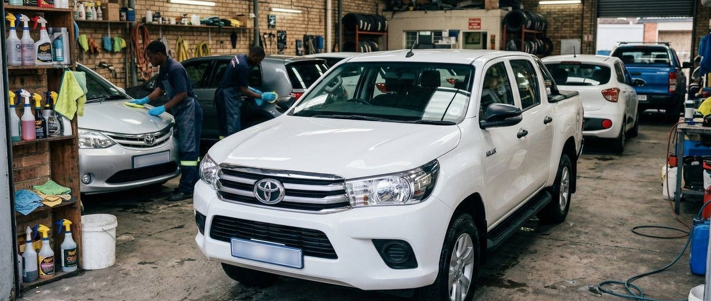
        <canvas
          id="car-canvas"
          class="car-canvas"
          aria-label="Interactive 3D sports car showroom. Drag horizontally to rotate."
          tabindex="-1"
        ></canvas>
        <div class="hero-annotation">
          A HIGHER STANDARD OF CAR CARE<strong>PRECISION IS PERSONAL.</strong>
        </div>
        <div class="container hero-content">
          <p class="eyebrow">FOR THOSE WHO EXPECT MORE</p>
          <h1 id="hero-heading">
            THE ART OF<br />VEHICLE<br /><span class="hero-red"
              >PERFECTION.</span
            >
          </h1>
          <p class="hero-lede">
            World-class paint correction, self-healing PPF,<br />and ceramic
            coatings. Nothing less than exceptional.
          </p>
          <div class="hero-actions">
            <a class="btn btn-primary" href="services.html"
              >Explore our services
              <svg class="icon" aria-hidden="true">
                <use href="#i-arrow-up-right"></use></svg></a
            ><a class="btn btn-secondary" href="booking.html"
              >Build your detail
              <svg class="icon" aria-hidden="true">
                <use href="#i-arrow-right"></use></svg
            ></a>
          </div>
          <p class="availability">
            <span class="status-dot" aria-hidden="true"></span> Now planning
            next week’s appointments
          </p>
        </div>
        <div class="hero-showroom">
          <div
            class="showroom-tools"
            id="showroom-tools"
            hidden
            aria-label="3D showroom controls"
          >
            <button
              class="color-swatch"
              type="button"
              data-car-color="#b2b8c2"
              style="--swatch: #b2b8c2"
              aria-label="Silver car paint"
              aria-pressed="true"
            ></button
            ><button
              class="color-swatch"
              type="button"
              data-car-color="#b60012"
              style="--swatch: #d00014"
              aria-label="Rosso red car paint"
              aria-pressed="false"
            ></button
            ><button
              class="color-swatch"
              type="button"
              data-car-color="#101216"
              style="--swatch: #17191d"
              aria-label="Obsidian car paint"
              aria-pressed="false"
            ></button
            ><button
              class="icon-button"
              type="button"
              id="car-autorotate"
              aria-label="Pause car rotation"
              aria-pressed="true"
            >
              <svg class="icon" aria-hidden="true">
                <use href="#i-pause"></use>
              </svg></button
            ><button
              class="icon-button"
              type="button"
              id="car-reset"
              aria-label="Reset car view"
            >
              <svg class="icon" aria-hidden="true">
                <use href="#i-rotate"></use>
              </svg>
            </button>
          </div>
          <button
            class="showroom-trigger"
            type="button"
            id="showroom-toggle"
            aria-pressed="false"
            aria-controls="car-canvas"
          >
            <svg class="icon" aria-hidden="true"><use href="#i-cube"></use></svg
            ><span>Explore in 3D</span
            ><i class="live-dot" aria-hidden="true"></i></button
          ><span id="showroom-hint">A CLOSER LOOK. A DIFFERENT DIMENSION.</span>
        </div>
        <div class="hero-bottom">
          <div class="container">
            <div class="hero-bottom-inner">
              <div class="hero-pillars">
                <div class="hero-pillar">
                  <span>01 /</span>
                  <div>
                    <strong>CORRECT.</strong
                    ><small>Reveal the true finish</small>
                  </div>
                </div>
                <div class="hero-pillar">
                  <span>02 /</span>
                  <div>
                    <strong>PROTECT.</strong
                    ><small>Preserve every detail</small>
                  </div>
                </div>
                <div class="hero-pillar">
                  <span>03 /</span>
                  <div>
                    <strong>PERFECT.</strong
                    ><small>Drive something exceptional</small>
                  </div>
                </div>
              </div>
              <a href="#services" class="hero-scroll"
                >SCROLL TO DISCOVER
                <svg class="icon" aria-hidden="true">
                  <use href="#i-arrow-down"></use></svg
              ></a>
            </div>
          </div>
        </div>
      </section>
      <section class="marque-strip" aria-label="Care for every vehicle">
        <div class="container marque-inner">
          <p class="marque-intro">EVERY MARQUE.<br />THE SAME OBSESSION.</p>
          <span class="marque-name">VOLKSWAGEN</span
          ><span class="marque-name">TOYOTA</span
          ><span class="marque-name">FORD</span
          ><span class="marque-name">SUZUKI</span
          ><span class="marque-name">ISUZU</span
          ><span class="marque-name">HYUNDAI</span>
        </div>
      </section>
      <section class="section services-overview" id="services">
        <div class="container">
          <div class="section-heading reveal">
            <div>
              <p class="eyebrow">THE MARIO STANDARD</p>
              <h2 class="section-title">GOOD ISN’T<br />GOOD ENOUGH.</h2>
            </div>
            <a class="text-link" href="services.html"
              >Precision, in every service
              <svg class="icon" aria-hidden="true">
                <use href="#i-arrow-up-right"></use></svg
            ></a>
          </div>
          <div class="service-grid">
            <a
              class="service-card reveal delay-0"
              href="services.html?package=stage1#packages"
              >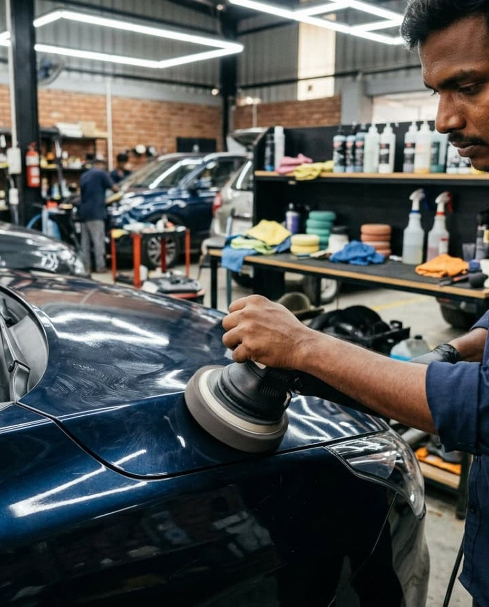
              <div class="service-card-top">
                <span class="service-number">01 /</span
                ><svg class="icon" aria-hidden="true">
                  <use href="#i-arrow-up-right"></use>
                </svg>
              </div>
              <div class="service-card-copy">
                <span class="service-category">RESTORE THE EXTRAORDINARY</span>
                <h3>Multi-Stage<br />Paint Correction</h3>
                <p>Swirls out. Depth in. Your paint, as it was meant to be.</p>
              </div></a
            ><a
              class="service-card reveal delay-1"
              href="services.html?package=ceramic#packages"
              >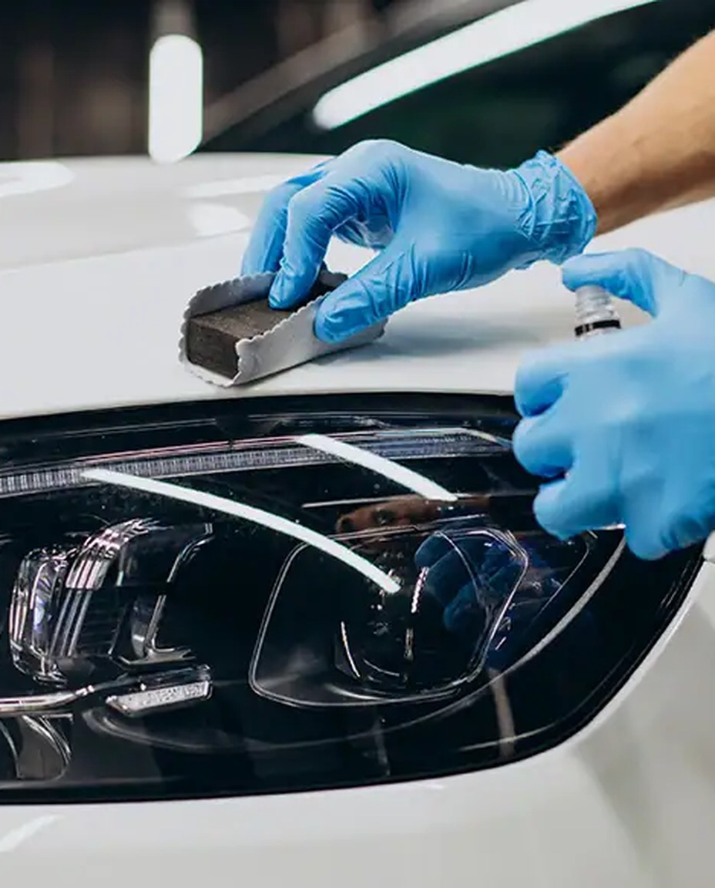
              <div class="service-card-top">
                <span class="service-number">02 /</span
                ><svg class="icon" aria-hidden="true">
                  <use href="#i-arrow-up-right"></use>
                </svg>
              </div>
              <div class="service-card-copy">
                <span class="service-category">AN INVISIBLE ADVANTAGE</span>
                <h3>Nano-Ceramic<br />Shielding</h3>
                <p>Molecular-level protection. An unmistakable glass finish.</p>
              </div></a
            ><a
              class="service-card reveal delay-2"
              href="services.html?package=ppf#packages"
              >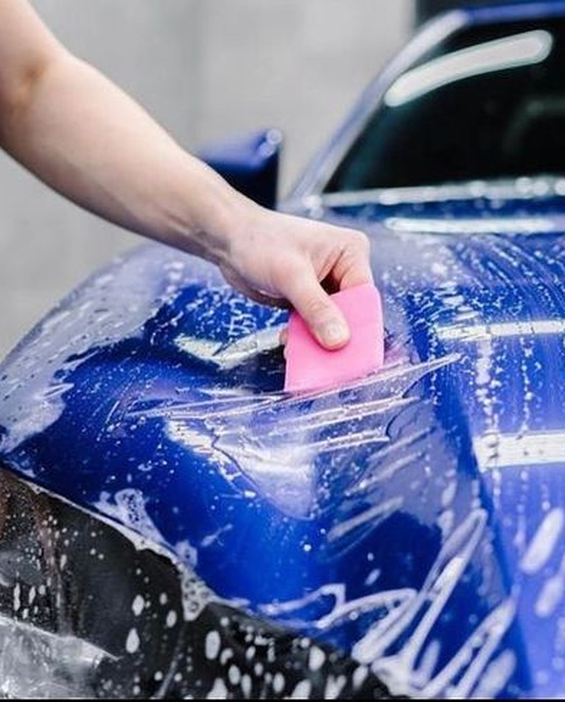
              <div class="service-card-top">
                <span class="service-number">03 /</span
                ><svg class="icon" aria-hidden="true">
                  <use href="#i-arrow-up-right"></use>
                </svg>
              </div>
              <div class="service-card-copy">
                <span class="service-category">DEFENCE WITHOUT COMPROMISE</span>
                <h3>Self-Healing<br />Paint Protection Film</h3>
                <p>A precision-cut shield against the road ahead.</p>
              </div></a
            ><a
              class="service-card reveal delay-3"
              href="services.html?package=basic#packages"
              >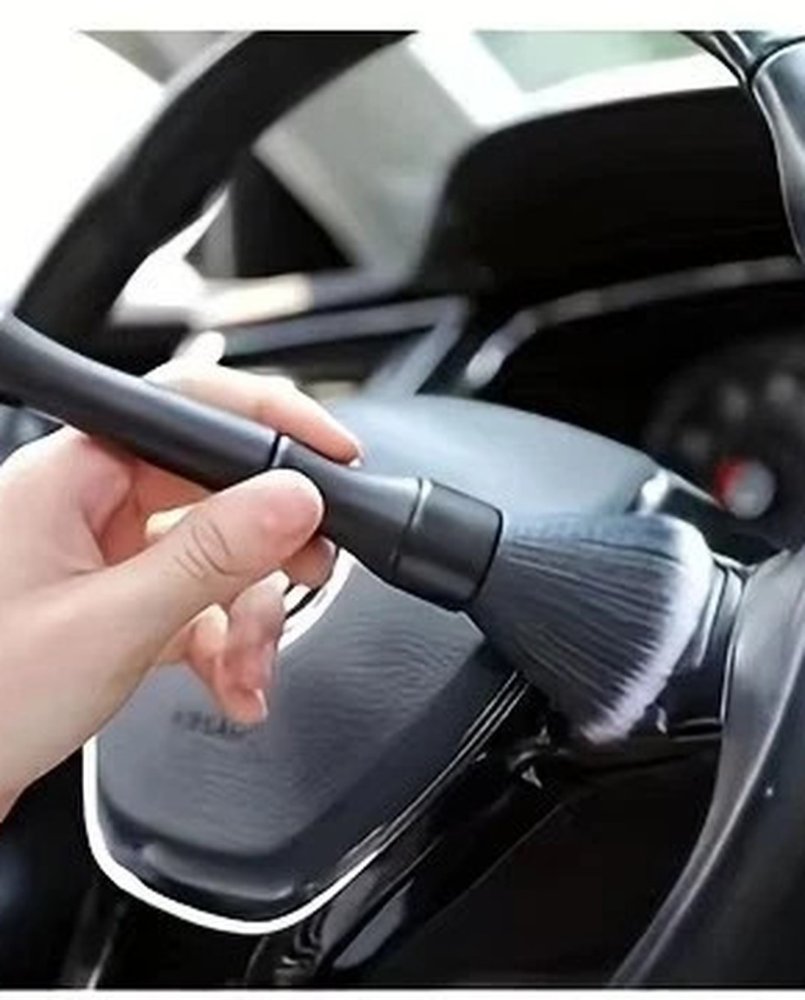
              <div class="service-card-top">
                <span class="service-number">04 /</span
                ><svg class="icon" aria-hidden="true">
                  <use href="#i-arrow-up-right"></use>
                </svg>
              </div>
              <div class="service-card-copy">
                <span class="service-category">EXCELLENCE, INSIDE OUT</span>
                <h3>Concours Interior<br />Restoration</h3>
                <p>A tactile reset. Because the inside matters just as much.</p>
              </div></a
            >
          </div>
          <div class="service-footnote">
            <p>
              <span class="red">✳</span> Every vehicle is different. So is
              every detail.
            </p>
            <a class="text-link" href="services.html#estimator"
              >Find your perfect package
              <svg class="icon" aria-hidden="true">
                <use href="#i-arrow-right"></use></svg
            ></a>
          </div>
        </div>
      </section>
      <section class="section comparison-section">
        <div class="container comparison-layout">
          <div class="comparison-copy reveal">
            <p class="eyebrow">THE DIFFERENCE IS IN THE DETAIL</p>
            <h2>
              A FINISH THAT<br />SPEAKS FOR<br /><span class="text-gradient"
                >ITSELF.</span
              >
            </h2>
            <p>
              Not a quick polish. A considered transformation. We refine what’s
              there, protect what matters, and leave nothing to chance.
            </p>
            <ul class="precision-list">
              <li>
                <svg class="icon" aria-hidden="true">
                  <use href="#i-check"></use>
                </svg>
                Measured paint correction
              </li>
              <li>
                <svg class="icon" aria-hidden="true">
                  <use href="#i-check"></use>
                </svg>
                Uncompromising surface preparation
              </li>
              <li>
                <svg class="icon" aria-hidden="true">
                  <use href="#i-check"></use>
                </svg>
                Protection made to last
              </li>
            </ul>
            <a class="text-link" href="transformations.html"
              >See the transformations
              <svg class="icon" aria-hidden="true">
                <use href="#i-arrow-up-right"></use></svg
            ></a>
          </div>
          <figure class="reveal delay-1">
            <div
              class="comparison"
              data-comparison
              style="--position: 48%"
              role="group"
              aria-label="Volkswagen Polo Vivo finish comparison"
            >
              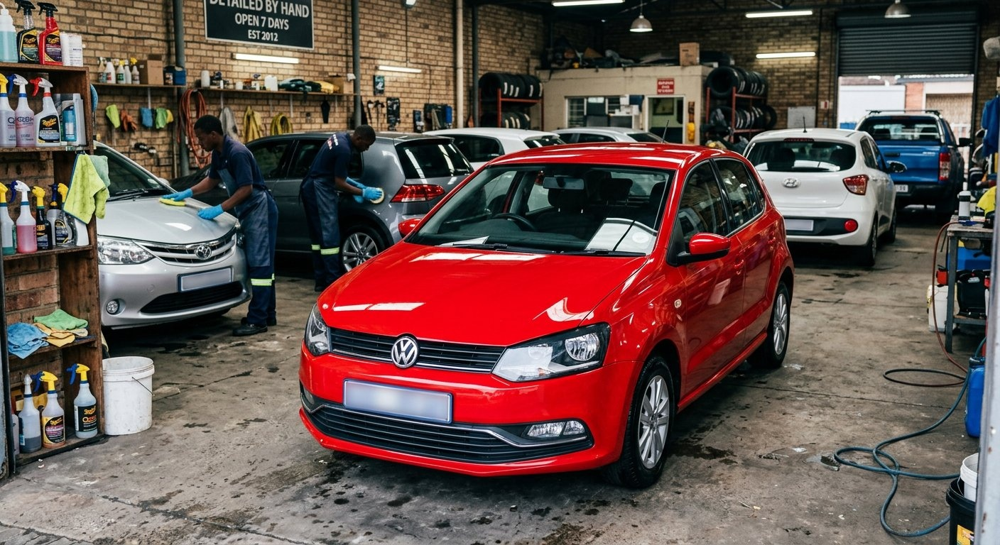
              <div class="comparison-before">
                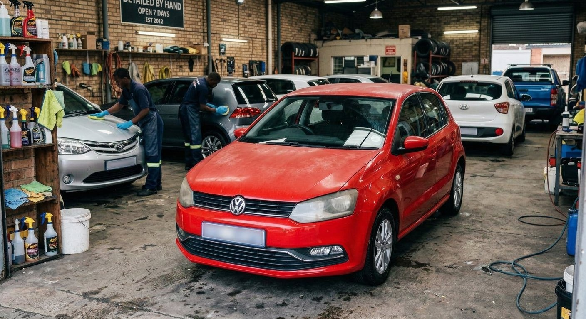
              </div>
              <span class="comparison-label before">BEFORE</span
              ><span class="comparison-label after">AFTER</span>
              <div class="comparison-line" aria-hidden="true">
                <span class="comparison-handle"
                  ><svg class="icon" aria-hidden="true">
                    <use href="#i-compare"></use></svg
                ></span>
              </div>
              <input
                class="comparison-range"
                type="range"
                min="0"
                max="100"
                value="48"
                aria-label="Reveal before finish on Volkswagen Polo Vivo"
                aria-valuetext="48 percent before finish"
                step="1"
              />
            </div>
            <figcaption class="comparison-caption">
              <span
                ><svg class="icon" aria-hidden="true">
                  <use href="#i-compare"></use>
                </svg>
                DRAG TO REVEAL THE DIFFERENCE</span
              ><span>PRECISION. NOT PROMISES.</span>
            </figcaption>
            <p class="fine-print home-compare-note">
              Customer Privacy: Vehicle registration numbers are blurred for customer privacy. Authentic local vehicle detailed in our Durban Central workshop.
            </p>
          </figure>
        </div>
      </section>
      <section class="section reviews-section">
        <div class="container">
          <div class="section-heading reveal">
            <div>
              <p class="eyebrow">THE OWNER’S PERSPECTIVE</p>
              <h2 class="section-title">THE FEELING.<br />AFTER THE FINISH.</h2>
              <p class="review-disclaimer">
                Editorial sample reviews for this concept. Not verified customer
                testimonials.
              </p>
            </div>
            <div class="reviews-controls">
              <button
                type="button"
                class="icon-button"
                data-carousel-prev
                aria-label="Previous owner perspective"
              >
                <svg class="icon" aria-hidden="true">
                  <use href="#i-arrow-left"></use>
                </svg></button
              ><button
                type="button"
                class="icon-button"
                data-carousel-next
                aria-label="Next owner perspective"
              >
                <svg class="icon" aria-hidden="true">
                  <use href="#i-arrow-right"></use>
                </svg>
              </button>
            </div>
          </div>
          <div
            class="testimonial-track"
            data-carousel
            tabindex="0"
            role="region"
            aria-label="Illustrative owner perspectives"
          >
            <article class="testimonial-card">
              <div
                class="review-stars"
                aria-label="Sample five out of five stars"
              >
                ★★★★★
              </div>
              <blockquote>
                “The kind of finish that makes you turn around for another look.
                The attention to every small detail is what sets it apart.”
              </blockquote>
              <div class="review-owner">
                <span class="owner-initials" aria-hidden="true">JD</span>
                <div class="owner-info">
                  <strong>James D.</strong><span>Volkswagen Polo Vivo owner (Morningside)</span>
                </div>
                <span class="review-badge">SAMPLE</span>
              </div>
            </article>
            <article class="testimonial-card">
              <div
                class="review-stars"
                aria-label="Sample five out of five stars"
              >
                ★★★★★
              </div>
              <blockquote>
                “Not just clean. The paint has a depth I didn’t know was
                possible. It feels like seeing the car for the very first time.”
              </blockquote>
              <div class="review-owner">
                <span class="owner-initials" aria-hidden="true">AK</span>
                <div class="owner-info">
                  <strong>Alex K.</strong><span>Toyota Hilux Double Cab owner (Durban North)</span>
                </div>
                <span class="review-badge">SAMPLE</span>
              </div>
            </article>
            <article class="testimonial-card">
              <div
                class="review-stars"
                aria-label="Sample five out of five stars"
              >
                ★★★★★
              </div>
              <blockquote>
                “Everything feels considered, from the first inspection to the
                final handover. Exactly the care a car like this deserves.”
              </blockquote>
              <div class="review-owner">
                <span class="owner-initials" aria-hidden="true">SM</span>
                <div class="owner-info">
                  <strong>Sam M.</strong><span>Ford Ranger Double Cab owner (Umhlanga)</span>
                </div>
                <span class="review-badge">SAMPLE</span>
              </div>
            </article>
            <article class="testimonial-card">
              <div
                class="review-stars"
                aria-label="Sample five out of five stars"
              >
                ★★★★★
              </div>
              <blockquote>
                “The interior, the wheels, the reflections. It’s all the little
                things coming together. A properly special finish.”
              </blockquote>
              <div class="review-owner">
                <span class="owner-initials" aria-hidden="true">RN</span>
                <div class="owner-info">
                  <strong>Ryan N.</strong><span>Suzuki Swift GLX owner (Glenwood)</span>
                </div>
                <span class="review-badge">SAMPLE</span>
              </div>
            </article>
          </div>
          <div
            class="carousel-progress"
            data-carousel-dots
            aria-label="Owner perspective pages"
          ></div>
        </div>
      </section>
      <!-- WORKSHOP LOCATION & MAP SECTION -->
      <section class="section section-dark workshop-section" id="workshop">
        <div class="container">
          <div class="workshop-grid">
            <div class="workshop-info">
              <p class="eyebrow">VISIT OUR DURBAN WORKSHOP</p>
              <h2 class="display-heading" style="font-size: clamp(26px, 3.2vw, 42px)">
                THE WORKSHOP.<br /><span class="text-gradient">WHERE PERFECTION HAPPENS.</span>
              </h2>
              <p class="lead" style="color: #94a3b8; font-size: 14px; line-height: 1.8; margin-top: 14px">
                Dedicated detailing studio located in Durban Central. Equipped with high-CRI inspection illumination, climate-controlled ceramic application bays, and multi-stage paint correction technology.
              </p>
              <div class="workshop-address-card">
                <div class="address-row">
                  <div class="address-icon">
                    <svg class="icon" aria-hidden="true"><use href="#i-map-pin"></use></svg>
                  </div>
                  <div>
                    <strong>16 Mona Rd, Durban Central</strong>
                    <p>Durban, KwaZulu-Natal, 4001 · South Africa</p>
                  </div>
                </div>
                <div class="address-row">
                  <div class="address-icon">
                    <svg class="icon" aria-hidden="true"><use href="#i-clock"></use></svg>
                  </div>
                  <div>
                    <strong>Studio &amp; Workshop Hours</strong>
                    <p>Monday – Friday: 08:00 – 17:00<br />Saturday: By Appointment · Sunday: Closed</p>
                  </div>
                </div>
              </div>
              <div class="workshop-actions">
                <a
                  class="btn btn-primary"
                  href="https://www.google.com/maps/search/?api=1&query=16+Mona+Rd%2C+Durban+Central%2C+Durban%2C+4001"
                  target="_blank"
                  rel="noopener noreferrer"
                  aria-label="Open 16 Mona Rd, Durban Central in Google Maps"
                >
                  <svg class="icon" aria-hidden="true"><use href="#i-map"></use></svg>
                  View on Google Maps
                  <svg class="icon" aria-hidden="true"><use href="#i-arrow-up-right"></use></svg>
                </a>
                <a
                  class="btn btn-secondary"
                  href="tel:+2778064006"
                  aria-label="Call workshop: +27 78 064 006"
                >
                  <svg class="icon" aria-hidden="true"><use href="#i-phone"></use></svg>
                  Call: (+27) 078 064 006
                </a>
              </div>
            </div>
            <div class="workshop-map-card">
              <a
                class="workshop-map-link"
                href="https://www.google.com/maps/search/?api=1&query=16+Mona+Rd%2C+Durban+Central%2C+Durban%2C+4001"
                target="_blank"
                rel="noopener noreferrer"
                aria-label="Click to open 16 Mona Rd, Durban Central in Google Maps"
              >
                <div class="map-graphic-container">
                  <svg class="map-vector" viewBox="0 0 600 420" xmlns="http://www.w3.org/2000/svg" aria-hidden="true">
                    <rect width="600" height="420" fill="#0d1117"/>
                    <path d="M420,0 Q450,150 490,260 T600,340 L600,0 Z" fill="#091422" opacity="0.7"/>
                    <text x="490" y="70" fill="#203348" font-size="11" font-weight="700" letter-spacing="0.14em">INDIAN OCEAN</text>
                    <text x="450" y="320" fill="#203348" font-size="10" font-weight="700" letter-spacing="0.1em">DURBAN HARBOUR</text>
                    
                    <line x1="0" y1="120" x2="440" y2="120" stroke="#1f2937" stroke-width="4"/>
                    <line x1="0" y1="210" x2="480" y2="210" stroke="#263445" stroke-width="6"/>
                    <text x="30" y="202" fill="#4a5568" font-size="9" font-weight="600" letter-spacing="0.08em">ANTON LEMBEDE ST (SMITH ST)</text>
                    <line x1="0" y1="290" x2="520" y2="290" stroke="#1f2937" stroke-width="4"/>
                    <text x="30" y="282" fill="#4a5568" font-size="9" letter-spacing="0.08em">MARGARET MNCADI AVE</text>
                    
                    <line x1="140" y1="0" x2="140" y2="420" stroke="#1f2937" stroke-width="4"/>
                    <line x1="280" y1="0" x2="280" y2="420" stroke="#2d3a4d" stroke-width="6"/>
                    <text x="290" y="85" fill="#5b6d85" font-size="9.5" font-weight="600" letter-spacing="0.1em">MAHATMA GANDHI RD (POINT RD)</text>
                    <line x1="380" y1="0" x2="380" y2="420" stroke="#1f2937" stroke-width="3"/>
                    
                    <rect x="235" y="168" width="95" height="28" fill="#1f0f13" rx="4" stroke="#e50914" stroke-width="1.2"/>
                    <line x1="242" y1="182" x2="322" y2="182" stroke="#e50914" stroke-width="4"/>
                    <text x="250" y="177" fill="#e50914" font-size="10" font-weight="700" letter-spacing="0.08em">MONA RD</text>
                    
                    <circle cx="282" cy="182" r="28" fill="#e50914" opacity="0.18"/>
                    <circle cx="282" cy="182" r="15" fill="#e50914" opacity="0.4"/>
                    <circle cx="282" cy="182" r="8" fill="#e50914"/>
                    <circle cx="282" cy="182" r="3.5" fill="#ffffff"/>
                    
                    <g transform="translate(195, 95)">
                      <rect width="180" height="46" rx="5" fill="#131822" stroke="#e50914" stroke-width="1.5"/>
                      <text x="14" y="20" fill="#ffffff" font-size="11.5" font-weight="700">MARIO WORKSHOP</text>
                      <text x="14" y="36" fill="#94a3b8" font-size="10">16 Mona Rd, Durban Central</text>
                    </g>
                  </svg>
                  <div class="map-overlay-badge">
                    <svg class="icon" aria-hidden="true"><use href="#i-map-pin"></use></svg>
                    <span>Click to open in Google Maps</span>
                    <svg class="icon" aria-hidden="true"><use href="#i-arrow-up-right"></use></svg>
                  </div>
                </div>
              </a>
            </div>
          </div>
        </div>
      </section>

      <section class="closing-cta">
        <div class="container closing-inner">
          <div>
            <p class="eyebrow">A BETTER FINISH STARTS WITH A CONVERSATION</p>
            <h2>YOUR CAR.<br /><span>OUR OBSESSION.</span></h2>
          </div>
          <div class="closing-actions">
            <a class="btn btn-primary" href="booking.html"
              >Let’s make it exceptional
              <svg class="icon" aria-hidden="true">
                <use href="#i-arrow-up-right"></use></svg
            ></a>
            <p>No shortcuts.<br />No compromises.</p>
          </div>
        </div>
      </section>
    </main>
    <footer class="site-footer">
      <div class="container">
        <div class="footer-main">
          <div class="footer-brand">
            <a
              class="brand"
              href="index.html"
              aria-label="Mario Auto and Detailing home"
              ><span class="brand-mark" aria-hidden="true"><i></i><i></i></span
              ><span
                ><span class="brand-word">MARIO</span
                ><span class="brand-descriptor"
                  >AUTO &amp; DETAILING</span
                ></span
              ></a
            >
            <p>
              For those who see more than a car.<br />World-class care. An
              uncompromising finish.
            </p>
            <div class="footer-location">
              <svg class="icon" aria-hidden="true">
                <use href="#i-map-pin"></use></svg
              ><div>
                <strong>16 Mona Rd, Durban Central</strong><br />
                <span>Durban, KwaZulu-Natal, 4001</span><br />
                <a
                  class="footer-map-action"
                  href="https://www.google.com/maps/search/?api=1&query=16+Mona+Rd%2C+Durban+Central%2C+Durban%2C+4001"
                  target="_blank"
                  rel="noopener noreferrer"
                  aria-label="View 16 Mona Rd, Durban Central on Google Maps"
                >
                  <svg class="icon" aria-hidden="true"><use href="#i-map"></use></svg>
                  <span>View on Google Maps</span>
                  <svg class="icon" aria-hidden="true"><use href="#i-arrow-up-right"></use></svg>
                </a>
              </div>
            </div>
            <div class="footer-call-box">
              <a
                class="btn btn-secondary footer-call-btn"
                href="tel:+2778064006"
                aria-label="Call Mario Auto detailing workshop at (+27) 078 064 006"
              >
                <svg class="icon" aria-hidden="true"><use href="#i-phone"></use></svg>
                <span>Call Workshop · (+27) 078 064 006</span>
              </a>
            </div>
          </div>
          <div class="footer-column">
            <h3>EXPLORE</h3>
            <ul>
              <li><a href="index.html">The showroom</a></li>
              <li><a href="services.html">Services &amp; packages</a></li>
              <li><a href="transformations.html">Transformations</a></li>
              <li><a href="about.html">Our obsession</a></li>
              <li><a href="booking.html">Book a detail</a></li>
            </ul>
          </div>
          <div class="footer-column">
            <h3>STUDIO HOURS</h3>
            <ul class="hours-list">
              <li><span>Monday – Friday</span><span>08:00 – 17:00</span></li>
              <li><span>Saturday</span><span>By appointment</span></li>
              <li><span>Sunday</span><span>Closed</span></li>
            </ul>
            <p class="newsletter-note" style="margin-top: 16px">
              Concept hours. All visits require confirmation.
            </p>
          </div>
          <div class="footer-column footer-newsletter">
            <h3>STAY IN THE KNOW</h3>
            <p>
              Care notes, studio stories, and the pursuit of a better finish.
            </p>
            <form data-newsletter>
              <label class="sr-only" for="newsletter-email"
                >Email address for studio updates</label
              >
              <div class="newsletter-field">
                <input
                  id="newsletter-email"
                  type="email"
                  name="email"
                  autocomplete="email"
                  placeholder="Your email address"
                  required
                  maxlength="254"
                /><button type="submit" aria-label="Save newsletter interest">
                  <svg class="icon" aria-hidden="true">
                    <use href="#i-arrow-right"></use>
                  </svg>
                </button>
              </div>
              <div class="newsletter-note">
                Local preview only. No subscription is sent.
              </div>
            </form>
          </div>
        </div>
        <div class="footer-journal">
          <span class="journal-label"
            ><svg class="icon" aria-hidden="true">
              <use href="#i-instagram"></use>
            </svg>
            FROM THE STUDIO<br />SOCIAL FEED PREVIEW</span
          >
          <div class="journal-grid">
            <a
              href="transformations.html"
              aria-label="Explore paint correction finishes"
              ></a
            ><a
              href="transformations.html"
              aria-label="Explore ceramic coating finishes"
              ></a
            ><a
              href="transformations.html"
              aria-label="Explore paint protection finishes"
              ></a
            ><a href="about.html#studio" aria-label="Inside the concept studio"
              ></a>
          </div>
          <a class="text-link" href="transformations.html"
            >Explore the gallery
            <svg class="icon" aria-hidden="true">
              <use href="#i-arrow-up-right"></use></svg
          ></a>
        </div>
        <div class="footer-bottom">
          <p>
            © <span data-current-year>2026</span> Mario Auto &amp; Detailing.
            Driven by detail.
          </p>
          <div class="footer-legal">
            <button type="button" data-info="privacy">Privacy</button
            ><button type="button" data-info="terms">Booking terms</button>
          </div>
          <a class="top-link" href="#top"
            >BACK TO TOP
            <svg class="icon" aria-hidden="true">
              <use href="#i-arrow-up"></use></svg
          ></a>
        </div>
        <p class="footer-disclosure">
          Interactive concept website. Prices, hours, reviews and availability
          are illustrative; imagery includes AI-generated finish visualisations.
          No reservations, payments or newsletter subscriptions are transmitted.
        </p>
      </div>
    </footer>
    <dialog
      class="info-dialog"
      id="info-dialog"
      aria-labelledby="info-dialog-title"
    >
      <div class="dialog-top">
        <h2 id="info-dialog-title">Information</h2>
        <button
          class="icon-button"
          type="button"
          data-close-dialog
          aria-label="Close information"
        >
          <svg class="icon" aria-hidden="true"><use href="#i-x"></use></svg>
        </button>
      </div>
      <div class="dialog-body" data-dialog-body></div>
    </dialog>
    <div
      class="toast-stack"
      id="toast-stack"
      role="status"
      aria-live="polite"
      aria-atomic="false"
    ></div>
  </body>
</html>

```

## services.html

```html
<!doctype html>
<!-- services.html — Mario Auto & Detailing -->
<html lang="en-ZA">
  <head>
    <meta charset="UTF-8" />
    <meta name="viewport" content="width=device-width, initial-scale=1.0" />
    <meta name="theme-color" content="#08080A" />
    <meta
      name="description"
      content="Compare detailing packages, configure a personalised ZAR estimate, and explore paint correction, ceramic coating and full-body PPF."
    />
    <title>Precision Services and Packages | Mario Auto &amp; Detailing</title>
    <meta
      property="og:title"
      content="Precision Services and Packages | Mario Auto &amp; Detailing"
    />
    <meta
      property="og:description"
      content="Compare detailing packages, configure a personalised ZAR estimate, and explore paint correction, ceramic coating and full-body PPF."
    />
    <meta property="og:type" content="website" />
    <meta property="og:image" content="assets/showroom-hero.jpg" />
    <link rel="icon" type="image/svg+xml" href="assets/favicon.svg" />
    <link rel="preconnect" href="https://fonts.googleapis.com" />
    <link rel="preconnect" href="https://fonts.gstatic.com" crossorigin />
    <link
      href="https://fonts.googleapis.com/css2?family=Inter:wght@400;500;600;700;800&amp;family=Montserrat:wght@400;500;600;700;800;900&amp;display=swap"
      rel="stylesheet"
    />
    <link rel="stylesheet" href="css/styles.css" />
    <!-- Required CDN stack. The design and interactions also work with local CSS, SVG icons and a local Three.js fallback. -->
    <script src="https://cdn.tailwindcss.com" async></script>
    <script
      src="https://cdnjs.cloudflare.com/ajax/libs/three.js/r128/three.min.js"
      async
    ></script>
    <script src="https://unpkg.com/lucide@latest" async></script>
    <script src="js/main.js" defer></script>
    <script src="js/three-scene.js" defer></script>
  </head>
  <body data-page="services">
    <svg
      xmlns="http://www.w3.org/2000/svg"
      class="sr-only"
      aria-hidden="true"
      focusable="false"
    >
      <defs>
                <symbol id="i-phone" viewBox="0 0 24 24">
          <path
            d="M22 16.92v3a2 2 0 0 1-2.18 2 19.79 19.79 0 0 1-8.63-3.07 19.5 19.5 0 0 1-6-6 19.79 19.79 0 0 1-3.07-8.67A2 2 0 0 1 4.11 2h3a2 2 0 0 1 2 1.72 12.84 12.84 0 0 0 .7 2.81 2 2 0 0 1-.45 2.11L8.09 9.91a16 16 0 0 0 6 6l1.27-1.27a2 2 0 0 1 2.11-.45 12.84 12.84 0 0 0 2.81.7A2 2 0 0 1 22 16.92z"
            fill="none"
            stroke="currentColor"
            stroke-width="1.75"
            stroke-linecap="round"
            stroke-linejoin="round"
          />
        </symbol>
        <symbol id="i-map" viewBox="0 0 24 24">
          <polygon
            points="1 6 1 22 8 18 16 22 23 18 23 2 16 6 8 2 1 6"
            fill="none"
            stroke="currentColor"
            stroke-width="1.75"
            stroke-linecap="round"
            stroke-linejoin="round"
          />
          <line x1="8" y1="2" x2="8" y2="18" stroke="currentColor" stroke-width="1.75" />
          <line x1="16" y1="6" x2="16" y2="22" stroke="currentColor" stroke-width="1.75" />
        </symbol>
        <symbol id="i-arrow-up-right" viewBox="0 0 24 24">
          <path
            d="M7 17 17 7M7 7h10v10"
            stroke-linecap="round"
            stroke-linejoin="round"
          />
        </symbol>
        <symbol id="i-arrow-right" viewBox="0 0 24 24">
          <path
            d="M4 12h16m-6-6 6 6-6 6"
            stroke-linecap="round"
            stroke-linejoin="round"
          />
        </symbol>
        <symbol id="i-arrow-left" viewBox="0 0 24 24">
          <path
            d="M20 12H4m6-6-6 6 6 6"
            stroke-linecap="round"
            stroke-linejoin="round"
          />
        </symbol>
        <symbol id="i-arrow-down" viewBox="0 0 24 24">
          <path
            d="M12 4v16m-6-6 6 6 6-6"
            stroke-linecap="round"
            stroke-linejoin="round"
          />
        </symbol>
        <symbol id="i-arrow-up" viewBox="0 0 24 24">
          <path
            d="M12 20V4m-6 6 6-6 6 6"
            stroke-linecap="round"
            stroke-linejoin="round"
          />
        </symbol>
        <symbol id="i-chevron-right" viewBox="0 0 24 24">
          <path
            d="m9 5 7 7-7 7"
            stroke-linecap="round"
            stroke-linejoin="round"
          />
        </symbol>
        <symbol id="i-chevron-left" viewBox="0 0 24 24">
          <path
            d="m15 5-7 7 7 7"
            stroke-linecap="round"
            stroke-linejoin="round"
          />
        </symbol>
        <symbol id="i-chevron-down" viewBox="0 0 24 24">
          <path
            d="m6 9 6 6 6-6"
            stroke-linecap="round"
            stroke-linejoin="round"
          />
        </symbol>
        <symbol id="i-menu" viewBox="0 0 24 24">
          <path
            d="M4 7h16M4 12h16M4 17h16"
            stroke-linecap="round"
            stroke-linejoin="round"
          />
        </symbol>
        <symbol id="i-x" viewBox="0 0 24 24">
          <path
            d="m6 6 12 12M6 18 18 6"
            stroke-linecap="round"
            stroke-linejoin="round"
          />
        </symbol>
        <symbol id="i-check" viewBox="0 0 24 24">
          <path
            d="m5 12 4 4L19 6"
            stroke-linecap="round"
            stroke-linejoin="round"
          />
        </symbol>
        <symbol id="i-plus" viewBox="0 0 24 24">
          <path
            d="M12 5v14M5 12h14"
            stroke-linecap="round"
            stroke-linejoin="round"
          />
        </symbol>
        <symbol id="i-minus" viewBox="0 0 24 24">
          <path d="M5 12h14" stroke-linecap="round" stroke-linejoin="round" />
        </symbol>
        <symbol id="i-car" viewBox="0 0 24 24">
          <path
            d="m3 11 2-6h14l2 6v8h-3v-3H6v3H3v-8Zm0 0h18M6 8h12M6 13h2m8 0h2"
            stroke-linecap="round"
            stroke-linejoin="round"
          />
        </symbol>
        <symbol id="i-suv" viewBox="0 0 24 24">
          <path
            d="M3 18v-8l2-5h13l3 5v8h-3v-3H6v3H3ZM3 10h18M8 5v5M6 12h2m8 0h2"
            stroke-linecap="round"
            stroke-linejoin="round"
          />
        </symbol>
        <symbol id="i-truck" viewBox="0 0 24 24">
          <path
            d="M2 8h12v8H2V8Zm12 3h4l4 4v1h-8M6 16v1m12-1v1M5 8V5h7v3"
            stroke-linecap="round"
            stroke-linejoin="round"
          />
        </symbol>
        <symbol id="i-shield" viewBox="0 0 24 24">
          <path
            d="M12 3 3 7v5c0 5 9 9 9 9s9-4 9-9V7l-9-4Zm-4 9 3 3 5-6"
            stroke-linecap="round"
            stroke-linejoin="round"
          />
        </symbol>
        <symbol id="i-sparkles" viewBox="0 0 24 24">
          <path
            d="m12 3 2.6 6.4L21 12l-6.4 2.6L12 21l-2.6-6.4L3 12l6.4-2.6L12 3ZM20 2v4m-2-2h4"
            stroke-linecap="round"
            stroke-linejoin="round"
          />
        </symbol>
        <symbol id="i-droplet" viewBox="0 0 24 24">
          <path
            d="M12 3C9 7 5 11 5 15a7 7 0 0 0 14 0c0-4-4-8-7-12ZM8 15a4 4 0 0 0 4 4"
            stroke-linecap="round"
            stroke-linejoin="round"
          />
        </symbol>
        <symbol id="i-layers" viewBox="0 0 24 24">
          <path
            d="m12 3 10 5-10 5L2 8l10-5ZM2 12l10 5 10-5M2 16l10 5 10-5"
            stroke-linecap="round"
            stroke-linejoin="round"
          />
        </symbol>
        <symbol id="i-circle-check" viewBox="0 0 24 24">
          <path
            d="M21 11a9 9 0 1 1-5-8M8 11l4 4L22 5"
            stroke-linecap="round"
            stroke-linejoin="round"
          />
        </symbol>
        <symbol id="i-clock" viewBox="0 0 24 24">
          <path
            d="M12 8v5l3 2M21 12a9 9 0 1 1-18 0 9 9 0 0 1 18 0"
            stroke-linecap="round"
            stroke-linejoin="round"
          />
        </symbol>
        <symbol id="i-calendar" viewBox="0 0 24 24">
          <path
            d="M5 5h14a2 2 0 0 1 2 2v12a2 2 0 0 1-2 2H5a2 2 0 0 1-2-2V7a2 2 0 0 1 2-2ZM7 2v6m10-6v6M3 11h18m-12 4h.01M12 15h.01M15 15h.01"
            stroke-linecap="round"
            stroke-linejoin="round"
          />
        </symbol>
        <symbol id="i-map-pin" viewBox="0 0 24 24">
          <path
            d="M20 10c0 6-8 12-8 12S4 16 4 10a8 8 0 1 1 16 0ZM15 10a3 3 0 1 1-6 0 3 3 0 0 1 6 0"
            stroke-linecap="round"
            stroke-linejoin="round"
          />
        </symbol>
        <symbol id="i-camera" viewBox="0 0 24 24">
          <path
            d="M4 6h4l2-3h4l2 3h4a1 1 0 0 1 1 1v12a1 1 0 0 1-1 1H4a1 1 0 0 1-1-1V7a1 1 0 0 1 1-1ZM16 12a4 4 0 1 1-8 0 4 4 0 0 1 8 0"
            stroke-linecap="round"
            stroke-linejoin="round"
          />
        </symbol>
        <symbol id="i-instagram" viewBox="0 0 24 24">
          <path
            d="M7 3h10a4 4 0 0 1 4 4v10a4 4 0 0 1-4 4H7a4 4 0 0 1-4-4V7a4 4 0 0 1 4-4ZM16 12a4 4 0 1 1-8 0 4 4 0 0 1 8 0M17.5 6.5h.01"
            stroke-linecap="round"
            stroke-linejoin="round"
          />
        </symbol>
        <symbol id="i-cube" viewBox="0 0 24 24">
          <path
            d="m12 3 9 5v9l-9 5-9-5V8l9-5ZM3 8l9 5 9-5M12 13v9M8 5l9 5"
            stroke-linecap="round"
            stroke-linejoin="round"
          />
        </symbol>
        <symbol id="i-pause" viewBox="0 0 24 24">
          <path
            d="M8 5v14M16 5v14"
            stroke-linecap="round"
            stroke-linejoin="round"
          />
        </symbol>
        <symbol id="i-play" viewBox="0 0 24 24">
          <path
            d="m8 4 12 8-12 8V4Z"
            stroke-linecap="round"
            stroke-linejoin="round"
          />
        </symbol>
        <symbol id="i-rotate" viewBox="0 0 24 24">
          <path
            d="M3 10a9 9 0 1 1 1 7M3 4v6h6"
            stroke-linecap="round"
            stroke-linejoin="round"
          />
        </symbol>
        <symbol id="i-compare" viewBox="0 0 24 24">
          <path
            d="M12 3v18M8 8l-4 4 4 4m8-8 4 4-4 4"
            stroke-linecap="round"
            stroke-linejoin="round"
          />
        </symbol>
        <symbol id="i-info" viewBox="0 0 24 24">
          <path
            d="M12 11v6m0-10h.01M21 12a9 9 0 1 1-18 0 9 9 0 0 1 18 0"
            stroke-linecap="round"
            stroke-linejoin="round"
          />
        </symbol>
        <symbol id="i-lock" viewBox="0 0 24 24">
          <path
            d="M6 10h12a2 2 0 0 1 2 2v8H4v-8a2 2 0 0 1 2-2ZM8 10V7a4 4 0 0 1 8 0v3M12 14v3"
            stroke-linecap="round"
            stroke-linejoin="round"
          />
        </symbol>
        <symbol id="i-download" viewBox="0 0 24 24">
          <path
            d="M12 3v12m-5-5 5 5 5-5M4 15v6h16v-6"
            stroke-linecap="round"
            stroke-linejoin="round"
          />
        </symbol>
        <symbol id="i-file" viewBox="0 0 24 24">
          <path
            d="M14 2H5v20h14V7l-5-5Zm0 0v6h5M8 12h8M8 16h6"
            stroke-linecap="round"
            stroke-linejoin="round"
          />
        </symbol>
        <symbol id="i-headphones" viewBox="0 0 24 24">
          <path
            d="M4 13v-1a8 8 0 1 1 16 0v1M4 12H2v7h5v-7H4Zm16 0h2v7h-5v-7h3Z"
            stroke-linecap="round"
            stroke-linejoin="round"
          />
        </symbol>
        <symbol id="i-ruler" viewBox="0 0 24 24">
          <path
            d="m3 15 12-12 6 6L9 21l-6-6ZM8 10l3 3m1-7 3 3m-3 7 3 3"
            stroke-linecap="round"
            stroke-linejoin="round"
          />
        </symbol>
        <symbol id="i-wind" viewBox="0 0 24 24">
          <path
            d="M3 8h12a3 3 0 1 0-3-3M3 12h16a3 3 0 1 1-3 3M3 16h6a3 3 0 1 1-3 3"
            stroke-linecap="round"
            stroke-linejoin="round"
          />
        </symbol>
        <symbol id="i-light" viewBox="0 0 24 24">
          <path
            d="M9 18h6M10 21h4M8 14a6 6 0 1 1 8 0l-1 2H9l-1-2Z"
            stroke-linecap="round"
            stroke-linejoin="round"
          />
        </symbol>
      </defs></svg
    ><a class="skip-link" href="#main-content">Skip to content</a>
    <header class="site-header glass-nav" id="top">
      <div class="container nav-inner">
        <a
          class="brand"
          href="index.html"
          aria-label="Mario Auto and Detailing home"
          ><span class="brand-mark" aria-hidden="true"><i></i><i></i></span
          ><span
            ><span class="brand-word">MARIO</span
            ><span class="brand-descriptor">AUTO &amp; DETAILING</span></span
          ></a
        >
        <nav class="desktop-nav" aria-label="Primary navigation">
          <a class="nav-link" href="index.html">Home</a
          ><a class="nav-link" href="services.html" aria-current="page"
            >Services</a
          ><a class="nav-link" href="transformations.html">Transformations</a
          ><a class="nav-link" href="about.html">About</a>
        </nav>
        <div class="nav-actions">
          <a class="nav-phone" href="tel:+2778064006" aria-label="Call Mario workshop: +27 78 064 006">
            <svg class="icon" aria-hidden="true">
              <use href="#i-phone"></use>
            </svg>
            <span>(+27) 078 064 006</span>
          </a>
          <a class="nav-location" href="https://www.google.com/maps/search/?api=1&query=16+Mona+Rd%2C+Durban+Central%2C+Durban%2C+4001" target="_blank" rel="noopener noreferrer" aria-label="Open 16 Mona Rd, Durban Central in Google Maps">
            <svg class="icon" aria-hidden="true">
              <use href="#i-map-pin"></use>
            </svg>
            16 MONA RD · DURBAN</a>
          <a class="btn btn-primary" href="booking.html"
            >Book a detail
            <svg class="icon" aria-hidden="true">
              <use href="#i-arrow-up-right"></use></svg></a
          ><button
            class="menu-toggle"
            type="button"
            aria-label="Open navigation"
            aria-expanded="false"
            aria-controls="mobile-menu"
          >
            <svg class="icon" aria-hidden="true">
              <use href="#i-menu"></use>
            </svg>
          </button>
        </div>
      </div>
    </header>
    <div class="mobile-drawer" id="mobile-menu" hidden>
      <nav aria-label="Mobile navigation">
        <a href="index.html">Home</a
        ><a href="services.html" aria-current="page">Services</a
        ><a href="transformations.html">Transformations</a
        ><a href="about.html">About</a
        ><a href="booking.html"
          >Book a detail
          <svg class="icon" aria-hidden="true">
            <use href="#i-arrow-up-right"></use></svg
        ></a>
      </nav>
      <div class="mobile-contact-bar">
        <a class="btn btn-secondary" href="tel:+2778064006" aria-label="Call workshop: +27 78 064 006">
          <svg class="icon" aria-hidden="true">
            <use href="#i-phone"></use>
          </svg>
          Call (+27) 078 064 006
        </a>
        <a class="btn btn-secondary" href="https://www.google.com/maps/search/?api=1&query=16+Mona+Rd%2C+Durban+Central%2C+Durban%2C+4001" target="_blank" rel="noopener noreferrer" aria-label="Open workshop map">
          <svg class="icon" aria-hidden="true">
            <use href="#i-map-pin"></use>
          </svg>
          16 Mona Rd
        </a>
      </div>
      <p>
        Precision care. Exceptional finishes.<br />Durban, KwaZulu-Natal · by
        appointment.
      </p>
    </div>
    <main id="main-content" tabindex="-1">
      <section class="page-hero">
        <div class="container">
          <div class="breadcrumbs">
            <a href="index.html">The showroom</a
            ><svg class="icon" aria-hidden="true">
              <use href="#i-chevron-right"></use></svg
            ><span>Services</span>
          </div>
          <div class="page-hero-content">
            <div>
              <p class="eyebrow">CORRECT. PROTECT. PERFECT.</p>
              <h1 class="display-heading">
                PRECISION SERVICES.<br /><span class="text-gradient"
                  >EXCEPTIONAL PACKAGES.</span
                >
              </h1>
            </div>
            <p>
              From a considered reset to comprehensive protection. Choose the
              level of care your car deserves.
            </p>
          </div>
          <div class="page-hero-foot">
            <span
              ><svg class="icon" aria-hidden="true">
                <use href="#i-shield"></use>
              </svg>
              BUILT AROUND YOUR CAR. NEVER A ONE-SIZE-FITS-ALL APPROACH.</span
            ><span class="page-number">MARIO / SERVICES</span>
          </div>
        </div>
      </section>
      <section class="section" id="packages">
        <div class="container">
          <div class="section-heading reveal">
            <div>
              <p class="eyebrow">A HIGHER LEVEL OF CARE</p>
              <h2 class="section-title">
                FOUR WAYS TO<br />RAISE THE STANDARD.
              </h2>
            </div>
            <p>
              Indicative starting prices for a coupe or sedan. Final scope
              follows a hands-on inspection.
            </p>
          </div>
          <div class="package-grid">
            <article class="package-card reveal" id="basic">
              <span class="package-number">01 /</span>
              <h3>Signature<br />Detail</h3>
              <p>
                The essential reset. A meticulous deep clean, inside and out.
              </p>
              <div class="package-price">
                <small>ESTIMATED FROM</small>R 1 500
              </div>
              <span class="duration"
                ><svg class="icon" aria-hidden="true">
                  <use href="#i-clock"></use>
                </svg>
                4–6 hours</span
              >
              <ul class="package-features">
                <li>
                  <svg class="icon" aria-hidden="true">
                    <use href="#i-check"></use>
                  </svg>
                  pH-balanced hand wash
                </li>
                <li>
                  <svg class="icon" aria-hidden="true">
                    <use href="#i-check"></use>
                  </svg>
                  Chemical decontamination
                </li>
                <li>
                  <svg class="icon" aria-hidden="true">
                    <use href="#i-check"></use>
                  </svg>
                  Interior deep clean
                </li>
                <li>
                  <svg class="icon" aria-hidden="true">
                    <use href="#i-check"></use>
                  </svg>
                  Premium finishing sealant
                </li>
              </ul>
              <button
                class="btn btn-secondary btn-wide"
                type="button"
                data-select-package="basic"
              >
                Configure this detail
                <svg class="icon" aria-hidden="true">
                  <use href="#i-arrow-up-right"></use>
                </svg>
              </button>
            </article>
            <article class="package-card reveal" id="stage1">
              <span class="package-number">02 /</span>
              <h3>Stage 1<br />Correction</h3>
              <p>
                Restore clarity and gloss with a tailored single-stage
                correction.
              </p>
              <div class="package-price">
                <small>ESTIMATED FROM</small>R 3 500
              </div>
              <span class="duration"
                ><svg class="icon" aria-hidden="true">
                  <use href="#i-clock"></use>
                </svg>
                1 day</span
              >
              <ul class="package-features">
                <li>
                  <svg class="icon" aria-hidden="true">
                    <use href="#i-check"></use>
                  </svg>
                  Signature preparation
                </li>
                <li>
                  <svg class="icon" aria-hidden="true">
                    <use href="#i-check"></use>
                  </svg>
                  Single-stage machine polish
                </li>
                <li>
                  <svg class="icon" aria-hidden="true">
                    <use href="#i-check"></use>
                  </svg>
                  Light swirl reduction
                </li>
                <li>
                  <svg class="icon" aria-hidden="true">
                    <use href="#i-check"></use>
                  </svg>
                  Protective paint sealant
                </li>
              </ul>
              <button
                class="btn btn-secondary btn-wide"
                type="button"
                data-select-package="stage1"
              >
                Configure this detail
                <svg class="icon" aria-hidden="true">
                  <use href="#i-arrow-up-right"></use>
                </svg>
              </button>
            </article>
            <article class="package-card featured reveal" id="ceramic">
              <span class="package-number">03 /</span>
              <h3>Correction +<br />5-Year Ceramic</h3>
              <p>
                Multi-stage refinement. Long-term gloss and hydrophobic
                protection.
              </p>
              <div class="package-price">
                <small>ESTIMATED FROM</small>R 8 900
              </div>
              <span class="duration"
                ><svg class="icon" aria-hidden="true">
                  <use href="#i-clock"></use>
                </svg>
                2–3 days</span
              >
              <ul class="package-features">
                <li>
                  <svg class="icon" aria-hidden="true">
                    <use href="#i-check"></use>
                  </svg>
                  Multi-stage paint correction
                </li>
                <li>
                  <svg class="icon" aria-hidden="true">
                    <use href="#i-check"></use>
                  </svg>
                  5-year ceramic system
                </li>
                <li>
                  <svg class="icon" aria-hidden="true">
                    <use href="#i-check"></use>
                  </svg>
                  Paint & exterior trim coating
                </li>
                <li>
                  <svg class="icon" aria-hidden="true">
                    <use href="#i-check"></use>
                  </svg>
                  Aftercare consultation
                </li>
              </ul>
              <button
                class="btn btn-primary btn-wide"
                type="button"
                data-select-package="ceramic"
              >
                Configure this detail
                <svg class="icon" aria-hidden="true">
                  <use href="#i-arrow-up-right"></use>
                </svg>
              </button>
            </article>
            <article class="package-card reveal" id="ppf">
              <span class="package-number">04 /</span>
              <h3>Ultimate<br />Full-Body PPF</h3>
              <p>Discreet, self-healing protection for every painted panel.</p>
              <div class="package-price">
                <small>ESTIMATED FROM</small>R 35 000
              </div>
              <span class="duration"
                ><svg class="icon" aria-hidden="true">
                  <use href="#i-clock"></use>
                </svg>
                4–5 days</span
              >
              <ul class="package-features">
                <li>
                  <svg class="icon" aria-hidden="true">
                    <use href="#i-check"></use>
                  </svg>
                  Detailed surface preparation
                </li>
                <li>
                  <svg class="icon" aria-hidden="true">
                    <use href="#i-check"></use>
                  </svg>
                  Full-body clear TPU film
                </li>
                <li>
                  <svg class="icon" aria-hidden="true">
                    <use href="#i-check"></use>
                  </svg>
                  Precision pattern installation
                </li>
                <li>
                  <svg class="icon" aria-hidden="true">
                    <use href="#i-check"></use>
                  </svg>
                  Edge & finish inspection
                </li>
              </ul>
              <button
                class="btn btn-secondary btn-wide"
                type="button"
                data-select-package="ppf"
              >
                Configure this detail
                <svg class="icon" aria-hidden="true">
                  <use href="#i-arrow-up-right"></use>
                </svg>
              </button>
            </article>
          </div>
          <p class="fine-print" style="margin-top: 20px">
            Durability depends on the selected product, application and
            aftercare. Ceramic coatings do not prevent stone chips or make paint
            scratch-proof.
          </p>
          <div class="matrix-section">
            <div class="matrix-intro">
              <h3>Every detail. Compared.</h3>
              <p>Swipe the table on smaller screens.</p>
            </div>
            <div
              class="table-scroll"
              tabindex="0"
              role="region"
              aria-label="Service package comparison"
            >
              <table class="feature-table">
                <caption class="sr-only">
                  Feature matrix comparing Basic Detail, Stage 1 Paint
                  Correction, Stage 2 Polish and 5-Year Ceramic, and Ultimate
                  Full-Body PPF
                </caption>
                <thead>
                  <tr>
                    <th scope="col">THE TREATMENT</th>
                    <th scope="col">Basic Detail</th>
                    <th scope="col">Stage 1 Correction</th>
                    <th scope="col">Stage 2 + Ceramic</th>
                    <th scope="col">Full-Body PPF</th>
                  </tr>
                </thead>
                <tbody>
                  <tr>
                    <td>Safe wash & decontamination</td>
                    <td>
                      <span class="sr-only">Included</span
                      ><svg class="icon" aria-hidden="true">
                        <use href="#i-check"></use>
                      </svg>
                    </td>
                    <td>
                      <span class="sr-only">Included</span
                      ><svg class="icon" aria-hidden="true">
                        <use href="#i-check"></use>
                      </svg>
                    </td>
                    <td>
                      <span class="sr-only">Included</span
                      ><svg class="icon" aria-hidden="true">
                        <use href="#i-check"></use>
                      </svg>
                    </td>
                    <td>
                      <span class="sr-only">Included</span
                      ><svg class="icon" aria-hidden="true">
                        <use href="#i-check"></use>
                      </svg>
                    </td>
                  </tr>
                  <tr>
                    <td>Interior reset</td>
                    <td>Deep clean</td>
                    <td>Light refresh</td>
                    <td>Light refresh</td>
                    <td>Light refresh</td>
                  </tr>
                  <tr>
                    <td>Paint depth assessment</td>
                    <td>Visual</td>
                    <td>
                      <span class="sr-only">Included</span
                      ><svg class="icon" aria-hidden="true">
                        <use href="#i-check"></use>
                      </svg>
                    </td>
                    <td>
                      <span class="sr-only">Included</span
                      ><svg class="icon" aria-hidden="true">
                        <use href="#i-check"></use>
                      </svg>
                    </td>
                    <td>
                      <span class="sr-only">Included</span
                      ><svg class="icon" aria-hidden="true">
                        <use href="#i-check"></use>
                      </svg>
                    </td>
                  </tr>
                  <tr>
                    <td>Machine paint correction</td>
                    <td>—</td>
                    <td>Single stage</td>
                    <td>Multi-stage</td>
                    <td>Prep as required</td>
                  </tr>
                  <tr>
                    <td>Paint protection</td>
                    <td>Sealant</td>
                    <td>Sealant</td>
                    <td>5-year ceramic</td>
                    <td>Self-healing TPU</td>
                  </tr>
                  <tr>
                    <td>Stone-chip resistance</td>
                    <td>—</td>
                    <td>—</td>
                    <td>—</td>
                    <td>Physical film barrier</td>
                  </tr>
                  <tr>
                    <td>Aftercare consultation</td>
                    <td>
                      <span class="sr-only">Included</span
                      ><svg class="icon" aria-hidden="true">
                        <use href="#i-check"></use>
                      </svg>
                    </td>
                    <td>
                      <span class="sr-only">Included</span
                      ><svg class="icon" aria-hidden="true">
                        <use href="#i-check"></use>
                      </svg>
                    </td>
                    <td>
                      <span class="sr-only">Included</span
                      ><svg class="icon" aria-hidden="true">
                        <use href="#i-check"></use>
                      </svg>
                    </td>
                    <td>
                      <span class="sr-only">Included</span
                      ><svg class="icon" aria-hidden="true">
                        <use href="#i-check"></use>
                      </svg>
                    </td>
                  </tr>
                </tbody>
              </table>
            </div>
          </div>
        </div>
      </section>
      <section class="section estimator-section" id="estimator">
        <div class="container estimator-layout">
          <div>
            <div class="estimator-intro">
              <p class="eyebrow">YOUR CAR. YOUR CONFIGURATION.</p>
              <h2 class="section-title">
                A LITTLE DETAIL.<br />A CLEARER ESTIMATE.
              </h2>
              <p>
                Tell us a little about your vehicle. We’ll put a starting point
                on your perfect finish.
              </p>
            </div>
            <form id="estimator-form">
              <fieldset class="estimator-group">
                <legend class="form-section-title">
                  <span>01 /</span> SELECT YOUR VEHICLE SIZE
                </legend>
                <div class="choice-row">
                  <label class="choice-card"
                    ><input
                      type="radio"
                      name="vehicle"
                      value="coupe"
                      checked /><svg class="icon" aria-hidden="true">
                      <use href="#i-car"></use></svg
                    ><strong>Hatchback / Sedan</strong
                    ><small>Polo Vivo, Corolla, Swift</small
                    ><span class="choice-check"
                      ><svg class="icon" aria-hidden="true">
                        <use href="#i-check"></use></svg></span></label
                  ><label class="choice-card"
                    ><input type="radio" name="vehicle" value="suv" /><svg
                      class="icon"
                      aria-hidden="true"
                    >
                      <use href="#i-suv"></use></svg
                    ><strong>SUV / Crossover</strong
                    ><small>Fortuner, Tiguan (+20%)</small
                    ><span class="choice-check"
                      ><svg class="icon" aria-hidden="true">
                        <use href="#i-check"></use></svg></span></label
                  ><label class="choice-card"
                    ><input type="radio" name="vehicle" value="exotic" /><svg
                      class="icon"
                      aria-hidden="true"
                    >
                      <use href="#i-truck"></use></svg
                    ><strong>Bakkie / Double Cab</strong
                    ><small>Hilux, Ranger, D-Max (+35%)</small
                    ><span class="choice-check"
                      ><svg class="icon" aria-hidden="true">
                        <use href="#i-check"></use></svg></span
                  ></label>
                </div>
              </fieldset>
              <fieldset class="estimator-group">
                <legend class="form-section-title">
                  <span>02 /</span> CURRENT PAINT CONDITION
                </legend>
                <div class="choice-row">
                  <label class="choice-card condition-choice"
                    ><input
                      type="radio"
                      name="condition"
                      value="minor"
                      checked /><strong>Minor Swirls</strong
                    ><small>Light wash marks</small
                    ><span class="choice-check"
                      ><svg class="icon" aria-hidden="true">
                        <use href="#i-check"></use></svg></span></label
                  ><label class="choice-card condition-choice"
                    ><input type="radio" name="condition" value="deep" /><strong
                      >Deep Scratches</strong
                    ><small>Additional refinement</small
                    ><span class="choice-check"
                      ><svg class="icon" aria-hidden="true">
                        <use href="#i-check"></use></svg></span></label
                  ><label class="choice-card condition-choice"
                    ><input
                      type="radio"
                      name="condition"
                      value="oxidation" /><strong>Oxidation</strong
                    ><small>Heavily weathered</small
                    ><span class="choice-check"
                      ><svg class="icon" aria-hidden="true">
                        <use href="#i-check"></use></svg></span
                  ></label>
                </div>
              </fieldset>
              <div class="field">
                <label class="form-section-title" for="estimate-package"
                  ><span class="red">03 /</span> &nbsp; YOUR SERVICE
                  PACKAGE</label
                ><select id="estimate-package" name="package">
                  <option value="basic">Signature Detail — from R 1 500</option>
                  <option value="stage1">
                    Stage 1 Paint Correction — from R 3 500
                  </option>
                  <option value="ceramic" selected>
                    Stage 2 Correction + 5-Year Ceramic — from R 8 900
                  </option>
                  <option value="ppf">
                    Ultimate Full-Body PPF — from R 35 000
                  </option>
                </select>
              </div>
              <div
                class="estimator-addons"
                role="group"
                aria-label="Optional finishing touches"
              >
                <label class="form-check"
                  ><input type="checkbox" name="addon" value="wheels" />Add
                  Wheel Armor coating
                  <span class="muted">+ R 1 200 base</span></label
                >
                <label class="form-check"
                  ><input type="checkbox" name="addon" value="engine" />Add
                  Engine Bay Detail
                  <span class="muted">+ R 650 base</span></label
                >
                <label class="form-check"
                  ><input type="checkbox" name="addon" value="leather" />Add
                  Interior Leather Coating
                  <span class="muted">+ R 1 400 base</span></label
                >
              </div>
            </form>
          </div>
          <aside
            class="estimate-card glass-panel"
            aria-labelledby="estimate-title"
          >
            <p class="eyebrow" id="estimate-title">YOUR FINISH. ESTIMATED.</p>
            <p class="estimate-total-label">Indicative investment</p>
            <div
              class="estimate-total"
              id="estimate-total"
              aria-live="polite"
              aria-atomic="true"
            >
              R 8 900
            </div>
            <p class="estimate-duration">
              <svg class="icon" aria-hidden="true">
                <use href="#i-clock"></use>
              </svg>
              <span id="estimate-duration">Allow 2–3 days in the studio</span>
            </p>
            <dl class="estimate-lines">
              <div>
                <dt>Vehicle</dt>
                <dd id="estimate-vehicle">Coupe / Sedan</dd>
              </div>
              <div>
                <dt>Condition</dt>
                <dd id="estimate-condition">Minor Swirls</dd>
              </div>
              <div>
                <dt>Package</dt>
                <dd id="estimate-package-name">Correction + Ceramic</dd>
              </div>
              <div>
                <dt>Preparation adjustment</dt>
                <dd id="estimate-adjustment">Included</dd>
              </div>
              <div>
                <dt>Additional protection</dt>
                <dd id="estimate-addons">None selected</dd>
              </div>
            </dl>
            <a
              class="btn btn-primary btn-wide"
              id="estimate-book"
              href="booking.html?package=ceramic"
              >Continue to your booking
              <svg class="icon" aria-hidden="true">
                <use href="#i-arrow-up-right"></use></svg
            ></a>
            <p class="estimate-note">
              <svg class="icon" aria-hidden="true">
                <use href="#i-shield"></use>
              </svg>
              No payment now. Your final scope and quote are confirmed after
              inspection.
            </p>
            <p class="fine-print">
              ZAR estimates, not a binding quote. Size multipliers apply to
              labour and selected add-ons. Deep damage may need refinishing
              rather than polishing.
            </p>
          </aside>
        </div>
      </section>
      <section class="section">
        <div class="container faq-grid">
          <div class="faq-heading">
            <p class="eyebrow">A FEW IMPORTANT DETAILS</p>
            <h2 class="section-title">
              GOOD QUESTIONS.<br />STRAIGHT ANSWERS.
            </h2>
            <p>
              The right treatment starts with understanding what your paint
              really needs.
            </p>
          </div>
          <div class="faq-list">
            <details>
              <summary>
                Is ceramic coating the same as paint protection film?
                <svg class="icon" aria-hidden="true">
                  <use href="#i-plus"></use>
                </svg>
              </summary>
              <p>
                No. Ceramic is a thin coating that helps resist contamination
                and makes maintenance easier. PPF is a physical polyurethane
                film designed to reduce stone-chip and light abrasion damage.
                They can complement each other, but they are not
                interchangeable.
              </p>
            </details>
            <details>
              <summary>
                Can every scratch be polished out?
                <svg class="icon" aria-hidden="true">
                  <use href="#i-plus"></use>
                </svg>
              </summary>
              <p>
                No. Safe correction is limited by clear-coat thickness.
                Scratches that pass through the clear coat may need refinishing.
                We inspect and measure before recommending a correction level,
                and never chase a defect at the expense of paint integrity.
              </p>
            </details>
            <details>
              <summary>
                What changes the estimate?
                <svg class="icon" aria-hidden="true">
                  <use href="#i-plus"></use>
                </svg>
              </summary>
              <p>
                The vehicle’s size, existing coatings or film, paint condition,
                intricate bodywork and chosen add-ons all affect labour and
                materials. This configurator uses size multipliers of 1.00, 1.20
                and 1.35. Condition adjustments apply to correction and
                protection packages, not the basic detail.
              </p>
            </details>
            <details>
              <summary>
                How long will the protection last?
                <svg class="icon" aria-hidden="true">
                  <use href="#i-plus"></use>
                </svg>
              </summary>
              <p>
                Product specifications are starting points, not guarantees.
                Storage, mileage, washing, environmental exposure and
                maintenance all matter. Any manufacturer-backed warranty,
                installer approval and required inspections must be verified
                with the studio before purchase.
              </p>
            </details>
            <details>
              <summary>
                Does creating a booking request reserve a slot?
                <svg class="icon" aria-hidden="true">
                  <use href="#i-plus"></use>
                </svg>
              </summary>
              <p>
                This demonstration creates a request you can download. It does
                not send information to the studio, take payment, or reserve a
                slot. Your preferred date and all prices remain subject to a
                direct inspection and confirmation.
              </p>
            </details>
          </div>
        </div>
      </section>
      <section class="closing-cta">
        <div class="container closing-inner">
          <div>
            <p class="eyebrow">A BETTER FINISH STARTS WITH A CONVERSATION</p>
            <h2>YOUR CAR.<br /><span>OUR OBSESSION.</span></h2>
          </div>
          <div class="closing-actions">
            <a class="btn btn-primary" href="booking.html"
              >Let’s make it exceptional
              <svg class="icon" aria-hidden="true">
                <use href="#i-arrow-up-right"></use></svg
            ></a>
            <p>No shortcuts.<br />No compromises.</p>
          </div>
        </div>
      </section>
    </main>
    <footer class="site-footer">
      <div class="container">
        <div class="footer-main">
          <div class="footer-brand">
            <a
              class="brand"
              href="index.html"
              aria-label="Mario Auto and Detailing home"
              ><span class="brand-mark" aria-hidden="true"><i></i><i></i></span
              ><span
                ><span class="brand-word">MARIO</span
                ><span class="brand-descriptor"
                  >AUTO &amp; DETAILING</span
                ></span
              ></a
            >
            <p>
              For those who see more than a car.<br />World-class care. An
              uncompromising finish.
            </p>
            <div class="footer-location">
              <svg class="icon" aria-hidden="true">
                <use href="#i-map-pin"></use></svg
              ><div>
                <strong>16 Mona Rd, Durban Central</strong><br />
                <span>Durban, KwaZulu-Natal, 4001</span><br />
                <a
                  class="footer-map-action"
                  href="https://www.google.com/maps/search/?api=1&query=16+Mona+Rd%2C+Durban+Central%2C+Durban%2C+4001"
                  target="_blank"
                  rel="noopener noreferrer"
                  aria-label="View 16 Mona Rd, Durban Central on Google Maps"
                >
                  <svg class="icon" aria-hidden="true"><use href="#i-map"></use></svg>
                  <span>View on Google Maps</span>
                  <svg class="icon" aria-hidden="true"><use href="#i-arrow-up-right"></use></svg>
                </a>
              </div>
            </div>
            <div class="footer-call-box">
              <a
                class="btn btn-secondary footer-call-btn"
                href="tel:+2778064006"
                aria-label="Call Mario Auto detailing workshop at (+27) 078 064 006"
              >
                <svg class="icon" aria-hidden="true"><use href="#i-phone"></use></svg>
                <span>Call Workshop · (+27) 078 064 006</span>
              </a>
            </div>
          </div>
          <div class="footer-column">
            <h3>EXPLORE</h3>
            <ul>
              <li><a href="index.html">The showroom</a></li>
              <li><a href="services.html">Services &amp; packages</a></li>
              <li><a href="transformations.html">Transformations</a></li>
              <li><a href="about.html">Our obsession</a></li>
              <li><a href="booking.html">Book a detail</a></li>
            </ul>
          </div>
          <div class="footer-column">
            <h3>STUDIO HOURS</h3>
            <ul class="hours-list">
              <li><span>Monday – Friday</span><span>08:00 – 17:00</span></li>
              <li><span>Saturday</span><span>By appointment</span></li>
              <li><span>Sunday</span><span>Closed</span></li>
            </ul>
            <p class="newsletter-note" style="margin-top: 16px">
              Concept hours. All visits require confirmation.
            </p>
          </div>
          <div class="footer-column footer-newsletter">
            <h3>STAY IN THE KNOW</h3>
            <p>
              Care notes, studio stories, and the pursuit of a better finish.
            </p>
            <form data-newsletter>
              <label class="sr-only" for="newsletter-email"
                >Email address for studio updates</label
              >
              <div class="newsletter-field">
                <input
                  id="newsletter-email"
                  type="email"
                  name="email"
                  autocomplete="email"
                  placeholder="Your email address"
                  required
                  maxlength="254"
                /><button type="submit" aria-label="Save newsletter interest">
                  <svg class="icon" aria-hidden="true">
                    <use href="#i-arrow-right"></use>
                  </svg>
                </button>
              </div>
              <div class="newsletter-note">
                Local preview only. No subscription is sent.
              </div>
            </form>
          </div>
        </div>
        <div class="footer-journal">
          <span class="journal-label"
            ><svg class="icon" aria-hidden="true">
              <use href="#i-instagram"></use>
            </svg>
            FROM THE STUDIO<br />SOCIAL FEED PREVIEW</span
          >
          <div class="journal-grid">
            <a
              href="transformations.html"
              aria-label="Explore paint correction finishes"
              ></a
            ><a
              href="transformations.html"
              aria-label="Explore ceramic coating finishes"
              ></a
            ><a
              href="transformations.html"
              aria-label="Explore paint protection finishes"
              ></a
            ><a href="about.html#studio" aria-label="Inside the concept studio"
              ></a>
          </div>
          <a class="text-link" href="transformations.html"
            >Explore the gallery
            <svg class="icon" aria-hidden="true">
              <use href="#i-arrow-up-right"></use></svg
          ></a>
        </div>
        <div class="footer-bottom">
          <p>
            © <span data-current-year>2026</span> Mario Auto &amp; Detailing.
            Driven by detail.
          </p>
          <div class="footer-legal">
            <button type="button" data-info="privacy">Privacy</button
            ><button type="button" data-info="terms">Booking terms</button>
          </div>
          <a class="top-link" href="#top"
            >BACK TO TOP
            <svg class="icon" aria-hidden="true">
              <use href="#i-arrow-up"></use></svg
          ></a>
        </div>
        <p class="footer-disclosure">
          Interactive concept website. Prices, hours, reviews and availability
          are illustrative; imagery includes AI-generated finish visualisations.
          No reservations, payments or newsletter subscriptions are transmitted.
        </p>
      </div>
    </footer>
    <dialog
      class="info-dialog"
      id="info-dialog"
      aria-labelledby="info-dialog-title"
    >
      <div class="dialog-top">
        <h2 id="info-dialog-title">Information</h2>
        <button
          class="icon-button"
          type="button"
          data-close-dialog
          aria-label="Close information"
        >
          <svg class="icon" aria-hidden="true"><use href="#i-x"></use></svg>
        </button>
      </div>
      <div class="dialog-body" data-dialog-body></div>
    </dialog>
    <div
      class="toast-stack"
      id="toast-stack"
      role="status"
      aria-live="polite"
      aria-atomic="false"
    ></div>
  </body>
</html>

```

## transformations.html

```html
<!doctype html>
<!-- transformations.html — Mario Auto & Detailing -->
<html lang="en-ZA">
  <head>
    <meta charset="UTF-8" />
    <meta name="viewport" content="width=device-width, initial-scale=1.0" />
    <meta name="theme-color" content="#08080A" />
    <meta
      name="description"
      content="Explore interactive before-and-after finish visualisations and filter our luxury automotive brand showcase by marque."
    />
    <title>The Proof Is in the Reflection | Mario Auto &amp; Detailing</title>
    <meta
      property="og:title"
      content="The Proof Is in the Reflection | Mario Auto &amp; Detailing"
    />
    <meta
      property="og:description"
      content="Explore interactive before-and-after finish visualisations and filter our luxury automotive brand showcase by marque."
    />
    <meta property="og:type" content="website" />
    <meta property="og:image" content="assets/showroom-hero.jpg" />
    <link rel="icon" type="image/svg+xml" href="assets/favicon.svg" />
    <link rel="preconnect" href="https://fonts.googleapis.com" />
    <link rel="preconnect" href="https://fonts.gstatic.com" crossorigin />
    <link
      href="https://fonts.googleapis.com/css2?family=Inter:wght@400;500;600;700;800&amp;family=Montserrat:wght@400;500;600;700;800;900&amp;display=swap"
      rel="stylesheet"
    />
    <link rel="stylesheet" href="css/styles.css" />
    <!-- Required CDN stack. The design and interactions also work with local CSS, SVG icons and a local Three.js fallback. -->
    <script src="https://cdn.tailwindcss.com" async></script>
    <script
      src="https://cdnjs.cloudflare.com/ajax/libs/three.js/r128/three.min.js"
      async
    ></script>
    <script src="https://unpkg.com/lucide@latest" async></script>
    <script src="js/main.js" defer></script>
    <script src="js/three-scene.js" defer></script>
  </head>
  <body data-page="transformations">
    <svg
      xmlns="http://www.w3.org/2000/svg"
      class="sr-only"
      aria-hidden="true"
      focusable="false"
    >
      <defs>
                <symbol id="i-phone" viewBox="0 0 24 24">
          <path
            d="M22 16.92v3a2 2 0 0 1-2.18 2 19.79 19.79 0 0 1-8.63-3.07 19.5 19.5 0 0 1-6-6 19.79 19.79 0 0 1-3.07-8.67A2 2 0 0 1 4.11 2h3a2 2 0 0 1 2 1.72 12.84 12.84 0 0 0 .7 2.81 2 2 0 0 1-.45 2.11L8.09 9.91a16 16 0 0 0 6 6l1.27-1.27a2 2 0 0 1 2.11-.45 12.84 12.84 0 0 0 2.81.7A2 2 0 0 1 22 16.92z"
            fill="none"
            stroke="currentColor"
            stroke-width="1.75"
            stroke-linecap="round"
            stroke-linejoin="round"
          />
        </symbol>
        <symbol id="i-map" viewBox="0 0 24 24">
          <polygon
            points="1 6 1 22 8 18 16 22 23 18 23 2 16 6 8 2 1 6"
            fill="none"
            stroke="currentColor"
            stroke-width="1.75"
            stroke-linecap="round"
            stroke-linejoin="round"
          />
          <line x1="8" y1="2" x2="8" y2="18" stroke="currentColor" stroke-width="1.75" />
          <line x1="16" y1="6" x2="16" y2="22" stroke="currentColor" stroke-width="1.75" />
        </symbol>
        <symbol id="i-arrow-up-right" viewBox="0 0 24 24">
          <path
            d="M7 17 17 7M7 7h10v10"
            stroke-linecap="round"
            stroke-linejoin="round"
          />
        </symbol>
        <symbol id="i-arrow-right" viewBox="0 0 24 24">
          <path
            d="M4 12h16m-6-6 6 6-6 6"
            stroke-linecap="round"
            stroke-linejoin="round"
          />
        </symbol>
        <symbol id="i-arrow-left" viewBox="0 0 24 24">
          <path
            d="M20 12H4m6-6-6 6 6 6"
            stroke-linecap="round"
            stroke-linejoin="round"
          />
        </symbol>
        <symbol id="i-arrow-down" viewBox="0 0 24 24">
          <path
            d="M12 4v16m-6-6 6 6 6-6"
            stroke-linecap="round"
            stroke-linejoin="round"
          />
        </symbol>
        <symbol id="i-arrow-up" viewBox="0 0 24 24">
          <path
            d="M12 20V4m-6 6 6-6 6 6"
            stroke-linecap="round"
            stroke-linejoin="round"
          />
        </symbol>
        <symbol id="i-chevron-right" viewBox="0 0 24 24">
          <path
            d="m9 5 7 7-7 7"
            stroke-linecap="round"
            stroke-linejoin="round"
          />
        </symbol>
        <symbol id="i-chevron-left" viewBox="0 0 24 24">
          <path
            d="m15 5-7 7 7 7"
            stroke-linecap="round"
            stroke-linejoin="round"
          />
        </symbol>
        <symbol id="i-chevron-down" viewBox="0 0 24 24">
          <path
            d="m6 9 6 6 6-6"
            stroke-linecap="round"
            stroke-linejoin="round"
          />
        </symbol>
        <symbol id="i-menu" viewBox="0 0 24 24">
          <path
            d="M4 7h16M4 12h16M4 17h16"
            stroke-linecap="round"
            stroke-linejoin="round"
          />
        </symbol>
        <symbol id="i-x" viewBox="0 0 24 24">
          <path
            d="m6 6 12 12M6 18 18 6"
            stroke-linecap="round"
            stroke-linejoin="round"
          />
        </symbol>
        <symbol id="i-check" viewBox="0 0 24 24">
          <path
            d="m5 12 4 4L19 6"
            stroke-linecap="round"
            stroke-linejoin="round"
          />
        </symbol>
        <symbol id="i-plus" viewBox="0 0 24 24">
          <path
            d="M12 5v14M5 12h14"
            stroke-linecap="round"
            stroke-linejoin="round"
          />
        </symbol>
        <symbol id="i-minus" viewBox="0 0 24 24">
          <path d="M5 12h14" stroke-linecap="round" stroke-linejoin="round" />
        </symbol>
        <symbol id="i-car" viewBox="0 0 24 24">
          <path
            d="m3 11 2-6h14l2 6v8h-3v-3H6v3H3v-8Zm0 0h18M6 8h12M6 13h2m8 0h2"
            stroke-linecap="round"
            stroke-linejoin="round"
          />
        </symbol>
        <symbol id="i-suv" viewBox="0 0 24 24">
          <path
            d="M3 18v-8l2-5h13l3 5v8h-3v-3H6v3H3ZM3 10h18M8 5v5M6 12h2m8 0h2"
            stroke-linecap="round"
            stroke-linejoin="round"
          />
        </symbol>
        <symbol id="i-truck" viewBox="0 0 24 24">
          <path
            d="M2 8h12v8H2V8Zm12 3h4l4 4v1h-8M6 16v1m12-1v1M5 8V5h7v3"
            stroke-linecap="round"
            stroke-linejoin="round"
          />
        </symbol>
        <symbol id="i-shield" viewBox="0 0 24 24">
          <path
            d="M12 3 3 7v5c0 5 9 9 9 9s9-4 9-9V7l-9-4Zm-4 9 3 3 5-6"
            stroke-linecap="round"
            stroke-linejoin="round"
          />
        </symbol>
        <symbol id="i-sparkles" viewBox="0 0 24 24">
          <path
            d="m12 3 2.6 6.4L21 12l-6.4 2.6L12 21l-2.6-6.4L3 12l6.4-2.6L12 3ZM20 2v4m-2-2h4"
            stroke-linecap="round"
            stroke-linejoin="round"
          />
        </symbol>
        <symbol id="i-droplet" viewBox="0 0 24 24">
          <path
            d="M12 3C9 7 5 11 5 15a7 7 0 0 0 14 0c0-4-4-8-7-12ZM8 15a4 4 0 0 0 4 4"
            stroke-linecap="round"
            stroke-linejoin="round"
          />
        </symbol>
        <symbol id="i-layers" viewBox="0 0 24 24">
          <path
            d="m12 3 10 5-10 5L2 8l10-5ZM2 12l10 5 10-5M2 16l10 5 10-5"
            stroke-linecap="round"
            stroke-linejoin="round"
          />
        </symbol>
        <symbol id="i-circle-check" viewBox="0 0 24 24">
          <path
            d="M21 11a9 9 0 1 1-5-8M8 11l4 4L22 5"
            stroke-linecap="round"
            stroke-linejoin="round"
          />
        </symbol>
        <symbol id="i-clock" viewBox="0 0 24 24">
          <path
            d="M12 8v5l3 2M21 12a9 9 0 1 1-18 0 9 9 0 0 1 18 0"
            stroke-linecap="round"
            stroke-linejoin="round"
          />
        </symbol>
        <symbol id="i-calendar" viewBox="0 0 24 24">
          <path
            d="M5 5h14a2 2 0 0 1 2 2v12a2 2 0 0 1-2 2H5a2 2 0 0 1-2-2V7a2 2 0 0 1 2-2ZM7 2v6m10-6v6M3 11h18m-12 4h.01M12 15h.01M15 15h.01"
            stroke-linecap="round"
            stroke-linejoin="round"
          />
        </symbol>
        <symbol id="i-map-pin" viewBox="0 0 24 24">
          <path
            d="M20 10c0 6-8 12-8 12S4 16 4 10a8 8 0 1 1 16 0ZM15 10a3 3 0 1 1-6 0 3 3 0 0 1 6 0"
            stroke-linecap="round"
            stroke-linejoin="round"
          />
        </symbol>
        <symbol id="i-camera" viewBox="0 0 24 24">
          <path
            d="M4 6h4l2-3h4l2 3h4a1 1 0 0 1 1 1v12a1 1 0 0 1-1 1H4a1 1 0 0 1-1-1V7a1 1 0 0 1 1-1ZM16 12a4 4 0 1 1-8 0 4 4 0 0 1 8 0"
            stroke-linecap="round"
            stroke-linejoin="round"
          />
        </symbol>
        <symbol id="i-instagram" viewBox="0 0 24 24">
          <path
            d="M7 3h10a4 4 0 0 1 4 4v10a4 4 0 0 1-4 4H7a4 4 0 0 1-4-4V7a4 4 0 0 1 4-4ZM16 12a4 4 0 1 1-8 0 4 4 0 0 1 8 0M17.5 6.5h.01"
            stroke-linecap="round"
            stroke-linejoin="round"
          />
        </symbol>
        <symbol id="i-cube" viewBox="0 0 24 24">
          <path
            d="m12 3 9 5v9l-9 5-9-5V8l9-5ZM3 8l9 5 9-5M12 13v9M8 5l9 5"
            stroke-linecap="round"
            stroke-linejoin="round"
          />
        </symbol>
        <symbol id="i-pause" viewBox="0 0 24 24">
          <path
            d="M8 5v14M16 5v14"
            stroke-linecap="round"
            stroke-linejoin="round"
          />
        </symbol>
        <symbol id="i-play" viewBox="0 0 24 24">
          <path
            d="m8 4 12 8-12 8V4Z"
            stroke-linecap="round"
            stroke-linejoin="round"
          />
        </symbol>
        <symbol id="i-rotate" viewBox="0 0 24 24">
          <path
            d="M3 10a9 9 0 1 1 1 7M3 4v6h6"
            stroke-linecap="round"
            stroke-linejoin="round"
          />
        </symbol>
        <symbol id="i-compare" viewBox="0 0 24 24">
          <path
            d="M12 3v18M8 8l-4 4 4 4m8-8 4 4-4 4"
            stroke-linecap="round"
            stroke-linejoin="round"
          />
        </symbol>
        <symbol id="i-info" viewBox="0 0 24 24">
          <path
            d="M12 11v6m0-10h.01M21 12a9 9 0 1 1-18 0 9 9 0 0 1 18 0"
            stroke-linecap="round"
            stroke-linejoin="round"
          />
        </symbol>
        <symbol id="i-lock" viewBox="0 0 24 24">
          <path
            d="M6 10h12a2 2 0 0 1 2 2v8H4v-8a2 2 0 0 1 2-2ZM8 10V7a4 4 0 0 1 8 0v3M12 14v3"
            stroke-linecap="round"
            stroke-linejoin="round"
          />
        </symbol>
        <symbol id="i-download" viewBox="0 0 24 24">
          <path
            d="M12 3v12m-5-5 5 5 5-5M4 15v6h16v-6"
            stroke-linecap="round"
            stroke-linejoin="round"
          />
        </symbol>
        <symbol id="i-file" viewBox="0 0 24 24">
          <path
            d="M14 2H5v20h14V7l-5-5Zm0 0v6h5M8 12h8M8 16h6"
            stroke-linecap="round"
            stroke-linejoin="round"
          />
        </symbol>
        <symbol id="i-headphones" viewBox="0 0 24 24">
          <path
            d="M4 13v-1a8 8 0 1 1 16 0v1M4 12H2v7h5v-7H4Zm16 0h2v7h-5v-7h3Z"
            stroke-linecap="round"
            stroke-linejoin="round"
          />
        </symbol>
        <symbol id="i-ruler" viewBox="0 0 24 24">
          <path
            d="m3 15 12-12 6 6L9 21l-6-6ZM8 10l3 3m1-7 3 3m-3 7 3 3"
            stroke-linecap="round"
            stroke-linejoin="round"
          />
        </symbol>
        <symbol id="i-wind" viewBox="0 0 24 24">
          <path
            d="M3 8h12a3 3 0 1 0-3-3M3 12h16a3 3 0 1 1-3 3M3 16h6a3 3 0 1 1-3 3"
            stroke-linecap="round"
            stroke-linejoin="round"
          />
        </symbol>
        <symbol id="i-light" viewBox="0 0 24 24">
          <path
            d="M9 18h6M10 21h4M8 14a6 6 0 1 1 8 0l-1 2H9l-1-2Z"
            stroke-linecap="round"
            stroke-linejoin="round"
          />
        </symbol>
      </defs></svg
    ><a class="skip-link" href="#main-content">Skip to content</a>
    <header class="site-header glass-nav" id="top">
      <div class="container nav-inner">
        <a
          class="brand"
          href="index.html"
          aria-label="Mario Auto and Detailing home"
          ><span class="brand-mark" aria-hidden="true"><i></i><i></i></span
          ><span
            ><span class="brand-word">MARIO</span
            ><span class="brand-descriptor">AUTO &amp; DETAILING</span></span
          ></a
        >
        <nav class="desktop-nav" aria-label="Primary navigation">
          <a class="nav-link" href="index.html">Home</a
          ><a class="nav-link" href="services.html">Services</a
          ><a class="nav-link" href="transformations.html" aria-current="page"
            >Transformations</a
          ><a class="nav-link" href="about.html">About</a>
        </nav>
        <div class="nav-actions">
          <a class="nav-phone" href="tel:+2778064006" aria-label="Call Mario workshop: +27 78 064 006">
            <svg class="icon" aria-hidden="true">
              <use href="#i-phone"></use>
            </svg>
            <span>(+27) 078 064 006</span>
          </a>
          <a class="nav-location" href="https://www.google.com/maps/search/?api=1&query=16+Mona+Rd%2C+Durban+Central%2C+Durban%2C+4001" target="_blank" rel="noopener noreferrer" aria-label="Open 16 Mona Rd, Durban Central in Google Maps">
            <svg class="icon" aria-hidden="true">
              <use href="#i-map-pin"></use>
            </svg>
            16 MONA RD · DURBAN</a>
          <a class="btn btn-primary" href="booking.html"
            >Book a detail
            <svg class="icon" aria-hidden="true">
              <use href="#i-arrow-up-right"></use></svg></a
          ><button
            class="menu-toggle"
            type="button"
            aria-label="Open navigation"
            aria-expanded="false"
            aria-controls="mobile-menu"
          >
            <svg class="icon" aria-hidden="true">
              <use href="#i-menu"></use>
            </svg>
          </button>
        </div>
      </div>
    </header>
    <div class="mobile-drawer" id="mobile-menu" hidden>
      <nav aria-label="Mobile navigation">
        <a href="index.html">Home</a><a href="services.html">Services</a
        ><a href="transformations.html" aria-current="page">Transformations</a
        ><a href="about.html">About</a
        ><a href="booking.html"
          >Book a detail
          <svg class="icon" aria-hidden="true">
            <use href="#i-arrow-up-right"></use></svg
        ></a>
      </nav>
      <div class="mobile-contact-bar">
        <a class="btn btn-secondary" href="tel:+2778064006" aria-label="Call workshop: +27 78 064 006">
          <svg class="icon" aria-hidden="true">
            <use href="#i-phone"></use>
          </svg>
          Call (+27) 078 064 006
        </a>
        <a class="btn btn-secondary" href="https://www.google.com/maps/search/?api=1&query=16+Mona+Rd%2C+Durban+Central%2C+Durban%2C+4001" target="_blank" rel="noopener noreferrer" aria-label="Open workshop map">
          <svg class="icon" aria-hidden="true">
            <use href="#i-map-pin"></use>
          </svg>
          16 Mona Rd
        </a>
      </div>
      <p>
        Precision care. Exceptional finishes.<br />Durban, KwaZulu-Natal · by
        appointment.
      </p>
    </div>
    <main id="main-content" tabindex="-1">
      <section class="page-hero">
        <div class="container">
          <div class="breadcrumbs">
            <a href="index.html">The showroom</a
            ><svg class="icon" aria-hidden="true">
              <use href="#i-chevron-right"></use></svg
            ><span>Transformations</span>
          </div>
          <div class="page-hero-content">
            <div>
              <p class="eyebrow">A CLOSER LOOK AT THE STANDARD</p>
              <h1 class="display-heading">
                THE PROOF IS IN<br /><span class="text-gradient"
                  >THE REFLECTION.</span
                >
              </h1>
            </div>
            <p>
              Refinement you can explore. Move the divider to compare a
              simulated weathered finish with its polished counterpart.
            </p>
          </div>
          <div class="page-hero-foot">
            <span
              ><svg class="icon" aria-hidden="true">
                <use href="#i-shield"></use>
              </svg>
              EXPLORE THE FINISH. DRAG THE DIVIDER. SEE THE DIFFERENCE.</span
            ><span class="page-number">MARIO / TRANSFORMATIONS</span>
          </div>
        </div>
      </section>
      <section class="section-sm">
        <div class="container">
          <div class="gallery-toolbar">
            <div
              class="filter-list"
              role="group"
              aria-label="Filter transformations by vehicle brand or category"
            >
              <button
                class="filter-button"
                type="button"
                data-filter="all"
                aria-pressed="true"
              >
                ALL</button
              ><button
                class="filter-button"
                type="button"
                data-filter="volkswagen"
                aria-pressed="false"
              >
                VOLKSWAGEN</button
              ><button
                class="filter-button"
                type="button"
                data-filter="toyota"
                aria-pressed="false"
              >
                TOYOTA</button
              ><button
                class="filter-button"
                type="button"
                data-filter="ford"
                aria-pressed="false"
              >
                FORD</button
              ><button
                class="filter-button"
                type="button"
                data-filter="suzuki"
                aria-pressed="false"
              >
                SUZUKI</button
              ><button
                class="filter-button"
                type="button"
                data-filter="bakkie"
                aria-pressed="false"
              >
                BAKKIES & SUVS
              </button>
            </div>
            <p class="gallery-count" aria-live="polite">
              <strong id="gallery-visible-count">06</strong> / 06 FINISHES
            </p>
          </div>
          <p class="gallery-note">
            <svg class="icon" aria-hidden="true">
              <use href="#i-info"></use>
            </svg>
            Customer Privacy: All customer vehicle registration plates are blurred for privacy. Real Durban workshop showcasing local passenger cars and bakkies.
          </p>
          <div class="gallery-grid" id="transformation-gallery">
            <article class="transformation-card" data-brand="volkswagen">
              <div
                class="comparison"
                data-comparison
                style="--position: 48%"
                role="group"
                aria-label="Volkswagen Polo Vivo finish comparison"
              >
                
                <div class="comparison-before">
                  
                </div>
                <span class="comparison-label before">BEFORE</span
                ><span class="comparison-label after">AFTER</span>
                <div class="comparison-line" aria-hidden="true">
                  <span class="comparison-handle"
                    ><svg class="icon" aria-hidden="true">
                      <use href="#i-compare"></use></svg
                  ></span>
                </div>
                <input
                  class="comparison-range"
                  type="range"
                  min="0"
                  max="100"
                  value="48"
                  aria-label="Reveal before finish on Volkswagen Polo Vivo"
                  aria-valuetext="48 percent before finish"
                  step="1"
                />
              </div>
              <div class="transformation-meta">
                <div>
                  <p class="eyebrow">
                    VOLKSWAGEN POLO VIVO / MULTI-STAGE PAINT CORRECTION
                  </p>
                  <h2>Flash Red. Restored to showroom gloss.</h2>
                  <p>Sun oxidation reversal + 3-year ceramic shield</p>
                </div>
                <a
                  href="services.html?package=ceramic#estimator"
                  aria-label="Configure paint correction for a Volkswagen Polo Vivo"
                  ><svg class="icon" aria-hidden="true">
                    <use href="#i-arrow-up-right"></use></svg
                ></a>
              </div>
            </article>
            <article class="transformation-card" data-brand="toyota bakkie">
              <div
                class="comparison"
                data-comparison
                style="--position: 42%"
                role="group"
                aria-label="Toyota Hilux Double Cab finish comparison"
              >
                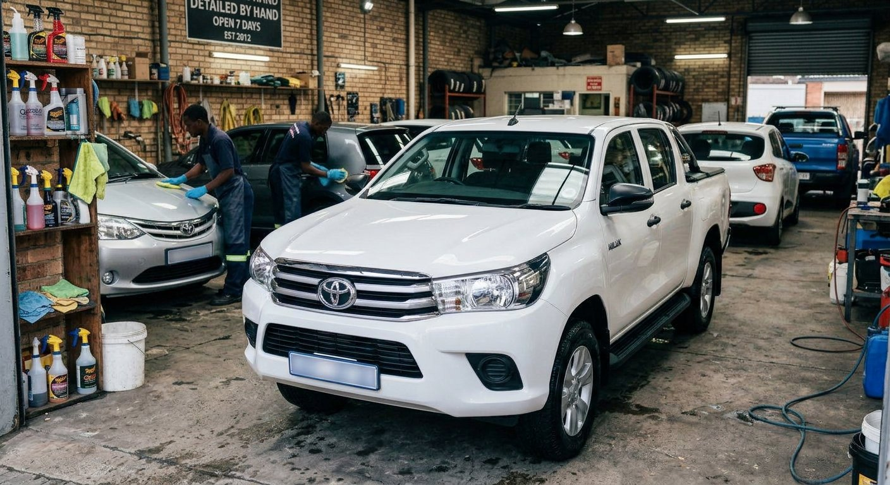
                <div class="comparison-before">
                  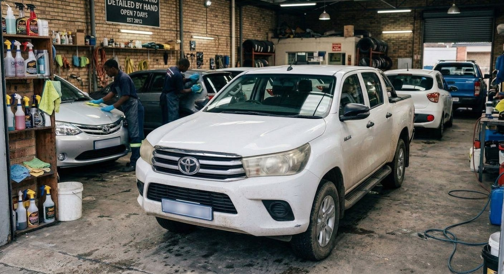
                </div>
                <span class="comparison-label before">BEFORE</span
                ><span class="comparison-label after">AFTER</span>
                <div class="comparison-line" aria-hidden="true">
                  <span class="comparison-handle"
                    ><svg class="icon" aria-hidden="true">
                      <use href="#i-compare"></use></svg
                  ></span>
                </div>
                <input
                  class="comparison-range"
                  type="range"
                  min="0"
                  max="100"
                  value="42"
                  aria-label="Reveal before finish on Toyota Hilux Double Cab"
                  aria-valuetext="42 percent before finish"
                  step="1"
                />
              </div>
              <div class="transformation-meta">
                <div>
                  <p class="eyebrow">TOYOTA HILUX DOUBLE CAB / HEADLIGHT RESTORATION & CERAMIC</p>
                  <h2>The Legend. Protected for KZN roads.</h2>
                  <p>Headlight oxidation restored + full-body ceramic coat</p>
                </div>
                <a
                  href="services.html?package=ceramic#estimator"
                  aria-label="Configure ceramic protection for a Toyota Hilux"
                  ><svg class="icon" aria-hidden="true">
                    <use href="#i-arrow-up-right"></use></svg
                ></a>
              </div>
            </article>
            <article class="transformation-card" data-brand="ford bakkie">
              <div
                class="comparison"
                data-comparison
                style="--position: 55%"
                role="group"
                aria-label="Ford Ranger Double Cab finish comparison"
              >
                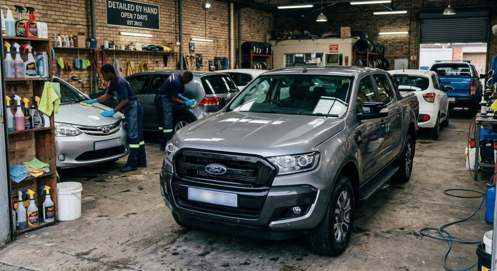
                <div class="comparison-before">
                  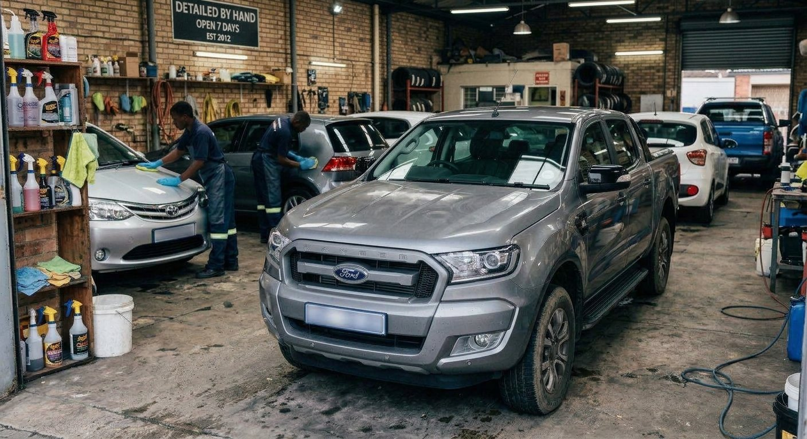
                </div>
                <span class="comparison-label before">BEFORE</span
                ><span class="comparison-label after">AFTER</span>
                <div class="comparison-line" aria-hidden="true">
                  <span class="comparison-handle"
                    ><svg class="icon" aria-hidden="true">
                      <use href="#i-compare"></use></svg
                  ></span>
                </div>
                <input
                  class="comparison-range"
                  type="range"
                  min="0"
                  max="100"
                  value="55"
                  aria-label="Reveal before finish on Ford Ranger Double Cab"
                  aria-valuetext="55 percent before finish"
                  step="1"
                />
              </div>
              <div class="transformation-meta">
                <div>
                  <p class="eyebrow">FORD RANGER DOUBLE CAB / PAINT PROTECTION FILM (PPF)</p>
                  <h2>Toughness. Shielded against gravel & stone chips.</h2>
                  <p>Self-healing front PPF clear bra + clearcoat correction</p>
                </div>
                <a
                  href="services.html?package=ppf#estimator"
                  aria-label="Configure paint protection film for a Ford Ranger"
                  ><svg class="icon" aria-hidden="true">
                    <use href="#i-arrow-up-right"></use></svg
                ></a>
              </div>
            </article>
            <article class="transformation-card" data-brand="volkswagen">
              <div
                class="comparison"
                data-comparison
                style="--position: 50%"
                role="group"
                aria-label="Volkswagen Polo Vivo headlight and clearcoat inspection comparison"
              >
                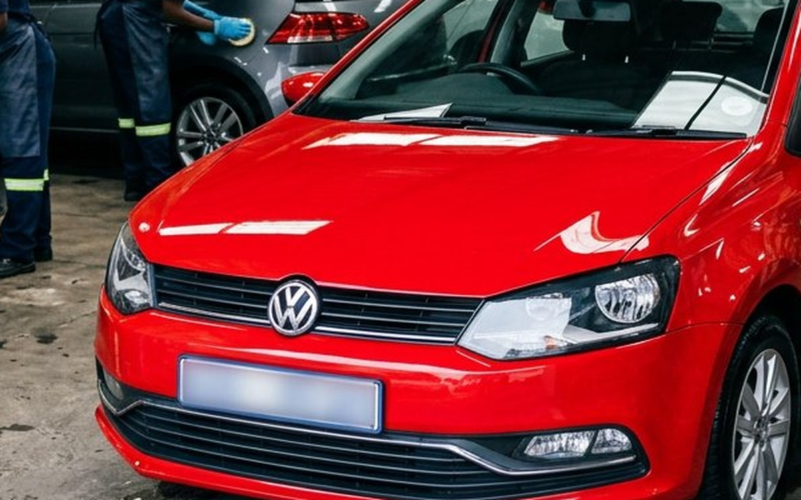
                <div class="comparison-before">
                  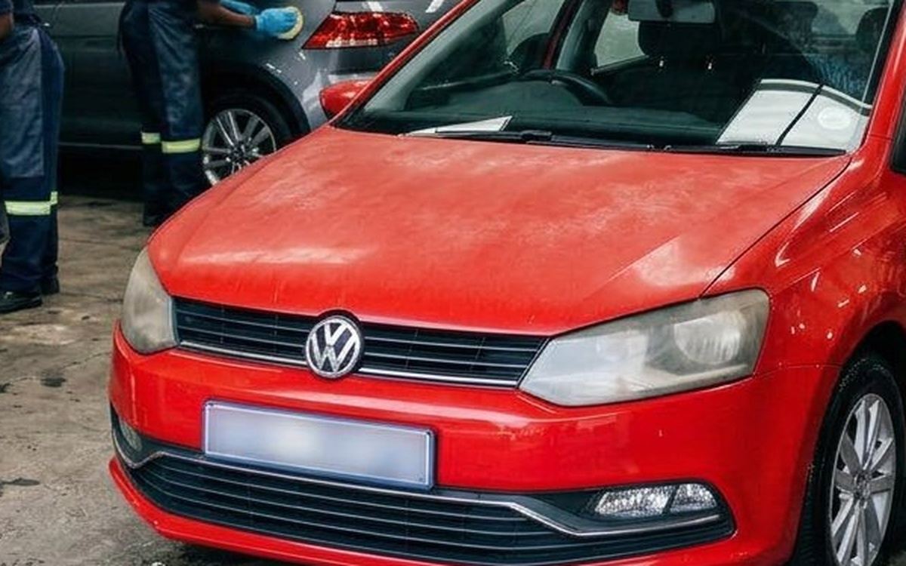
                </div>
                <span class="comparison-label before">BEFORE</span
                ><span class="comparison-label after">AFTER</span>
                <div class="comparison-line" aria-hidden="true">
                  <span class="comparison-handle"
                    ><svg class="icon" aria-hidden="true">
                      <use href="#i-compare"></use></svg
                  ></span>
                </div>
                <input
                  class="comparison-range"
                  type="range"
                  min="0"
                  max="100"
                  value="50"
                  aria-label="Reveal before finish on Volkswagen Polo Vivo detail"
                  aria-valuetext="50 percent before finish"
                  step="1"
                />
              </div>
              <div class="transformation-meta">
                <div>
                  <p class="eyebrow">VOLKSWAGEN POLO VIVO / HEADLIGHT & CLEARCOAT RESTORATION</p>
                  <h2>Close-up clarity. UV haze & swirls eliminated.</h2>
                  <p>Polycarbonate wet-sand & polish + 50/50 gloss enhancement</p>
                </div>
                <a
                  href="services.html?package=stage1#estimator"
                  aria-label="Configure headlight and paint correction for a Volkswagen Polo"
                  ><svg class="icon" aria-hidden="true">
                    <use href="#i-arrow-up-right"></use></svg
                ></a>
              </div>
            </article>
            <article class="transformation-card" data-brand="suzuki">
              <div
                class="comparison"
                data-comparison
                style="--position: 46%"
                role="group"
                aria-label="Suzuki Swift finish comparison"
              >
                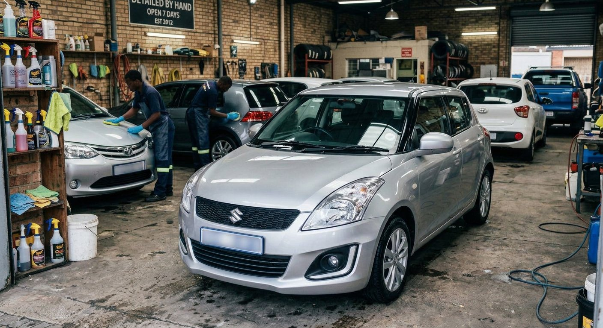
                <div class="comparison-before">
                  
                </div>
                <span class="comparison-label before">BEFORE</span
                ><span class="comparison-label after">AFTER</span>
                <div class="comparison-line" aria-hidden="true">
                  <span class="comparison-handle"
                    ><svg class="icon" aria-hidden="true">
                      <use href="#i-compare"></use></svg
                  ></span>
                </div>
                <input
                  class="comparison-range"
                  type="range"
                  min="0"
                  max="100"
                  value="46"
                  aria-label="Reveal before finish on Suzuki Swift"
                  aria-valuetext="46 percent before finish"
                  step="1"
                />
              </div>
              <div class="transformation-meta">
                <div>
                  <p class="eyebrow">SUZUKI SWIFT / CERAMIC PROTECTION & SWIRL REMOVAL</p>
                  <h2>City commuter. Wet-look mirror reflection.</h2>
                  <p>Single-stage gloss polish + 3-year ceramic protection</p>
                </div>
                <a
                  href="services.html?package=ceramic#estimator"
                  aria-label="Configure ceramic protection for a Suzuki Swift"
                  ><svg class="icon" aria-hidden="true">
                    <use href="#i-arrow-up-right"></use></svg
                ></a>
              </div>
            </article>
            <article class="transformation-card" data-brand="toyota bakkie">
              <div
                class="comparison"
                data-comparison
                style="--position: 52%"
                role="group"
                aria-label="Toyota Fortuner SUV finish comparison"
              >
                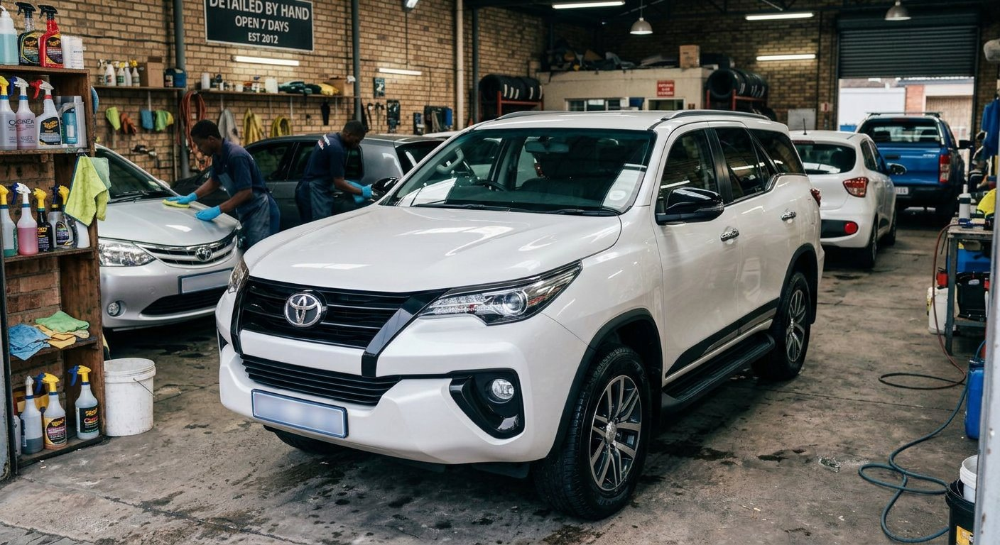
                <div class="comparison-before">
                  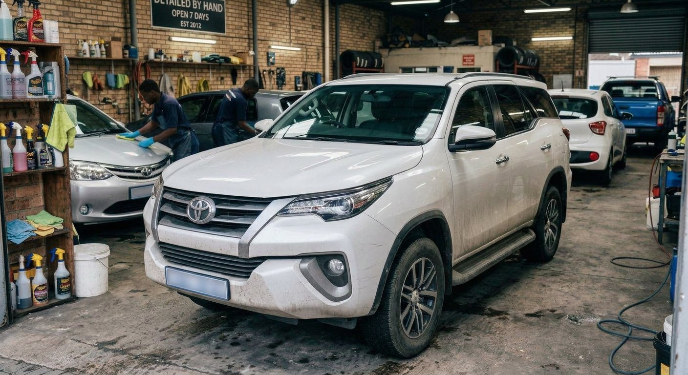
                </div>
                <span class="comparison-label before">BEFORE</span
                ><span class="comparison-label after">AFTER</span>
                <div class="comparison-line" aria-hidden="true">
                  <span class="comparison-handle"
                    ><svg class="icon" aria-hidden="true">
                      <use href="#i-compare"></use></svg
                  ></span>
                </div>
                <input
                  class="comparison-range"
                  type="range"
                  min="0"
                  max="100"
                  value="52"
                  aria-label="Reveal before finish on Toyota Fortuner"
                  aria-valuetext="52 percent before finish"
                  step="1"
                />
              </div>
              <div class="transformation-meta">
                <div>
                  <p class="eyebrow">TOYOTA FORTUNER / SIGNATURE DETAIL & TRIM REJUVENATION</p>
                  <h2>Pearl White. Bush scratches & road grime erased.</h2>
                  <p>Full exterior valet + bush pinstripe correction + trim seal</p>
                </div>
                <a
                  href="services.html?package=basic#estimator"
                  aria-label="Configure signature detail for a Toyota Fortuner"
                  ><svg class="icon" aria-hidden="true">
                    <use href="#i-arrow-up-right"></use></svg
                ></a>
              </div>
            </article>
          </div>
          <p class="gallery-empty" id="gallery-empty" hidden>
            No finishes match this filter.
          </p>
          <div class="gallery-end">
            <p>Different cars. One uncompromising standard.</p>
            <a class="text-link" href="booking.html"
              >Your car could be next
              <svg class="icon" aria-hidden="true">
                <use href="#i-arrow-up-right"></use></svg
            ></a>
          </div>
        </div>
      </section>
      <section class="closing-cta">
        <div class="container closing-inner">
          <div>
            <p class="eyebrow">LET’S TALK ABOUT YOUR FINISH</p>
            <h2>YOUR NEXT CHAPTER.<br /><span>A BETTER REFLECTION.</span></h2>
          </div>
          <div class="closing-actions">
            <a class="btn btn-primary" href="booking.html"
              >Let’s make it exceptional
              <svg class="icon" aria-hidden="true">
                <use href="#i-arrow-up-right"></use></svg
            ></a>
            <p>No shortcuts.<br />No compromises.</p>
          </div>
        </div>
      </section>
    </main>
    <footer class="site-footer">
      <div class="container">
        <div class="footer-main">
          <div class="footer-brand">
            <a
              class="brand"
              href="index.html"
              aria-label="Mario Auto and Detailing home"
              ><span class="brand-mark" aria-hidden="true"><i></i><i></i></span
              ><span
                ><span class="brand-word">MARIO</span
                ><span class="brand-descriptor"
                  >AUTO &amp; DETAILING</span
                ></span
              ></a
            >
            <p>
              For those who see more than a car.<br />World-class care. An
              uncompromising finish.
            </p>
            <div class="footer-location">
              <svg class="icon" aria-hidden="true">
                <use href="#i-map-pin"></use></svg
              ><div>
                <strong>16 Mona Rd, Durban Central</strong><br />
                <span>Durban, KwaZulu-Natal, 4001</span><br />
                <a
                  class="footer-map-action"
                  href="https://www.google.com/maps/search/?api=1&query=16+Mona+Rd%2C+Durban+Central%2C+Durban%2C+4001"
                  target="_blank"
                  rel="noopener noreferrer"
                  aria-label="View 16 Mona Rd, Durban Central on Google Maps"
                >
                  <svg class="icon" aria-hidden="true"><use href="#i-map"></use></svg>
                  <span>View on Google Maps</span>
                  <svg class="icon" aria-hidden="true"><use href="#i-arrow-up-right"></use></svg>
                </a>
              </div>
            </div>
            <div class="footer-call-box">
              <a
                class="btn btn-secondary footer-call-btn"
                href="tel:+2778064006"
                aria-label="Call Mario Auto detailing workshop at (+27) 078 064 006"
              >
                <svg class="icon" aria-hidden="true"><use href="#i-phone"></use></svg>
                <span>Call Workshop · (+27) 078 064 006</span>
              </a>
            </div>
          </div>
          <div class="footer-column">
            <h3>EXPLORE</h3>
            <ul>
              <li><a href="index.html">The showroom</a></li>
              <li><a href="services.html">Services &amp; packages</a></li>
              <li><a href="transformations.html">Transformations</a></li>
              <li><a href="about.html">Our obsession</a></li>
              <li><a href="booking.html">Book a detail</a></li>
            </ul>
          </div>
          <div class="footer-column">
            <h3>STUDIO HOURS</h3>
            <ul class="hours-list">
              <li><span>Monday – Friday</span><span>08:00 – 17:00</span></li>
              <li><span>Saturday</span><span>By appointment</span></li>
              <li><span>Sunday</span><span>Closed</span></li>
            </ul>
            <p class="newsletter-note" style="margin-top: 16px">
              Concept hours. All visits require confirmation.
            </p>
          </div>
          <div class="footer-column footer-newsletter">
            <h3>STAY IN THE KNOW</h3>
            <p>
              Care notes, studio stories, and the pursuit of a better finish.
            </p>
            <form data-newsletter>
              <label class="sr-only" for="newsletter-email"
                >Email address for studio updates</label
              >
              <div class="newsletter-field">
                <input
                  id="newsletter-email"
                  type="email"
                  name="email"
                  autocomplete="email"
                  placeholder="Your email address"
                  required
                  maxlength="254"
                /><button type="submit" aria-label="Save newsletter interest">
                  <svg class="icon" aria-hidden="true">
                    <use href="#i-arrow-right"></use>
                  </svg>
                </button>
              </div>
              <div class="newsletter-note">
                Local preview only. No subscription is sent.
              </div>
            </form>
          </div>
        </div>
        <div class="footer-journal">
          <span class="journal-label"
            ><svg class="icon" aria-hidden="true">
              <use href="#i-instagram"></use>
            </svg>
            FROM THE STUDIO<br />SOCIAL FEED PREVIEW</span
          >
          <div class="journal-grid">
            <a
              href="transformations.html"
              aria-label="Explore paint correction finishes"
              ></a
            ><a
              href="transformations.html"
              aria-label="Explore ceramic coating finishes"
              ></a
            ><a
              href="transformations.html"
              aria-label="Explore paint protection finishes"
              ></a
            ><a href="about.html#studio" aria-label="Inside the concept studio"
              ></a>
          </div>
          <a class="text-link" href="transformations.html"
            >Explore the gallery
            <svg class="icon" aria-hidden="true">
              <use href="#i-arrow-up-right"></use></svg
          ></a>
        </div>
        <div class="footer-bottom">
          <p>
            © <span data-current-year>2026</span> Mario Auto &amp; Detailing.
            Driven by detail.
          </p>
          <div class="footer-legal">
            <button type="button" data-info="privacy">Privacy</button
            ><button type="button" data-info="terms">Booking terms</button>
          </div>
          <a class="top-link" href="#top"
            >BACK TO TOP
            <svg class="icon" aria-hidden="true">
              <use href="#i-arrow-up"></use></svg
          ></a>
        </div>
        <p class="footer-disclosure">
          Interactive concept website. Prices, hours, reviews and availability
          are illustrative; imagery includes AI-generated finish visualisations.
          No reservations, payments or newsletter subscriptions are transmitted.
        </p>
      </div>
    </footer>
    <dialog
      class="info-dialog"
      id="info-dialog"
      aria-labelledby="info-dialog-title"
    >
      <div class="dialog-top">
        <h2 id="info-dialog-title">Information</h2>
        <button
          class="icon-button"
          type="button"
          data-close-dialog
          aria-label="Close information"
        >
          <svg class="icon" aria-hidden="true"><use href="#i-x"></use></svg>
        </button>
      </div>
      <div class="dialog-body" data-dialog-body></div>
    </dialog>
    <div
      class="toast-stack"
      id="toast-stack"
      role="status"
      aria-live="polite"
      aria-atomic="false"
    ></div>
  </body>
</html>

```

## booking.html

```html
<!doctype html>
<!-- booking.html — Mario Auto & Detailing -->
<html lang="en-ZA">
  <head>
    <meta charset="UTF-8" />
    <meta name="viewport" content="width=device-width, initial-scale=1.0" />
    <meta name="theme-color" content="#08080A" />
    <meta
      name="description"
      content="Create a personalised detailing estimate and downloadable booking request with our four-step vehicle, service, schedule and contact wizard."
    />
    <title>Build Your Personal Detail | Mario Auto &amp; Detailing</title>
    <meta
      property="og:title"
      content="Build Your Personal Detail | Mario Auto &amp; Detailing"
    />
    <meta
      property="og:description"
      content="Create a personalised detailing estimate and downloadable booking request with our four-step vehicle, service, schedule and contact wizard."
    />
    <meta property="og:type" content="website" />
    <meta property="og:image" content="assets/showroom-hero.jpg" />
    <link rel="icon" type="image/svg+xml" href="assets/favicon.svg" />
    <link rel="preconnect" href="https://fonts.googleapis.com" />
    <link rel="preconnect" href="https://fonts.gstatic.com" crossorigin />
    <link
      href="https://fonts.googleapis.com/css2?family=Inter:wght@400;500;600;700;800&amp;family=Montserrat:wght@400;500;600;700;800;900&amp;display=swap"
      rel="stylesheet"
    />
    <link rel="stylesheet" href="css/styles.css" />
    <!-- Required CDN stack. The design and interactions also work with local CSS, SVG icons and a local Three.js fallback. -->
    <script src="https://cdn.tailwindcss.com" async></script>
    <script
      src="https://cdnjs.cloudflare.com/ajax/libs/three.js/r128/three.min.js"
      async
    ></script>
    <script src="https://unpkg.com/lucide@latest" async></script>
    <script src="js/main.js" defer></script>
    <script src="js/three-scene.js" defer></script>
  </head>
  <body data-page="booking">
    <svg
      xmlns="http://www.w3.org/2000/svg"
      class="sr-only"
      aria-hidden="true"
      focusable="false"
    >
      <defs>
                <symbol id="i-phone" viewBox="0 0 24 24">
          <path
            d="M22 16.92v3a2 2 0 0 1-2.18 2 19.79 19.79 0 0 1-8.63-3.07 19.5 19.5 0 0 1-6-6 19.79 19.79 0 0 1-3.07-8.67A2 2 0 0 1 4.11 2h3a2 2 0 0 1 2 1.72 12.84 12.84 0 0 0 .7 2.81 2 2 0 0 1-.45 2.11L8.09 9.91a16 16 0 0 0 6 6l1.27-1.27a2 2 0 0 1 2.11-.45 12.84 12.84 0 0 0 2.81.7A2 2 0 0 1 22 16.92z"
            fill="none"
            stroke="currentColor"
            stroke-width="1.75"
            stroke-linecap="round"
            stroke-linejoin="round"
          />
        </symbol>
        <symbol id="i-map" viewBox="0 0 24 24">
          <polygon
            points="1 6 1 22 8 18 16 22 23 18 23 2 16 6 8 2 1 6"
            fill="none"
            stroke="currentColor"
            stroke-width="1.75"
            stroke-linecap="round"
            stroke-linejoin="round"
          />
          <line x1="8" y1="2" x2="8" y2="18" stroke="currentColor" stroke-width="1.75" />
          <line x1="16" y1="6" x2="16" y2="22" stroke="currentColor" stroke-width="1.75" />
        </symbol>
        <symbol id="i-arrow-up-right" viewBox="0 0 24 24">
          <path
            d="M7 17 17 7M7 7h10v10"
            stroke-linecap="round"
            stroke-linejoin="round"
          />
        </symbol>
        <symbol id="i-arrow-right" viewBox="0 0 24 24">
          <path
            d="M4 12h16m-6-6 6 6-6 6"
            stroke-linecap="round"
            stroke-linejoin="round"
          />
        </symbol>
        <symbol id="i-arrow-left" viewBox="0 0 24 24">
          <path
            d="M20 12H4m6-6-6 6 6 6"
            stroke-linecap="round"
            stroke-linejoin="round"
          />
        </symbol>
        <symbol id="i-arrow-down" viewBox="0 0 24 24">
          <path
            d="M12 4v16m-6-6 6 6 6-6"
            stroke-linecap="round"
            stroke-linejoin="round"
          />
        </symbol>
        <symbol id="i-arrow-up" viewBox="0 0 24 24">
          <path
            d="M12 20V4m-6 6 6-6 6 6"
            stroke-linecap="round"
            stroke-linejoin="round"
          />
        </symbol>
        <symbol id="i-chevron-right" viewBox="0 0 24 24">
          <path
            d="m9 5 7 7-7 7"
            stroke-linecap="round"
            stroke-linejoin="round"
          />
        </symbol>
        <symbol id="i-chevron-left" viewBox="0 0 24 24">
          <path
            d="m15 5-7 7 7 7"
            stroke-linecap="round"
            stroke-linejoin="round"
          />
        </symbol>
        <symbol id="i-chevron-down" viewBox="0 0 24 24">
          <path
            d="m6 9 6 6 6-6"
            stroke-linecap="round"
            stroke-linejoin="round"
          />
        </symbol>
        <symbol id="i-menu" viewBox="0 0 24 24">
          <path
            d="M4 7h16M4 12h16M4 17h16"
            stroke-linecap="round"
            stroke-linejoin="round"
          />
        </symbol>
        <symbol id="i-x" viewBox="0 0 24 24">
          <path
            d="m6 6 12 12M6 18 18 6"
            stroke-linecap="round"
            stroke-linejoin="round"
          />
        </symbol>
        <symbol id="i-check" viewBox="0 0 24 24">
          <path
            d="m5 12 4 4L19 6"
            stroke-linecap="round"
            stroke-linejoin="round"
          />
        </symbol>
        <symbol id="i-plus" viewBox="0 0 24 24">
          <path
            d="M12 5v14M5 12h14"
            stroke-linecap="round"
            stroke-linejoin="round"
          />
        </symbol>
        <symbol id="i-minus" viewBox="0 0 24 24">
          <path d="M5 12h14" stroke-linecap="round" stroke-linejoin="round" />
        </symbol>
        <symbol id="i-car" viewBox="0 0 24 24">
          <path
            d="m3 11 2-6h14l2 6v8h-3v-3H6v3H3v-8Zm0 0h18M6 8h12M6 13h2m8 0h2"
            stroke-linecap="round"
            stroke-linejoin="round"
          />
        </symbol>
        <symbol id="i-suv" viewBox="0 0 24 24">
          <path
            d="M3 18v-8l2-5h13l3 5v8h-3v-3H6v3H3ZM3 10h18M8 5v5M6 12h2m8 0h2"
            stroke-linecap="round"
            stroke-linejoin="round"
          />
        </symbol>
        <symbol id="i-truck" viewBox="0 0 24 24">
          <path
            d="M2 8h12v8H2V8Zm12 3h4l4 4v1h-8M6 16v1m12-1v1M5 8V5h7v3"
            stroke-linecap="round"
            stroke-linejoin="round"
          />
        </symbol>
        <symbol id="i-shield" viewBox="0 0 24 24">
          <path
            d="M12 3 3 7v5c0 5 9 9 9 9s9-4 9-9V7l-9-4Zm-4 9 3 3 5-6"
            stroke-linecap="round"
            stroke-linejoin="round"
          />
        </symbol>
        <symbol id="i-sparkles" viewBox="0 0 24 24">
          <path
            d="m12 3 2.6 6.4L21 12l-6.4 2.6L12 21l-2.6-6.4L3 12l6.4-2.6L12 3ZM20 2v4m-2-2h4"
            stroke-linecap="round"
            stroke-linejoin="round"
          />
        </symbol>
        <symbol id="i-droplet" viewBox="0 0 24 24">
          <path
            d="M12 3C9 7 5 11 5 15a7 7 0 0 0 14 0c0-4-4-8-7-12ZM8 15a4 4 0 0 0 4 4"
            stroke-linecap="round"
            stroke-linejoin="round"
          />
        </symbol>
        <symbol id="i-layers" viewBox="0 0 24 24">
          <path
            d="m12 3 10 5-10 5L2 8l10-5ZM2 12l10 5 10-5M2 16l10 5 10-5"
            stroke-linecap="round"
            stroke-linejoin="round"
          />
        </symbol>
        <symbol id="i-circle-check" viewBox="0 0 24 24">
          <path
            d="M21 11a9 9 0 1 1-5-8M8 11l4 4L22 5"
            stroke-linecap="round"
            stroke-linejoin="round"
          />
        </symbol>
        <symbol id="i-clock" viewBox="0 0 24 24">
          <path
            d="M12 8v5l3 2M21 12a9 9 0 1 1-18 0 9 9 0 0 1 18 0"
            stroke-linecap="round"
            stroke-linejoin="round"
          />
        </symbol>
        <symbol id="i-calendar" viewBox="0 0 24 24">
          <path
            d="M5 5h14a2 2 0 0 1 2 2v12a2 2 0 0 1-2 2H5a2 2 0 0 1-2-2V7a2 2 0 0 1 2-2ZM7 2v6m10-6v6M3 11h18m-12 4h.01M12 15h.01M15 15h.01"
            stroke-linecap="round"
            stroke-linejoin="round"
          />
        </symbol>
        <symbol id="i-map-pin" viewBox="0 0 24 24">
          <path
            d="M20 10c0 6-8 12-8 12S4 16 4 10a8 8 0 1 1 16 0ZM15 10a3 3 0 1 1-6 0 3 3 0 0 1 6 0"
            stroke-linecap="round"
            stroke-linejoin="round"
          />
        </symbol>
        <symbol id="i-camera" viewBox="0 0 24 24">
          <path
            d="M4 6h4l2-3h4l2 3h4a1 1 0 0 1 1 1v12a1 1 0 0 1-1 1H4a1 1 0 0 1-1-1V7a1 1 0 0 1 1-1ZM16 12a4 4 0 1 1-8 0 4 4 0 0 1 8 0"
            stroke-linecap="round"
            stroke-linejoin="round"
          />
        </symbol>
        <symbol id="i-instagram" viewBox="0 0 24 24">
          <path
            d="M7 3h10a4 4 0 0 1 4 4v10a4 4 0 0 1-4 4H7a4 4 0 0 1-4-4V7a4 4 0 0 1 4-4ZM16 12a4 4 0 1 1-8 0 4 4 0 0 1 8 0M17.5 6.5h.01"
            stroke-linecap="round"
            stroke-linejoin="round"
          />
        </symbol>
        <symbol id="i-cube" viewBox="0 0 24 24">
          <path
            d="m12 3 9 5v9l-9 5-9-5V8l9-5ZM3 8l9 5 9-5M12 13v9M8 5l9 5"
            stroke-linecap="round"
            stroke-linejoin="round"
          />
        </symbol>
        <symbol id="i-pause" viewBox="0 0 24 24">
          <path
            d="M8 5v14M16 5v14"
            stroke-linecap="round"
            stroke-linejoin="round"
          />
        </symbol>
        <symbol id="i-play" viewBox="0 0 24 24">
          <path
            d="m8 4 12 8-12 8V4Z"
            stroke-linecap="round"
            stroke-linejoin="round"
          />
        </symbol>
        <symbol id="i-rotate" viewBox="0 0 24 24">
          <path
            d="M3 10a9 9 0 1 1 1 7M3 4v6h6"
            stroke-linecap="round"
            stroke-linejoin="round"
          />
        </symbol>
        <symbol id="i-compare" viewBox="0 0 24 24">
          <path
            d="M12 3v18M8 8l-4 4 4 4m8-8 4 4-4 4"
            stroke-linecap="round"
            stroke-linejoin="round"
          />
        </symbol>
        <symbol id="i-info" viewBox="0 0 24 24">
          <path
            d="M12 11v6m0-10h.01M21 12a9 9 0 1 1-18 0 9 9 0 0 1 18 0"
            stroke-linecap="round"
            stroke-linejoin="round"
          />
        </symbol>
        <symbol id="i-lock" viewBox="0 0 24 24">
          <path
            d="M6 10h12a2 2 0 0 1 2 2v8H4v-8a2 2 0 0 1 2-2ZM8 10V7a4 4 0 0 1 8 0v3M12 14v3"
            stroke-linecap="round"
            stroke-linejoin="round"
          />
        </symbol>
        <symbol id="i-download" viewBox="0 0 24 24">
          <path
            d="M12 3v12m-5-5 5 5 5-5M4 15v6h16v-6"
            stroke-linecap="round"
            stroke-linejoin="round"
          />
        </symbol>
        <symbol id="i-file" viewBox="0 0 24 24">
          <path
            d="M14 2H5v20h14V7l-5-5Zm0 0v6h5M8 12h8M8 16h6"
            stroke-linecap="round"
            stroke-linejoin="round"
          />
        </symbol>
        <symbol id="i-headphones" viewBox="0 0 24 24">
          <path
            d="M4 13v-1a8 8 0 1 1 16 0v1M4 12H2v7h5v-7H4Zm16 0h2v7h-5v-7h3Z"
            stroke-linecap="round"
            stroke-linejoin="round"
          />
        </symbol>
        <symbol id="i-ruler" viewBox="0 0 24 24">
          <path
            d="m3 15 12-12 6 6L9 21l-6-6ZM8 10l3 3m1-7 3 3m-3 7 3 3"
            stroke-linecap="round"
            stroke-linejoin="round"
          />
        </symbol>
        <symbol id="i-wind" viewBox="0 0 24 24">
          <path
            d="M3 8h12a3 3 0 1 0-3-3M3 12h16a3 3 0 1 1-3 3M3 16h6a3 3 0 1 1-3 3"
            stroke-linecap="round"
            stroke-linejoin="round"
          />
        </symbol>
        <symbol id="i-light" viewBox="0 0 24 24">
          <path
            d="M9 18h6M10 21h4M8 14a6 6 0 1 1 8 0l-1 2H9l-1-2Z"
            stroke-linecap="round"
            stroke-linejoin="round"
          />
        </symbol>
      </defs></svg
    ><a class="skip-link" href="#main-content">Skip to content</a>
    <header class="site-header glass-nav" id="top">
      <div class="container nav-inner">
        <a
          class="brand"
          href="index.html"
          aria-label="Mario Auto and Detailing home"
          ><span class="brand-mark" aria-hidden="true"><i></i><i></i></span
          ><span
            ><span class="brand-word">MARIO</span
            ><span class="brand-descriptor">AUTO &amp; DETAILING</span></span
          ></a
        >
        <nav class="desktop-nav" aria-label="Primary navigation">
          <a class="nav-link" href="index.html">Home</a
          ><a class="nav-link" href="services.html">Services</a
          ><a class="nav-link" href="transformations.html">Transformations</a
          ><a class="nav-link" href="about.html">About</a>
        </nav>
        <div class="nav-actions">
          <span class="nav-location"
            ><svg class="icon" aria-hidden="true">
              <use href="#i-map-pin"></use>
            </svg>
            DURBAN, ZA</span
          ><a class="btn btn-primary" href="booking.html" aria-current="page"
            >Book a detail
            <svg class="icon" aria-hidden="true">
              <use href="#i-arrow-up-right"></use></svg></a
          ><button
            class="menu-toggle"
            type="button"
            aria-label="Open navigation"
            aria-expanded="false"
            aria-controls="mobile-menu"
          >
            <svg class="icon" aria-hidden="true">
              <use href="#i-menu"></use>
            </svg>
          </button>
        </div>
      </div>
    </header>
    <div class="mobile-drawer" id="mobile-menu" hidden>
      <nav aria-label="Mobile navigation">
        <a href="index.html">Home</a><a href="services.html">Services</a
        ><a href="transformations.html">Transformations</a
        ><a href="about.html">About</a
        ><a href="booking.html"
          >Book a detail
          <svg class="icon" aria-hidden="true">
            <use href="#i-arrow-up-right"></use></svg
        ></a>
      </nav>
      <div class="mobile-contact-bar">
        <a class="btn btn-secondary" href="tel:+2778064006" aria-label="Call workshop: +27 78 064 006">
          <svg class="icon" aria-hidden="true">
            <use href="#i-phone"></use>
          </svg>
          Call (+27) 078 064 006
        </a>
        <a class="btn btn-secondary" href="https://www.google.com/maps/search/?api=1&query=16+Mona+Rd%2C+Durban+Central%2C+Durban%2C+4001" target="_blank" rel="noopener noreferrer" aria-label="Open workshop map">
          <svg class="icon" aria-hidden="true">
            <use href="#i-map-pin"></use>
          </svg>
          16 Mona Rd
        </a>
      </div>
      <p>
        Precision care. Exceptional finishes.<br />Durban, KwaZulu-Natal · by
        appointment.
      </p>
    </div>
    <main id="main-content" tabindex="-1">
      <section class="page-hero booking-page-hero">
        <div class="container">
          <div class="breadcrumbs">
            <a href="index.html">The showroom</a
            ><svg class="icon" aria-hidden="true">
              <use href="#i-chevron-right"></use></svg
            ><span>Booking</span>
          </div>
          <div class="page-hero-content">
            <div>
              <p class="eyebrow">THE START OF SOMETHING EXCEPTIONAL</p>
              <h1 class="display-heading">
                YOUR CAR.<br /><span class="text-gradient"
                  >OUR NEXT OBSESSION.</span
                >
              </h1>
            </div>
            <p>
              Four considered steps. One personalised request. Your preferred
              date and quote are confirmed by the studio.
            </p>
          </div>
          <div class="page-hero-foot">
            <span
              ><svg class="icon" aria-hidden="true">
                <use href="#i-shield"></use>
              </svg>
              NO PAYMENT. NO PRESSURE. JUST A CLEAR STARTING POINT.</span
            ><span class="page-number">MARIO / BOOKING</span>
          </div>
        </div>
      </section>
      <section class="container booking-layout">
        <div class="wizard-main">
          <div class="wizard-progress" aria-label="Booking request progress">
            <button type="button" data-wizard-goto="1" aria-current="step">
              <span class="step-number">01</span
              ><span class="step-name">Your vehicle</span></button
            ><button type="button" data-wizard-goto="2" disabled>
              <span class="step-number">02</span
              ><span class="step-name">Your detail</span></button
            ><button type="button" data-wizard-goto="3" disabled>
              <span class="step-number">03</span
              ><span class="step-name">Your schedule</span></button
            ><button type="button" data-wizard-goto="4" disabled>
              <span class="step-number">04</span
              ><span class="step-name">Your details</span>
            </button>
          </div>
          <form id="booking-form" novalidate>
            <div
              class="wizard-error"
              id="wizard-error"
              role="alert"
              hidden
            ></div>
            <section
              class="wizard-step"
              data-wizard-step="1"
              aria-labelledby="step-1-heading"
            >
              <div class="wizard-heading">
                <p class="eyebrow">01 / A LITTLE INTRODUCTION</p>
                <h2 id="step-1-heading" tabindex="-1">
                  Tell us about your vehicle.
                </h2>
                <p>Every finish has a story. Let’s start with yours.</p>
              </div>
              <div class="field-row">
                <div class="field">
                  <label for="vehicle-year">Model year *</label
                  ><select id="vehicle-year" name="year" required>
                    <option value="">Select year</option>
                  </select>
                </div>
                <div class="field">
                  <label for="vehicle-make">Make *</label
                  ><select id="vehicle-make" name="make" required>
                    <option value="">Select make</option>
                    <option>Volkswagen</option>
                    <option>Toyota</option>
                    <option>Ford</option>
                    <option>Suzuki</option>
                    <option>Isuzu</option>
                    <option>Hyundai</option>
                    <option>Nissan</option>
                    <option>Kia</option>
                    <option>Renault</option>
                    <option>BMW</option>
                    <option>Mercedes-Benz</option>
                    <option>Audi</option>
                    <option>Other</option>
                  </select>
                </div>
              </div>
              <div class="field">
                <label for="vehicle-model">Model *</label
                ><input
                  id="vehicle-model"
                  name="model"
                  type="text"
                  list="vehicle-models"
                  placeholder="e.g. Polo Vivo 1.4, Hilux 2.8 GD-6, Ranger 2.0"
                  required
                  maxlength="80"
                  autocomplete="off"
                /><datalist id="vehicle-models"></datalist>
                <p class="field-note">
                  Select a make for suggestions, or type your exact model.
                </p>
              </div>
              <fieldset>
                <legend class="form-section-title">Vehicle size *</legend>
                <div class="choice-row">
                  <label class="choice-card"
                    ><input
                      type="radio"
                      name="vehicle"
                      value="coupe"
                      checked /><svg class="icon" aria-hidden="true">
                      <use href="#i-car"></use></svg
                    ><strong>Hatchback / Sedan</strong
                    ><small>Polo Vivo, Corolla, Swift</small
                    ><span class="choice-check"
                      ><svg class="icon" aria-hidden="true">
                        <use href="#i-check"></use></svg></span></label
                  ><label class="choice-card"
                    ><input type="radio" name="vehicle" value="suv" /><svg
                      class="icon"
                      aria-hidden="true"
                    >
                      <use href="#i-suv"></use></svg
                    ><strong>SUV / Crossover</strong
                    ><small>Fortuner, Tiguan (+20%)</small
                    ><span class="choice-check"
                      ><svg class="icon" aria-hidden="true">
                        <use href="#i-check"></use></svg></span></label
                  ><label class="choice-card"
                    ><input type="radio" name="vehicle" value="exotic" /><svg
                      class="icon"
                      aria-hidden="true"
                    >
                      <use href="#i-truck"></use></svg
                    ><strong>Bakkie / Double Cab</strong
                    ><small>Hilux, Ranger, D-Max (+35%)</small
                    ><span class="choice-check"
                      ><svg class="icon" aria-hidden="true">
                        <use href="#i-check"></use></svg></span
                  ></label>
                </div>
              </fieldset>
              <div class="field">
                <label for="booking-condition">Current paint condition</label
                ><select id="booking-condition" name="condition">
                  <option value="minor">Minor swirls / generally sound</option>
                  <option value="deep">
                    Deep scratches / additional refinement
                  </option>
                  <option value="oxidation">
                    Oxidation / heavily weathered
                  </option>
                </select>
                <p class="field-note">
                  Unsure? Select the closest match. The studio will inspect the
                  finish.
                </p>
              </div>
            </section>
            <section
              class="wizard-step"
              data-wizard-step="2"
              aria-labelledby="step-2-heading"
              hidden
            >
              <div class="wizard-heading">
                <p class="eyebrow">02 / SET YOUR STANDARD</p>
                <h2 id="step-2-heading" tabindex="-1">Choose your detail.</h2>
                <p>
                  One primary package. Add the finishing touches that matter to
                  you.
                </p>
              </div>
              <fieldset>
                <legend class="sr-only">Primary service package</legend>
                <div class="service-options">
                  <label class="service-option"
                    ><input type="radio" name="package" value="basic" /><svg
                      class="icon"
                      aria-hidden="true"
                    >
                      <use href="#i-sparkles"></use></svg
                    ><strong>Signature Detail</strong
                    ><small>A complete interior and exterior reset.</small
                    ><span class="option-price"
                      >R 1 500<small> BASE</small></span
                    ></label
                  ><label class="service-option"
                    ><input type="radio" name="package" value="stage1" /><svg
                      class="icon"
                      aria-hidden="true"
                    >
                      <use href="#i-layers"></use></svg
                    ><strong>Stage 1 Correction</strong
                    ><small>Clarity, gloss and light swirl reduction.</small
                    ><span class="option-price"
                      >R 3 500<small> BASE</small></span
                    ></label
                  ><label class="service-option"
                    ><input
                      type="radio"
                      name="package"
                      value="ceramic"
                      checked
                    /><svg class="icon" aria-hidden="true">
                      <use href="#i-droplet"></use></svg
                    ><strong>Correction + Ceramic</strong
                    ><small>Multi-stage polish + 5-year ceramic.</small
                    ><span class="option-price"
                      >R 8 900<small> BASE</small></span
                    ></label
                  ><label class="service-option"
                    ><input type="radio" name="package" value="ppf" /><svg
                      class="icon"
                      aria-hidden="true"
                    >
                      <use href="#i-shield"></use></svg
                    ><strong>Ultimate Full-Body PPF</strong
                    ><small>A self-healing physical protection layer.</small
                    ><span class="option-price"
                      >R 35 000<small> BASE</small></span
                    ></label
                  >
                </div>
              </fieldset>
              <h3 class="addon-title">
                THE FINISHING TOUCHES · OPTIONAL ADD-ONS
              </h3>
              <div class="addon-options">
                <label class="addon-option"
                  ><input type="checkbox" name="addon" value="engine" /><span
                    >Engine Bay Detail</span
                  ><small>+ R 650 base</small></label
                ><label class="addon-option"
                  ><input type="checkbox" name="addon" value="wheels" /><span
                    >Wheel Armor Coating</span
                  ><small>+ R 1 200 base</small></label
                ><label class="addon-option"
                  ><input type="checkbox" name="addon" value="leather" /><span
                    >Interior Leather Coating</span
                  ><small>+ R 1 400 base</small></label
                >
              </div>
              <p class="fine-print" style="margin-top: 15px">
                Displayed service prices are coupe / sedan base rates. Your
                vehicle size and condition are reflected in the live estimate.
              </p>
            </section>
            <section
              class="wizard-step"
              data-wizard-step="3"
              aria-labelledby="step-3-heading"
              hidden
            >
              <div class="wizard-heading">
                <p class="eyebrow">03 / MAKE ROOM FOR EXCEPTIONAL</p>
                <h2 id="step-3-heading" tabindex="-1">
                  Find your preferred moment.
                </h2>
                <p>
                  Select a drop-off date and time. This is a preference, not a
                  reservation.
                </p>
              </div>
              <div class="calendar-panel">
                <div class="calendar-header">
                  <strong id="calendar-month">Select a month</strong>
                  <div class="calendar-controls">
                    <button
                      type="button"
                      class="icon-button"
                      id="calendar-prev"
                      aria-label="Previous month"
                    >
                      <svg class="icon" aria-hidden="true">
                        <use href="#i-chevron-left"></use>
                      </svg></button
                    ><button
                      type="button"
                      class="icon-button"
                      id="calendar-next"
                      aria-label="Next month"
                    >
                      <svg class="icon" aria-hidden="true">
                        <use href="#i-chevron-right"></use>
                      </svg>
                    </button>
                  </div>
                </div>
                <div class="calendar-weekdays" aria-hidden="true">
                  <span>MON</span><span>TUE</span><span>WED</span
                  ><span>THU</span><span>FRI</span><span>SAT</span
                  ><span>SUN</span>
                </div>
                <div
                  class="calendar-days"
                  id="calendar-days"
                  role="group"
                  aria-label="Preferred drop-off date"
                ></div>
                <div class="calendar-note">
                  <span><i></i> Selectable preference</span
                  ><span><i></i> Your selection</span>
                </div>
              </div>
              <input type="hidden" name="date" id="booking-date" />
              <fieldset>
                <legend class="form-section-title">
                  Preferred drop-off time *
                </legend>
                <div class="time-slots">
                  <label class="time-slot"
                    ><input type="radio" name="time" value="09:00" /><span
                      >09:00</span
                    ></label
                  ><label class="time-slot"
                    ><input type="radio" name="time" value="11:00" /><span
                      >11:00</span
                    ></label
                  ><label class="time-slot"
                    ><input type="radio" name="time" value="14:00" /><span
                      >14:00</span
                    ></label
                  >
                </div>
              </fieldset>
              <p class="schedule-notice">
                <svg class="icon" aria-hidden="true">
                  <use href="#i-info"></use>
                </svg>
                Dates are illustrative preferences for the next 90 days. Past
                dates, same-day requests and Sundays are excluded. Actual
                capacity, Saturday hours and your vehicle’s studio duration must
                be confirmed directly.
              </p>
            </section>
            <section
              class="wizard-step"
              data-wizard-step="4"
              aria-labelledby="step-4-heading"
              hidden
            >
              <div class="wizard-heading">
                <p class="eyebrow">04 / THE LAST FEW DETAILS</p>
                <h2 id="step-4-heading" tabindex="-1">
                  Let’s put a name to the finish.
                </h2>
                <p>
                  Review your estimate, add your details, and create a
                  downloadable request.
                </p>
              </div>
              <div class="contact-notice">
                This is a working front-end demonstration. Your contact details
                stay in this tab until you download the request. Nothing is sent
                to a studio, and no appointment is reserved.
              </div>
              <div class="field-row">
                <div class="field">
                  <label for="owner-name">Full name *</label
                  ><input
                    type="text"
                    id="owner-name"
                    name="ownerName"
                    autocomplete="name"
                    required
                    minlength="2"
                    maxlength="100"
                    placeholder="Your full name"
                  />
                </div>
                <div class="field">
                  <label for="owner-phone">Phone number *</label
                  ><input
                    type="tel"
                    id="owner-phone"
                    name="phone"
                    autocomplete="tel"
                    required
                    minlength="7"
                    maxlength="25"
                    placeholder="e.g. +27 82 123 4567"
                  />
                </div>
              </div>
              <div class="field">
                <label for="owner-email">Email address *</label
                ><input
                  type="email"
                  id="owner-email"
                  name="email"
                  autocomplete="email"
                  required
                  maxlength="254"
                  placeholder="you@example.com"
                />
              </div>
              <div class="field">
                <label for="owner-notes">Anything else we should know?</label
                ><textarea
                  id="owner-notes"
                  name="notes"
                  maxlength="1000"
                  placeholder="Existing coatings, special requirements, or what the perfect finish means to you."
                ></textarea>
              </div>
              <div class="review-summary-box">
                <h3>YOUR REQUEST, AT A GLANCE</h3>
                <p id="final-review">
                  Your personalised detail summary will appear here.
                </p>
              </div>
              <label class="form-check contact-consent"
                ><input type="checkbox" name="consent" required /><span
                  >I understand this creates a local request only. The price is
                  indicative, my chosen time is not reserved, and an inspection
                  and direct studio confirmation are required.</span
                ></label
              >
            </section>
            <div class="wizard-footer">
              <button
                class="btn btn-secondary"
                id="wizard-back"
                type="button"
                hidden
              >
                <svg class="icon" aria-hidden="true">
                  <use href="#i-arrow-left"></use>
                </svg>
                Go back</button
              ><span class="wizard-trust" id="wizard-trust"
                ><svg class="icon" aria-hidden="true">
                  <use href="#i-lock"></use>
                </svg>
                No payment or account required</span
              ><button class="btn btn-primary" id="wizard-next" type="button">
                Choose your detail
                <svg class="icon" aria-hidden="true">
                  <use href="#i-arrow-right"></use>
                </svg></button
              ><button
                class="btn btn-primary"
                id="wizard-submit"
                type="submit"
                hidden
              >
                Create booking request
                <svg class="icon" aria-hidden="true">
                  <use href="#i-arrow-up-right"></use>
                </svg>
              </button>
            </div>
          </form>
          <section
            class="success-panel"
            id="booking-success"
            aria-labelledby="success-heading"
            hidden
          >
            <div class="success-icon">
              <svg class="icon" aria-hidden="true">
                <use href="#i-check"></use>
              </svg>
            </div>
            <p class="eyebrow" style="margin-bottom: 15px">
              THE FIRST DETAIL. TAKEN CARE OF.
            </p>
            <h2 id="success-heading" tabindex="-1">Your request is ready.</h2>
            <p>
              Your personalised request has been created in this browser.
              Download a copy and share it with the studio to arrange a
              confirmed quote and appointment.
            </p>
            <div class="success-reference">
              REQUEST REFERENCE <strong id="request-reference"></strong>
            </div>
            <p class="fine-print">
              Nothing has been sent, charged or reserved. A calendar download is
              marked tentative.
            </p>
            <div class="success-buttons">
              <a
                class="btn btn-primary"
                href="tel:+2778064006"
                aria-label="Call workshop to confirm booking: +27 78 064 006"
              >
                Call to confirm · (+27) 078 064 006
                <svg class="icon" aria-hidden="true">
                  <use href="#i-phone"></use>
                </svg>
              </a>
              <button
                class="btn btn-secondary"
                type="button"
                id="download-request"
              >
                Download request
                <svg class="icon" aria-hidden="true">
                  <use href="#i-download"></use>
                </svg></button
              ><button
                class="btn btn-secondary"
                type="button"
                id="download-calendar"
              >
                Save preferred date
                <svg class="icon" aria-hidden="true">
                  <use href="#i-calendar"></use>
                </svg>
              </button>
            </div>
            <button class="success-back" type="button" id="edit-request">
              Return to your request
            </button>
          </section>
        </div>
        <aside
          class="estimate-card booking-summary"
          aria-labelledby="booking-summary-heading"
        >
          <h2 id="booking-summary-heading">YOUR PERSONAL FINISH</h2>
          <div class="summary-stage">
            <span class="summary-car-icon"
              ><svg class="icon" aria-hidden="true">
                <use href="#i-car"></use></svg
            ></span>
            <div class="summary-vehicle">
              <strong id="summary-vehicle">Your vehicle, your story.</strong
              ><span id="summary-size">Coupe / Sedan · Minor Swirls</span>
            </div>
          </div>
          <div class="summary-lines" id="booking-summary-lines">
            <div class="summary-line">
              <span>Correction + Ceramic</span><span>R 8 900</span>
            </div>
          </div>
          <p class="estimate-total-label">Indicative total · ZAR</p>
          <div
            class="estimate-total"
            id="booking-total"
            aria-live="polite"
            aria-atomic="true"
          >
            R 8 900
          </div>
          <p class="estimate-duration">
            <svg class="icon" aria-hidden="true">
              <use href="#i-clock"></use>
            </svg>
            <span id="booking-duration">Allow 2–3 days in the studio</span>
          </p>
          <div class="summary-schedule">
            <svg class="icon" aria-hidden="true">
              <use href="#i-calendar"></use>
            </svg>
            <div>
              <strong id="summary-date">Your preferred date</strong
              ><span id="summary-time">Select a date and drop-off time</span>
            </div>
          </div>
          <p class="summary-policy">
            <svg class="icon" aria-hidden="true">
              <use href="#i-shield"></use>
            </svg>
            No payment is collected. Final price, suitability and timing follow
            an inspection and a direct conversation.
          </p>
          <p class="estimate-note">
            <svg class="icon" aria-hidden="true">
              <use href="#i-info"></use>
            </svg>
            Configuration is remembered on this device. Contact details are not
            stored automatically.
          </p>
          <div class="booking-support">
            <svg class="icon" aria-hidden="true">
              <use href="#i-headphones"></use>
            </svg>
            <p>
              Not sure where to start?<br /><a href="services.html#estimator"
                >Explore the services and build an estimate.</a
              >
            </p>
          </div>
        </aside>
      </section>
    </main>
    <footer class="site-footer">
      <div class="container">
        <div class="footer-main">
          <div class="footer-brand">
            <a
              class="brand"
              href="index.html"
              aria-label="Mario Auto and Detailing home"
              ><span class="brand-mark" aria-hidden="true"><i></i><i></i></span
              ><span
                ><span class="brand-word">MARIO</span
                ><span class="brand-descriptor"
                  >AUTO &amp; DETAILING</span
                ></span
              ></a
            >
            <p>
              For those who see more than a car.<br />World-class care. An
              uncompromising finish.
            </p>
            <div class="footer-location">
              <svg class="icon" aria-hidden="true">
                <use href="#i-map-pin"></use></svg
              ><div>
                <strong>16 Mona Rd, Durban Central</strong><br />
                <span>Durban, KwaZulu-Natal, 4001</span><br />
                <a
                  class="footer-map-action"
                  href="https://www.google.com/maps/search/?api=1&query=16+Mona+Rd%2C+Durban+Central%2C+Durban%2C+4001"
                  target="_blank"
                  rel="noopener noreferrer"
                  aria-label="View 16 Mona Rd, Durban Central on Google Maps"
                >
                  <svg class="icon" aria-hidden="true"><use href="#i-map"></use></svg>
                  <span>View on Google Maps</span>
                  <svg class="icon" aria-hidden="true"><use href="#i-arrow-up-right"></use></svg>
                </a>
              </div>
            </div>
            <div class="footer-call-box">
              <a
                class="btn btn-secondary footer-call-btn"
                href="tel:+2778064006"
                aria-label="Call Mario Auto detailing workshop at (+27) 078 064 006"
              >
                <svg class="icon" aria-hidden="true"><use href="#i-phone"></use></svg>
                <span>Call Workshop · (+27) 078 064 006</span>
              </a>
            </div>
          </div>
          <div class="footer-column">
            <h3>EXPLORE</h3>
            <ul>
              <li><a href="index.html">The showroom</a></li>
              <li><a href="services.html">Services &amp; packages</a></li>
              <li><a href="transformations.html">Transformations</a></li>
              <li><a href="about.html">Our obsession</a></li>
              <li><a href="booking.html">Book a detail</a></li>
            </ul>
          </div>
          <div class="footer-column">
            <h3>STUDIO HOURS</h3>
            <ul class="hours-list">
              <li><span>Monday – Friday</span><span>08:00 – 17:00</span></li>
              <li><span>Saturday</span><span>By appointment</span></li>
              <li><span>Sunday</span><span>Closed</span></li>
            </ul>
            <p class="newsletter-note" style="margin-top: 16px">
              Concept hours. All visits require confirmation.
            </p>
          </div>
          <div class="footer-column footer-newsletter">
            <h3>STAY IN THE KNOW</h3>
            <p>
              Care notes, studio stories, and the pursuit of a better finish.
            </p>
            <form data-newsletter>
              <label class="sr-only" for="newsletter-email"
                >Email address for studio updates</label
              >
              <div class="newsletter-field">
                <input
                  id="newsletter-email"
                  type="email"
                  name="email"
                  autocomplete="email"
                  placeholder="Your email address"
                  required
                  maxlength="254"
                /><button type="submit" aria-label="Save newsletter interest">
                  <svg class="icon" aria-hidden="true">
                    <use href="#i-arrow-right"></use>
                  </svg>
                </button>
              </div>
              <div class="newsletter-note">
                Local preview only. No subscription is sent.
              </div>
            </form>
          </div>
        </div>
        <div class="footer-journal">
          <span class="journal-label"
            ><svg class="icon" aria-hidden="true">
              <use href="#i-instagram"></use>
            </svg>
            FROM THE STUDIO<br />SOCIAL FEED PREVIEW</span
          >
          <div class="journal-grid">
            <a
              href="transformations.html"
              aria-label="Explore paint correction finishes"
              ></a
            ><a
              href="transformations.html"
              aria-label="Explore ceramic coating finishes"
              ></a
            ><a
              href="transformations.html"
              aria-label="Explore paint protection finishes"
              ></a
            ><a href="about.html#studio" aria-label="Inside the concept studio"
              ></a>
          </div>
          <a class="text-link" href="transformations.html"
            >Explore the gallery
            <svg class="icon" aria-hidden="true">
              <use href="#i-arrow-up-right"></use></svg
          ></a>
        </div>
        <div class="footer-bottom">
          <p>
            © <span data-current-year>2026</span> Mario Auto &amp; Detailing.
            Driven by detail.
          </p>
          <div class="footer-legal">
            <button type="button" data-info="privacy">Privacy</button
            ><button type="button" data-info="terms">Booking terms</button>
          </div>
          <a class="top-link" href="#top"
            >BACK TO TOP
            <svg class="icon" aria-hidden="true">
              <use href="#i-arrow-up"></use></svg
          ></a>
        </div>
        <p class="footer-disclosure">
          Interactive concept website. Prices, hours, reviews and availability
          are illustrative; imagery includes AI-generated finish visualisations.
          No reservations, payments or newsletter subscriptions are transmitted.
        </p>
      </div>
    </footer>
    <dialog
      class="info-dialog"
      id="info-dialog"
      aria-labelledby="info-dialog-title"
    >
      <div class="dialog-top">
        <h2 id="info-dialog-title">Information</h2>
        <button
          class="icon-button"
          type="button"
          data-close-dialog
          aria-label="Close information"
        >
          <svg class="icon" aria-hidden="true"><use href="#i-x"></use></svg>
        </button>
      </div>
      <div class="dialog-body" data-dialog-body></div>
    </dialog>
    <div
      class="toast-stack"
      id="toast-stack"
      role="status"
      aria-live="polite"
      aria-atomic="false"
    ></div>
  </body>
</html>

```

## about.html

```html
<!doctype html>
<!-- about.html — Mario Auto & Detailing -->
<html lang="en-ZA">
  <head>
    <meta charset="UTF-8" />
    <meta name="viewport" content="width=device-width, initial-scale=1.0" />
    <meta name="theme-color" content="#08080A" />
    <meta
      name="description"
      content="Discover the Mario detailing philosophy, precision process, ceramic protection science and concept studio designed around an exceptional finish."
    />
    <title>
      Craft, Care and an Uncompromising Standard | Mario Auto &amp; Detailing
    </title>
    <meta
      property="og:title"
      content="Craft, Care and an Uncompromising Standard | Mario Auto &amp; Detailing"
    />
    <meta
      property="og:description"
      content="Discover the Mario detailing philosophy, precision process, ceramic protection science and concept studio designed around an exceptional finish."
    />
    <meta property="og:type" content="website" />
    <meta property="og:image" content="assets/showroom-hero.jpg" />
    <link rel="icon" type="image/svg+xml" href="assets/favicon.svg" />
    <link rel="preconnect" href="https://fonts.googleapis.com" />
    <link rel="preconnect" href="https://fonts.gstatic.com" crossorigin />
    <link
      href="https://fonts.googleapis.com/css2?family=Inter:wght@400;500;600;700;800&amp;family=Montserrat:wght@400;500;600;700;800;900&amp;display=swap"
      rel="stylesheet"
    />
    <link rel="stylesheet" href="css/styles.css" />
    <!-- Required CDN stack. The design and interactions also work with local CSS, SVG icons and a local Three.js fallback. -->
    <script src="https://cdn.tailwindcss.com" async></script>
    <script
      src="https://cdnjs.cloudflare.com/ajax/libs/three.js/r128/three.min.js"
      async
    ></script>
    <script src="https://unpkg.com/lucide@latest" async></script>
    <script src="js/main.js" defer></script>
    <script src="js/three-scene.js" defer></script>
  </head>
  <body data-page="about">
    <svg
      xmlns="http://www.w3.org/2000/svg"
      class="sr-only"
      aria-hidden="true"
      focusable="false"
    >
      <defs>
                <symbol id="i-phone" viewBox="0 0 24 24">
          <path
            d="M22 16.92v3a2 2 0 0 1-2.18 2 19.79 19.79 0 0 1-8.63-3.07 19.5 19.5 0 0 1-6-6 19.79 19.79 0 0 1-3.07-8.67A2 2 0 0 1 4.11 2h3a2 2 0 0 1 2 1.72 12.84 12.84 0 0 0 .7 2.81 2 2 0 0 1-.45 2.11L8.09 9.91a16 16 0 0 0 6 6l1.27-1.27a2 2 0 0 1 2.11-.45 12.84 12.84 0 0 0 2.81.7A2 2 0 0 1 22 16.92z"
            fill="none"
            stroke="currentColor"
            stroke-width="1.75"
            stroke-linecap="round"
            stroke-linejoin="round"
          />
        </symbol>
        <symbol id="i-map" viewBox="0 0 24 24">
          <polygon
            points="1 6 1 22 8 18 16 22 23 18 23 2 16 6 8 2 1 6"
            fill="none"
            stroke="currentColor"
            stroke-width="1.75"
            stroke-linecap="round"
            stroke-linejoin="round"
          />
          <line x1="8" y1="2" x2="8" y2="18" stroke="currentColor" stroke-width="1.75" />
          <line x1="16" y1="6" x2="16" y2="22" stroke="currentColor" stroke-width="1.75" />
        </symbol>
        <symbol id="i-arrow-up-right" viewBox="0 0 24 24">
          <path
            d="M7 17 17 7M7 7h10v10"
            stroke-linecap="round"
            stroke-linejoin="round"
          />
        </symbol>
        <symbol id="i-arrow-right" viewBox="0 0 24 24">
          <path
            d="M4 12h16m-6-6 6 6-6 6"
            stroke-linecap="round"
            stroke-linejoin="round"
          />
        </symbol>
        <symbol id="i-arrow-left" viewBox="0 0 24 24">
          <path
            d="M20 12H4m6-6-6 6 6 6"
            stroke-linecap="round"
            stroke-linejoin="round"
          />
        </symbol>
        <symbol id="i-arrow-down" viewBox="0 0 24 24">
          <path
            d="M12 4v16m-6-6 6 6 6-6"
            stroke-linecap="round"
            stroke-linejoin="round"
          />
        </symbol>
        <symbol id="i-arrow-up" viewBox="0 0 24 24">
          <path
            d="M12 20V4m-6 6 6-6 6 6"
            stroke-linecap="round"
            stroke-linejoin="round"
          />
        </symbol>
        <symbol id="i-chevron-right" viewBox="0 0 24 24">
          <path
            d="m9 5 7 7-7 7"
            stroke-linecap="round"
            stroke-linejoin="round"
          />
        </symbol>
        <symbol id="i-chevron-left" viewBox="0 0 24 24">
          <path
            d="m15 5-7 7 7 7"
            stroke-linecap="round"
            stroke-linejoin="round"
          />
        </symbol>
        <symbol id="i-chevron-down" viewBox="0 0 24 24">
          <path
            d="m6 9 6 6 6-6"
            stroke-linecap="round"
            stroke-linejoin="round"
          />
        </symbol>
        <symbol id="i-menu" viewBox="0 0 24 24">
          <path
            d="M4 7h16M4 12h16M4 17h16"
            stroke-linecap="round"
            stroke-linejoin="round"
          />
        </symbol>
        <symbol id="i-x" viewBox="0 0 24 24">
          <path
            d="m6 6 12 12M6 18 18 6"
            stroke-linecap="round"
            stroke-linejoin="round"
          />
        </symbol>
        <symbol id="i-check" viewBox="0 0 24 24">
          <path
            d="m5 12 4 4L19 6"
            stroke-linecap="round"
            stroke-linejoin="round"
          />
        </symbol>
        <symbol id="i-plus" viewBox="0 0 24 24">
          <path
            d="M12 5v14M5 12h14"
            stroke-linecap="round"
            stroke-linejoin="round"
          />
        </symbol>
        <symbol id="i-minus" viewBox="0 0 24 24">
          <path d="M5 12h14" stroke-linecap="round" stroke-linejoin="round" />
        </symbol>
        <symbol id="i-car" viewBox="0 0 24 24">
          <path
            d="m3 11 2-6h14l2 6v8h-3v-3H6v3H3v-8Zm0 0h18M6 8h12M6 13h2m8 0h2"
            stroke-linecap="round"
            stroke-linejoin="round"
          />
        </symbol>
        <symbol id="i-suv" viewBox="0 0 24 24">
          <path
            d="M3 18v-8l2-5h13l3 5v8h-3v-3H6v3H3ZM3 10h18M8 5v5M6 12h2m8 0h2"
            stroke-linecap="round"
            stroke-linejoin="round"
          />
        </symbol>
        <symbol id="i-truck" viewBox="0 0 24 24">
          <path
            d="M2 8h12v8H2V8Zm12 3h4l4 4v1h-8M6 16v1m12-1v1M5 8V5h7v3"
            stroke-linecap="round"
            stroke-linejoin="round"
          />
        </symbol>
        <symbol id="i-shield" viewBox="0 0 24 24">
          <path
            d="M12 3 3 7v5c0 5 9 9 9 9s9-4 9-9V7l-9-4Zm-4 9 3 3 5-6"
            stroke-linecap="round"
            stroke-linejoin="round"
          />
        </symbol>
        <symbol id="i-sparkles" viewBox="0 0 24 24">
          <path
            d="m12 3 2.6 6.4L21 12l-6.4 2.6L12 21l-2.6-6.4L3 12l6.4-2.6L12 3ZM20 2v4m-2-2h4"
            stroke-linecap="round"
            stroke-linejoin="round"
          />
        </symbol>
        <symbol id="i-droplet" viewBox="0 0 24 24">
          <path
            d="M12 3C9 7 5 11 5 15a7 7 0 0 0 14 0c0-4-4-8-7-12ZM8 15a4 4 0 0 0 4 4"
            stroke-linecap="round"
            stroke-linejoin="round"
          />
        </symbol>
        <symbol id="i-layers" viewBox="0 0 24 24">
          <path
            d="m12 3 10 5-10 5L2 8l10-5ZM2 12l10 5 10-5M2 16l10 5 10-5"
            stroke-linecap="round"
            stroke-linejoin="round"
          />
        </symbol>
        <symbol id="i-circle-check" viewBox="0 0 24 24">
          <path
            d="M21 11a9 9 0 1 1-5-8M8 11l4 4L22 5"
            stroke-linecap="round"
            stroke-linejoin="round"
          />
        </symbol>
        <symbol id="i-clock" viewBox="0 0 24 24">
          <path
            d="M12 8v5l3 2M21 12a9 9 0 1 1-18 0 9 9 0 0 1 18 0"
            stroke-linecap="round"
            stroke-linejoin="round"
          />
        </symbol>
        <symbol id="i-calendar" viewBox="0 0 24 24">
          <path
            d="M5 5h14a2 2 0 0 1 2 2v12a2 2 0 0 1-2 2H5a2 2 0 0 1-2-2V7a2 2 0 0 1 2-2ZM7 2v6m10-6v6M3 11h18m-12 4h.01M12 15h.01M15 15h.01"
            stroke-linecap="round"
            stroke-linejoin="round"
          />
        </symbol>
        <symbol id="i-map-pin" viewBox="0 0 24 24">
          <path
            d="M20 10c0 6-8 12-8 12S4 16 4 10a8 8 0 1 1 16 0ZM15 10a3 3 0 1 1-6 0 3 3 0 0 1 6 0"
            stroke-linecap="round"
            stroke-linejoin="round"
          />
        </symbol>
        <symbol id="i-camera" viewBox="0 0 24 24">
          <path
            d="M4 6h4l2-3h4l2 3h4a1 1 0 0 1 1 1v12a1 1 0 0 1-1 1H4a1 1 0 0 1-1-1V7a1 1 0 0 1 1-1ZM16 12a4 4 0 1 1-8 0 4 4 0 0 1 8 0"
            stroke-linecap="round"
            stroke-linejoin="round"
          />
        </symbol>
        <symbol id="i-instagram" viewBox="0 0 24 24">
          <path
            d="M7 3h10a4 4 0 0 1 4 4v10a4 4 0 0 1-4 4H7a4 4 0 0 1-4-4V7a4 4 0 0 1 4-4ZM16 12a4 4 0 1 1-8 0 4 4 0 0 1 8 0M17.5 6.5h.01"
            stroke-linecap="round"
            stroke-linejoin="round"
          />
        </symbol>
        <symbol id="i-cube" viewBox="0 0 24 24">
          <path
            d="m12 3 9 5v9l-9 5-9-5V8l9-5ZM3 8l9 5 9-5M12 13v9M8 5l9 5"
            stroke-linecap="round"
            stroke-linejoin="round"
          />
        </symbol>
        <symbol id="i-pause" viewBox="0 0 24 24">
          <path
            d="M8 5v14M16 5v14"
            stroke-linecap="round"
            stroke-linejoin="round"
          />
        </symbol>
        <symbol id="i-play" viewBox="0 0 24 24">
          <path
            d="m8 4 12 8-12 8V4Z"
            stroke-linecap="round"
            stroke-linejoin="round"
          />
        </symbol>
        <symbol id="i-rotate" viewBox="0 0 24 24">
          <path
            d="M3 10a9 9 0 1 1 1 7M3 4v6h6"
            stroke-linecap="round"
            stroke-linejoin="round"
          />
        </symbol>
        <symbol id="i-compare" viewBox="0 0 24 24">
          <path
            d="M12 3v18M8 8l-4 4 4 4m8-8 4 4-4 4"
            stroke-linecap="round"
            stroke-linejoin="round"
          />
        </symbol>
        <symbol id="i-info" viewBox="0 0 24 24">
          <path
            d="M12 11v6m0-10h.01M21 12a9 9 0 1 1-18 0 9 9 0 0 1 18 0"
            stroke-linecap="round"
            stroke-linejoin="round"
          />
        </symbol>
        <symbol id="i-lock" viewBox="0 0 24 24">
          <path
            d="M6 10h12a2 2 0 0 1 2 2v8H4v-8a2 2 0 0 1 2-2ZM8 10V7a4 4 0 0 1 8 0v3M12 14v3"
            stroke-linecap="round"
            stroke-linejoin="round"
          />
        </symbol>
        <symbol id="i-download" viewBox="0 0 24 24">
          <path
            d="M12 3v12m-5-5 5 5 5-5M4 15v6h16v-6"
            stroke-linecap="round"
            stroke-linejoin="round"
          />
        </symbol>
        <symbol id="i-file" viewBox="0 0 24 24">
          <path
            d="M14 2H5v20h14V7l-5-5Zm0 0v6h5M8 12h8M8 16h6"
            stroke-linecap="round"
            stroke-linejoin="round"
          />
        </symbol>
        <symbol id="i-headphones" viewBox="0 0 24 24">
          <path
            d="M4 13v-1a8 8 0 1 1 16 0v1M4 12H2v7h5v-7H4Zm16 0h2v7h-5v-7h3Z"
            stroke-linecap="round"
            stroke-linejoin="round"
          />
        </symbol>
        <symbol id="i-ruler" viewBox="0 0 24 24">
          <path
            d="m3 15 12-12 6 6L9 21l-6-6ZM8 10l3 3m1-7 3 3m-3 7 3 3"
            stroke-linecap="round"
            stroke-linejoin="round"
          />
        </symbol>
        <symbol id="i-wind" viewBox="0 0 24 24">
          <path
            d="M3 8h12a3 3 0 1 0-3-3M3 12h16a3 3 0 1 1-3 3M3 16h6a3 3 0 1 1-3 3"
            stroke-linecap="round"
            stroke-linejoin="round"
          />
        </symbol>
        <symbol id="i-light" viewBox="0 0 24 24">
          <path
            d="M9 18h6M10 21h4M8 14a6 6 0 1 1 8 0l-1 2H9l-1-2Z"
            stroke-linecap="round"
            stroke-linejoin="round"
          />
        </symbol>
      </defs></svg
    ><a class="skip-link" href="#main-content">Skip to content</a>
    <header class="site-header glass-nav" id="top">
      <div class="container nav-inner">
        <a
          class="brand"
          href="index.html"
          aria-label="Mario Auto and Detailing home"
          ><span class="brand-mark" aria-hidden="true"><i></i><i></i></span
          ><span
            ><span class="brand-word">MARIO</span
            ><span class="brand-descriptor">AUTO &amp; DETAILING</span></span
          ></a
        >
        <nav class="desktop-nav" aria-label="Primary navigation">
          <a class="nav-link" href="index.html">Home</a
          ><a class="nav-link" href="services.html">Services</a
          ><a class="nav-link" href="transformations.html">Transformations</a
          ><a class="nav-link" href="about.html" aria-current="page">About</a>
        </nav>
        <div class="nav-actions">
          <a class="nav-phone" href="tel:+2778064006" aria-label="Call Mario workshop: +27 78 064 006">
            <svg class="icon" aria-hidden="true">
              <use href="#i-phone"></use>
            </svg>
            <span>(+27) 078 064 006</span>
          </a>
          <a class="nav-location" href="https://www.google.com/maps/search/?api=1&query=16+Mona+Rd%2C+Durban+Central%2C+Durban%2C+4001" target="_blank" rel="noopener noreferrer" aria-label="Open 16 Mona Rd, Durban Central in Google Maps">
            <svg class="icon" aria-hidden="true">
              <use href="#i-map-pin"></use>
            </svg>
            16 MONA RD · DURBAN</a>
          <a class="btn btn-primary" href="booking.html"
            >Book a detail
            <svg class="icon" aria-hidden="true">
              <use href="#i-arrow-up-right"></use></svg></a
          ><button
            class="menu-toggle"
            type="button"
            aria-label="Open navigation"
            aria-expanded="false"
            aria-controls="mobile-menu"
          >
            <svg class="icon" aria-hidden="true">
              <use href="#i-menu"></use>
            </svg>
          </button>
        </div>
      </div>
    </header>
    <div class="mobile-drawer" id="mobile-menu" hidden>
      <nav aria-label="Mobile navigation">
        <a href="index.html">Home</a><a href="services.html">Services</a
        ><a href="transformations.html">Transformations</a
        ><a href="about.html" aria-current="page">About</a
        ><a href="booking.html"
          >Book a detail
          <svg class="icon" aria-hidden="true">
            <use href="#i-arrow-up-right"></use></svg
        ></a>
      </nav>
      <div class="mobile-contact-bar">
        <a class="btn btn-secondary" href="tel:+2778064006" aria-label="Call workshop: +27 78 064 006">
          <svg class="icon" aria-hidden="true">
            <use href="#i-phone"></use>
          </svg>
          Call (+27) 078 064 006
        </a>
        <a class="btn btn-secondary" href="https://www.google.com/maps/search/?api=1&query=16+Mona+Rd%2C+Durban+Central%2C+Durban%2C+4001" target="_blank" rel="noopener noreferrer" aria-label="Open workshop map">
          <svg class="icon" aria-hidden="true">
            <use href="#i-map-pin"></use>
          </svg>
          16 Mona Rd
        </a>
      </div>
      <p>
        Precision care. Exceptional finishes.<br />Durban, KwaZulu-Natal · by
        appointment.
      </p>
    </div>
    <main id="main-content" tabindex="-1">
      <section class="about-hero">
        <div class="about-hero-visual">
          
        </div>
        <div class="container">
          <div class="breadcrumbs">
            <a href="index.html">The showroom</a
            ><svg class="icon" aria-hidden="true">
              <use href="#i-chevron-right"></use></svg
            ><span>Our obsession</span>
          </div>
          <p class="eyebrow">THIS IS MORE THAN CAR CARE.</p>
          <h1>
            DETAILING IS A CRAFT.<br /><span class="text-gradient"
              >WE TREAT IT</span
            ><br />LIKE ONE.
          </h1>
          <p>
            For the people who notice the way light moves across a bonnet. For
            those who care about the details no one else sees. You’re in the
            right place.
          </p>
          <a class="text-link" href="#philosophy"
            >Meet the Mario philosophy
            <svg class="icon" aria-hidden="true">
              <use href="#i-arrow-down"></use></svg
          ></a>
        </div>
      </section>
      <section class="section" id="philosophy">
        <div class="container about-manifesto">
          <div class="reveal">
            <p class="eyebrow">RELENTLESS. BY DESIGN.</p>
            <h2 class="section-title">
              IT WAS NEVER<br />JUST ABOUT<br />SHINY CARS.
            </h2>
          </div>
          <div class="manifesto-copy reveal delay-1">
            <p>
              A remarkable car deserves more than a routine. It deserves
              patience, an informed eye, and a genuine respect for what lies
              beneath the surface. That is the idea behind Mario Auto &amp;
              Detailing.
            </p>
            <p>
              Our philosophy is simple: understand first, refine second. Choose
              the right process, not the quickest one. Measure before removing.
              Protect without hiding. And make every handover feel as considered
              as the work itself.
            </p>
            <div class="founder-quote">
              <blockquote>
                “Perfection isn’t one big moment. It’s a thousand small
                decisions, made properly.”
              </blockquote>
              <div class="founder-signature">
                <span>Mario</span>
                <p>
                  THE FOUNDER’S VISION<br />A STATEMENT OF OUR BRAND PHILOSOPHY
                </p>
              </div>
            </div>
          </div>
        </div>
      </section>
      <section class="section science-section">
        <div class="container">
          <div class="section-heading reveal">
            <div>
              <p class="eyebrow">LESS MYSTERY. MORE MOLECULES.</p>
              <h2 class="section-title">
                PROTECTION.<br />WITH A LITTLE SCIENCE.
              </h2>
            </div>
            <p>
              A beautiful finish is only the beginning. The right surface
              chemistry helps keep it that way.
            </p>
          </div>
          <div class="science-grid">
            <article class="science-card">
              <div class="science-card-head">
                <div>
                  <h3>Conventional wax.</h3>
                  <p>A temporary surface barrier.</p>
                </div>
                <span class="badge">THE TRADITIONAL APPROACH</span>
              </div>
              <div
                class="science-visual"
                role="img"
                aria-label="Schematic: a temporary wax layer rests above the clear coat"
              >
                <div class="wax-drops" aria-hidden="true">
                  <i></i><i></i><i></i>
                </div>
                <div class="protection-layer"></div>
                <div class="paint-layer"></div>
              </div>
              <ul class="science-points">
                <li>
                  <svg class="icon" aria-hidden="true">
                    <use href="#i-minus"></use>
                  </svg>
                  Organic protective layer at the surface
                </li>
                <li>
                  <svg class="icon" aria-hidden="true">
                    <use href="#i-minus"></use>
                  </svg>
                  Gradual breakdown through washing and exposure
                </li>
                <li>
                  <svg class="icon" aria-hidden="true">
                    <use href="#i-minus"></use>
                  </svg>
                  Regular renewal to maintain protection
                </li>
              </ul>
            </article>
            <article class="science-card ceramic-science">
              <div class="science-card-head">
                <div>
                  <h3>Nano-ceramic.</h3>
                  <p>A cross-linked protective network.</p>
                </div>
                <span class="badge badge-red">THE MOLECULAR ADVANTAGE</span>
              </div>
              <div
                class="science-visual"
                role="img"
                aria-label="Schematic: ceramic molecules form a bonded protective network above the clear coat"
              >
                <div class="ceramic-drops" aria-hidden="true">
                  <i></i><i></i><i></i>
                </div>
                <div class="molecule-grid" aria-hidden="true">
                  <i class="molecule"></i><i class="molecule"></i
                  ><i class="molecule"></i><i class="molecule"></i
                  ><i class="molecule"></i>
                </div>
                <div class="protection-layer"></div>
                <div class="paint-layer"></div>
              </div>
              <ul class="science-points">
                <li>
                  <svg class="icon" aria-hidden="true">
                    <use href="#i-check"></use>
                  </svg>
                  SiO₂-based chemistry forms a thin bonded film
                </li>
                <li>
                  <svg class="icon" aria-hidden="true">
                    <use href="#i-check"></use>
                  </svg>
                  Hydrophobic behaviour supports easier cleaning
                </li>
                <li>
                  <svg class="icon" aria-hidden="true">
                    <use href="#i-check"></use>
                  </svg>
                  Improved environmental and chemical resistance
                </li>
              </ul>
            </article>
          </div>
          <p class="science-note">
            Simplified illustration, not to scale. Performance depends on
            formulation, preparation and maintenance. Ceramic is not
            scratch-proof, does not prevent stone chips, and is not a substitute
            for physical paint protection film.
          </p>
        </div>
      </section>
      <section class="section">
        <div class="container">
          <div class="section-heading reveal">
            <div>
              <p class="eyebrow">THE PROCESS IS THE PROMISE</p>
              <h2 class="section-title">
                NOT ONE STEP<br />IS AN AFTERTHOUGHT.
              </h2>
            </div>
            <p>
              A disciplined approach from the first inspection to the final
              reflection.
            </p>
          </div>
          <div class="process-grid">
            <article class="process-card reveal">
              <span>01 /</span>
              <h3>Understand.</h3>
              <p>
                Inspect the paint, listen to your expectations, and map a
                treatment that respects the vehicle’s condition.
              </p>
            </article>
            <article class="process-card reveal">
              <span>02 /</span>
              <h3>Refine.</h3>
              <p>
                Decontaminate thoroughly. Take paint-depth readings. Test a
                small area before committing to correction.
              </p>
            </article>
            <article class="process-card reveal">
              <span>03 /</span>
              <h3>Protect.</h3>
              <p>
                Prepare each panel, then apply the chosen ceramic or film system
                in a clean, controlled environment.
              </p>
            </article>
            <article class="process-card reveal">
              <span>04 /</span>
              <h3>Perfect.</h3>
              <p>
                Inspect under multiple light sources, check the edges and
                finishing details, and explain the right aftercare.
              </p>
            </article>
          </div>
        </div>
      </section>
      <section class="section section-topline" id="studio">
        <div class="container">
          <div class="section-heading reveal">
            <div>
              <p class="eyebrow">THE ENVIRONMENT MATTERS</p>
              <h2 class="section-title">
                A STUDIO BUILT<br />AROUND THE STANDARD.
              </h2>
            </div>
            <p>
              Concept facility design. Every zone serves a specific purpose.
            </p>
          </div>
          <div class="facility-grid">
            <article class="facility-card reveal">
              <div class="facility-image">
                
              </div>
              <div class="facility-copy">
                <p class="eyebrow">THE APPLICATION SPACE</p>
                <h3>Controlled. Not improvised.</h3>
                <p>
                  A climate-controlled, dust-managed clean room is the benchmark
                  for consistent coating and film application.
                </p>
              </div>
            </article>
            <article class="facility-card reveal">
              <div class="facility-image">
                
              </div>
              <div class="facility-copy">
                <p class="eyebrow">THE INSPECTION RIG</p>
                <h3>Light reveals everything.</h3>
                <p>
                  Directional inspection lights help distinguish swirls, haze
                  and deeper defects that ordinary room lighting can hide.
                </p>
              </div>
            </article>
            <article class="facility-card reveal">
              <div class="facility-image">
                
              </div>
              <div class="facility-copy">
                <p class="eyebrow">THE MEASUREMENT PROTOCOL</p>
                <h3>Measure before refining.</h3>
                <p>
                  Paint-depth mapping and test spots guide a conservative
                  correction plan. Preserving clear coat is the priority.
                </p>
              </div>
            </article>
          </div>
        </div>
      </section>
      <section class="section standards-section">
        <div class="container">
          <div class="section-heading reveal">
            <div>
              <p class="eyebrow">TECHNOLOGY. TRAINING. TRANSPARENCY.</p>
              <h2 class="section-title">GREAT WORK.<br />GREATER STANDARDS.</h2>
            </div>
            <p>
              Reference technologies and professional standards for considered
              car care.
            </p>
          </div>
          <div class="standards-grid">
            <article class="standard-badge">
              <div class="standard-logo">
                IDA<small>INTERNATIONAL DETAILING ASSOCIATION</small>
              </div>
              <p>PROFESSIONAL EDUCATION &amp; STANDARDS</p>
            </article>
            <article class="standard-badge gtech">
              <div class="standard-logo">
                Gtechniq<small>SMART SURFACE SCIENCE</small>
              </div>
              <p>ADVANCED SURFACE CHEMISTRY</p>
            </article>
            <article class="standard-badge">
              <div class="standard-logo">
                CERAMIC PRO<small>NANOCERAMIC COATINGS</small>
              </div>
              <p>PROTECTIVE COATING TECHNOLOGY</p>
            </article>
            <article class="standard-badge xpel">
              <div class="standard-logo">
                XPEL<small>PAINT PROTECTION FILM</small>
              </div>
              <p>PRECISION PROTECTIVE FILM SYSTEMS</p>
            </article>
          </div>
          <p class="standards-disclaimer">
            These reference badges do not assert certification,
            approved-installer status or a commercial partnership. Confirm
            current accreditation, product availability and warranty eligibility
            directly with the studio and relevant manufacturer before
            commissioning work.
          </p>
          <div class="popia-notice-card" style="margin-top: 36px; padding: 22px 26px; background: rgba(255,255,255,0.03); border: 1px solid rgba(255,255,255,0.08); border-radius: 8px;">
            <div style="display: flex; gap: 14px; align-items: flex-start;">
              <svg class="icon" aria-hidden="true" style="width: 20px; height: 20px; color: #f7434d; flex-shrink: 0; margin-top: 2px;"><use href="#i-shield"></use></svg>
              <div>
                <strong style="color: #fff; font-size: 13px; letter-spacing: 0.05em;">CUSTOMER PRIVACY &amp; VEHICLE DISCRETION</strong>
                <p style="margin-top: 6px; font-size: 11px; color: #94a3b8; line-height: 1.7;">
                  At Mario Auto &amp; Detailing, we respect the privacy of every client. All customer vehicle license plates and registration numbers are cleanly blurred across our portfolio and workshop photography to protect owner privacy. Whether you bring us your daily Polo Vivo, Hilux bakkie, Fortuner, or Ranger, your privacy is safeguarded from drop-off to collection.
                </p>
              </div>
            </div>
          </div>
        </div>
      </section>
      <!-- WORKSHOP LOCATION & MAP SECTION -->
      <section class="section section-dark workshop-section" id="workshop">
        <div class="container">
          <div class="workshop-grid">
            <div class="workshop-info">
              <p class="eyebrow">VISIT OUR DURBAN WORKSHOP</p>
              <h2 class="display-heading" style="font-size: clamp(26px, 3.2vw, 42px)">
                THE WORKSHOP.<br /><span class="text-gradient">WHERE PERFECTION HAPPENS.</span>
              </h2>
              <p class="lead" style="color: #94a3b8; font-size: 14px; line-height: 1.8; margin-top: 14px">
                Dedicated detailing studio located in Durban Central. Equipped with high-CRI inspection illumination, climate-controlled ceramic application bays, and multi-stage paint correction technology.
              </p>
              <div class="workshop-address-card">
                <div class="address-row">
                  <div class="address-icon">
                    <svg class="icon" aria-hidden="true"><use href="#i-map-pin"></use></svg>
                  </div>
                  <div>
                    <strong>16 Mona Rd, Durban Central</strong>
                    <p>Durban, KwaZulu-Natal, 4001 · South Africa</p>
                  </div>
                </div>
                <div class="address-row">
                  <div class="address-icon">
                    <svg class="icon" aria-hidden="true"><use href="#i-clock"></use></svg>
                  </div>
                  <div>
                    <strong>Studio &amp; Workshop Hours</strong>
                    <p>Monday – Friday: 08:00 – 17:00<br />Saturday: By Appointment · Sunday: Closed</p>
                  </div>
                </div>
              </div>
              <div class="workshop-actions">
                <a
                  class="btn btn-primary"
                  href="https://www.google.com/maps/search/?api=1&query=16+Mona+Rd%2C+Durban+Central%2C+Durban%2C+4001"
                  target="_blank"
                  rel="noopener noreferrer"
                  aria-label="Open 16 Mona Rd, Durban Central in Google Maps"
                >
                  <svg class="icon" aria-hidden="true"><use href="#i-map"></use></svg>
                  View on Google Maps
                  <svg class="icon" aria-hidden="true"><use href="#i-arrow-up-right"></use></svg>
                </a>
                <a
                  class="btn btn-secondary"
                  href="tel:+2778064006"
                  aria-label="Call workshop: +27 78 064 006"
                >
                  <svg class="icon" aria-hidden="true"><use href="#i-phone"></use></svg>
                  Call: (+27) 078 064 006
                </a>
              </div>
            </div>
            <div class="workshop-map-card">
              <a
                class="workshop-map-link"
                href="https://www.google.com/maps/search/?api=1&query=16+Mona+Rd%2C+Durban+Central%2C+Durban%2C+4001"
                target="_blank"
                rel="noopener noreferrer"
                aria-label="Click to open 16 Mona Rd, Durban Central in Google Maps"
              >
                <div class="map-graphic-container">
                  <svg class="map-vector" viewBox="0 0 600 420" xmlns="http://www.w3.org/2000/svg" aria-hidden="true">
                    <rect width="600" height="420" fill="#0d1117"/>
                    <path d="M420,0 Q450,150 490,260 T600,340 L600,0 Z" fill="#091422" opacity="0.7"/>
                    <text x="490" y="70" fill="#203348" font-size="11" font-weight="700" letter-spacing="0.14em">INDIAN OCEAN</text>
                    <text x="450" y="320" fill="#203348" font-size="10" font-weight="700" letter-spacing="0.1em">DURBAN HARBOUR</text>
                    
                    <line x1="0" y1="120" x2="440" y2="120" stroke="#1f2937" stroke-width="4"/>
                    <line x1="0" y1="210" x2="480" y2="210" stroke="#263445" stroke-width="6"/>
                    <text x="30" y="202" fill="#4a5568" font-size="9" font-weight="600" letter-spacing="0.08em">ANTON LEMBEDE ST (SMITH ST)</text>
                    <line x1="0" y1="290" x2="520" y2="290" stroke="#1f2937" stroke-width="4"/>
                    <text x="30" y="282" fill="#4a5568" font-size="9" letter-spacing="0.08em">MARGARET MNCADI AVE</text>
                    
                    <line x1="140" y1="0" x2="140" y2="420" stroke="#1f2937" stroke-width="4"/>
                    <line x1="280" y1="0" x2="280" y2="420" stroke="#2d3a4d" stroke-width="6"/>
                    <text x="290" y="85" fill="#5b6d85" font-size="9.5" font-weight="600" letter-spacing="0.1em">MAHATMA GANDHI RD (POINT RD)</text>
                    <line x1="380" y1="0" x2="380" y2="420" stroke="#1f2937" stroke-width="3"/>
                    
                    <rect x="235" y="168" width="95" height="28" fill="#1f0f13" rx="4" stroke="#e50914" stroke-width="1.2"/>
                    <line x1="242" y1="182" x2="322" y2="182" stroke="#e50914" stroke-width="4"/>
                    <text x="250" y="177" fill="#e50914" font-size="10" font-weight="700" letter-spacing="0.08em">MONA RD</text>
                    
                    <circle cx="282" cy="182" r="28" fill="#e50914" opacity="0.18"/>
                    <circle cx="282" cy="182" r="15" fill="#e50914" opacity="0.4"/>
                    <circle cx="282" cy="182" r="8" fill="#e50914"/>
                    <circle cx="282" cy="182" r="3.5" fill="#ffffff"/>
                    
                    <g transform="translate(195, 95)">
                      <rect width="180" height="46" rx="5" fill="#131822" stroke="#e50914" stroke-width="1.5"/>
                      <text x="14" y="20" fill="#ffffff" font-size="11.5" font-weight="700">MARIO WORKSHOP</text>
                      <text x="14" y="36" fill="#94a3b8" font-size="10">16 Mona Rd, Durban Central</text>
                    </g>
                  </svg>
                  <div class="map-overlay-badge">
                    <svg class="icon" aria-hidden="true"><use href="#i-map-pin"></use></svg>
                    <span>Click to open in Google Maps</span>
                    <svg class="icon" aria-hidden="true"><use href="#i-arrow-up-right"></use></svg>
                  </div>
                </div>
              </a>
            </div>
          </div>
        </div>
      </section>

      <section class="closing-cta">
        <div class="container closing-inner">
          <div>
            <p class="eyebrow">LET’S PUT THE PHILOSOPHY INTO PRACTICE</p>
            <h2>SAME CAR.<br /><span>ENTIRELY NEW FEELING.</span></h2>
          </div>
          <div class="closing-actions">
            <a class="btn btn-primary" href="booking.html"
              >Let’s make it exceptional
              <svg class="icon" aria-hidden="true">
                <use href="#i-arrow-up-right"></use></svg
            ></a>
            <p>No shortcuts.<br />No compromises.</p>
          </div>
        </div>
      </section>
    </main>
    <footer class="site-footer">
      <div class="container">
        <div class="footer-main">
          <div class="footer-brand">
            <a
              class="brand"
              href="index.html"
              aria-label="Mario Auto and Detailing home"
              ><span class="brand-mark" aria-hidden="true"><i></i><i></i></span
              ><span
                ><span class="brand-word">MARIO</span
                ><span class="brand-descriptor"
                  >AUTO &amp; DETAILING</span
                ></span
              ></a
            >
            <p>
              For those who see more than a car.<br />World-class care. An
              uncompromising finish.
            </p>
            <div class="footer-location">
              <svg class="icon" aria-hidden="true">
                <use href="#i-map-pin"></use></svg
              ><div>
                <strong>16 Mona Rd, Durban Central</strong><br />
                <span>Durban, KwaZulu-Natal, 4001</span><br />
                <a
                  class="footer-map-action"
                  href="https://www.google.com/maps/search/?api=1&query=16+Mona+Rd%2C+Durban+Central%2C+Durban%2C+4001"
                  target="_blank"
                  rel="noopener noreferrer"
                  aria-label="View 16 Mona Rd, Durban Central on Google Maps"
                >
                  <svg class="icon" aria-hidden="true"><use href="#i-map"></use></svg>
                  <span>View on Google Maps</span>
                  <svg class="icon" aria-hidden="true"><use href="#i-arrow-up-right"></use></svg>
                </a>
              </div>
            </div>
            <div class="footer-call-box">
              <a
                class="btn btn-secondary footer-call-btn"
                href="tel:+2778064006"
                aria-label="Call Mario Auto detailing workshop at (+27) 078 064 006"
              >
                <svg class="icon" aria-hidden="true"><use href="#i-phone"></use></svg>
                <span>Call Workshop · (+27) 078 064 006</span>
              </a>
            </div>
          </div>
          <div class="footer-column">
            <h3>EXPLORE</h3>
            <ul>
              <li><a href="index.html">The showroom</a></li>
              <li><a href="services.html">Services &amp; packages</a></li>
              <li><a href="transformations.html">Transformations</a></li>
              <li><a href="about.html">Our obsession</a></li>
              <li><a href="booking.html">Book a detail</a></li>
            </ul>
          </div>
          <div class="footer-column">
            <h3>STUDIO HOURS</h3>
            <ul class="hours-list">
              <li><span>Monday – Friday</span><span>08:00 – 17:00</span></li>
              <li><span>Saturday</span><span>By appointment</span></li>
              <li><span>Sunday</span><span>Closed</span></li>
            </ul>
            <p class="newsletter-note" style="margin-top: 16px">
              Concept hours. All visits require confirmation.
            </p>
          </div>
          <div class="footer-column footer-newsletter">
            <h3>STAY IN THE KNOW</h3>
            <p>
              Care notes, studio stories, and the pursuit of a better finish.
            </p>
            <form data-newsletter>
              <label class="sr-only" for="newsletter-email"
                >Email address for studio updates</label
              >
              <div class="newsletter-field">
                <input
                  id="newsletter-email"
                  type="email"
                  name="email"
                  autocomplete="email"
                  placeholder="Your email address"
                  required
                  maxlength="254"
                /><button type="submit" aria-label="Save newsletter interest">
                  <svg class="icon" aria-hidden="true">
                    <use href="#i-arrow-right"></use>
                  </svg>
                </button>
              </div>
              <div class="newsletter-note">
                Local preview only. No subscription is sent.
              </div>
            </form>
          </div>
        </div>
        <div class="footer-journal">
          <span class="journal-label"
            ><svg class="icon" aria-hidden="true">
              <use href="#i-instagram"></use>
            </svg>
            FROM THE STUDIO<br />SOCIAL FEED PREVIEW</span
          >
          <div class="journal-grid">
            <a
              href="transformations.html"
              aria-label="Explore paint correction finishes"
              ></a
            ><a
              href="transformations.html"
              aria-label="Explore ceramic coating finishes"
              ></a
            ><a
              href="transformations.html"
              aria-label="Explore paint protection finishes"
              ></a
            ><a href="about.html#studio" aria-label="Inside the concept studio"
              ></a>
          </div>
          <a class="text-link" href="transformations.html"
            >Explore the gallery
            <svg class="icon" aria-hidden="true">
              <use href="#i-arrow-up-right"></use></svg
          ></a>
        </div>
        <div class="footer-bottom">
          <p>
            © <span data-current-year>2026</span> Mario Auto &amp; Detailing.
            Driven by detail.
          </p>
          <div class="footer-legal">
            <button type="button" data-info="privacy">Privacy</button
            ><button type="button" data-info="terms">Booking terms</button>
          </div>
          <a class="top-link" href="#top"
            >BACK TO TOP
            <svg class="icon" aria-hidden="true">
              <use href="#i-arrow-up"></use></svg
          ></a>
        </div>
        <p class="footer-disclosure">
          Interactive concept website. Prices, hours, reviews and availability
          are illustrative; imagery includes AI-generated finish visualisations.
          No reservations, payments or newsletter subscriptions are transmitted.
        </p>
      </div>
    </footer>
    <dialog
      class="info-dialog"
      id="info-dialog"
      aria-labelledby="info-dialog-title"
    >
      <div class="dialog-top">
        <h2 id="info-dialog-title">Information</h2>
        <button
          class="icon-button"
          type="button"
          data-close-dialog
          aria-label="Close information"
        >
          <svg class="icon" aria-hidden="true"><use href="#i-x"></use></svg>
        </button>
      </div>
      <div class="dialog-body" data-dialog-body></div>
    </dialog>
    <div
      class="toast-stack"
      id="toast-stack"
      role="status"
      aria-live="polite"
      aria-atomic="false"
    ></div>
  </body>
</html>

```

## css/styles.css

```css
/* css/styles.css — Mario Auto & Detailing */
@font-face {
  font-family: Inter;
  src: url("../assets/fonts/inter.ttf") format("truetype");
  font-style: normal;
  font-weight: 100 900;
  font-display: swap;
}
@font-face {
  font-family: Montserrat;
  src: url("../assets/fonts/montserrat.ttf") format("truetype");
  font-style: normal;
  font-weight: 100 900;
  font-display: swap;
}
:root {
  --red: #e50914;
  --red-deep: #d00000;
  --obsidian: #08080a;
  --charcoal: #121316;
  --panel: #101114;
  --silver: #e2e8f0;
  --white: #fff;
  --muted: #96979e;
  --line: rgba(255, 255, 255, 0.11);
  --amber: #ff9900;
  --green: #82d6a0;
  --font-body:
    Inter, system-ui, -apple-system, BlinkMacSystemFont, "Segoe UI", sans-serif;
  --font-heading: Montserrat, Inter, sans-serif;
  --space: clamp(24px, 5.2vw, 88px);
  --max: 1440px;
  --radius: 4px;
  --ease: cubic-bezier(0.22, 1, 0.36, 1);
  --nav-height: 92px;
  color-scheme: dark;
}
*,
*::before,
*::after {
  box-sizing: border-box;
}
html {
  scroll-behavior: smooth;
  scroll-padding-top: 115px;
}
body {
  margin: 0;
  background: var(--obsidian);
  color: var(--silver);
  font-family: var(--font-body);
  font-size: 14px;
  line-height: 1.65;
  -webkit-font-smoothing: antialiased;
}
body.menu-open {
  overflow: hidden;
}
a {
  color: inherit;
  text-decoration: none;
}
button,
input,
select,
textarea {
  font: inherit;
}
button {
  cursor: pointer;
}
button,
a,
input,
select,
textarea {
  -webkit-tap-highlight-color: transparent;
}
button {
  color: inherit;
}
img,
svg,
canvas {
  display: block;
}
img {
  max-width: 100%;
  height: auto;
}
button {
  border: 0;
}
button:disabled {
  cursor: not-allowed;
  opacity: 0.4;
}
::selection {
  background: var(--red);
  color: white;
}
:focus-visible {
  outline: 2px solid #ff6068;
  outline-offset: 5px;
}
input:focus-visible,
select:focus-visible,
textarea:focus-visible {
  outline-offset: 2px;
}
h1,
h2,
h3,
h4,
p,
figure,
blockquote {
  margin: 0;
}
h1,
h2,
h3,
h4 {
  font-family: var(--font-heading);
  line-height: 1.12;
}
ul,
ol {
  padding: 0;
  margin: 0;
  list-style: none;
}
[hidden] {
  display: none !important;
}
::-webkit-scrollbar {
  width: 5px;
  height: 5px;
}
::-webkit-scrollbar-track {
  background: #0c0c0f;
}
::-webkit-scrollbar-thumb {
  background: #be101c;
  border-radius: 10px;
}
* {
  scrollbar-width: thin;
  scrollbar-color: #be101c #0c0c0f;
}
body .container {
  width: 100%;
  max-width: var(--max);
  margin-inline: auto;
  padding-inline: var(--space);
}
.section {
  padding-block: 100px;
}
.section-sm {
  padding-block: 64px;
}
.section-topline {
  border-top: 1px solid var(--line);
}
.eyebrow {
  display: flex;
  align-items: center;
  gap: 11px;
  font-size: 10px;
  font-weight: 600;
  letter-spacing: 0.19em;
  text-transform: uppercase;
  color: #b7b8be;
}
.eyebrow::before {
  content: "";
  width: 23px;
  height: 2px;
  background: var(--red);
  flex: none;
}
.eyebrow.no-line::before {
  display: none;
}
.red {
  color: var(--red);
}
.muted {
  color: var(--muted);
}
.text-gradient {
  background: linear-gradient(110deg, #fff 10%, #d8dce2 55%, #777b85);
  -webkit-background-clip: text;
  background-clip: text;
  color: transparent;
}
.display-heading {
  font-size: clamp(40px, 4.2vw, 66px);
  font-weight: 800;
  letter-spacing: -0.055em;
  line-height: 1.03;
  text-transform: uppercase;
}
.section-title {
  font-size: clamp(30px, 3.1vw, 46px);
  font-weight: 800;
  letter-spacing: -0.045em;
  text-transform: uppercase;
  line-height: 1.13;
}
.section-heading {
  display: flex;
  justify-content: space-between;
  align-items: flex-end;
  gap: 40px;
  margin-bottom: 34px;
}
.section-heading .eyebrow {
  margin-bottom: 18px;
}
.section-heading > p {
  max-width: 340px;
  color: var(--muted);
  font-size: 13px;
}
.section-heading .text-link {
  margin-bottom: 4px;
}
.icon {
  width: 19px;
  height: 19px;
  stroke: currentColor;
  stroke-width: 1.6;
  fill: none;
  flex-shrink: 0;
}
.icon-sm {
  width: 15px;
  height: 15px;
}
.icon-lg {
  width: 26px;
  height: 26px;
}
.btn {
  display: inline-flex;
  align-items: center;
  justify-content: center;
  gap: 24px;
  min-height: 48px;
  padding: 14px 23px;
  font-size: 11px;
  line-height: 1.4;
  font-weight: 600;
  letter-spacing: 0.045em;
  border: 1px solid transparent;
  border-radius: 2px;
  transition:
    background 0.22s,
    box-shadow 0.22s,
    transform 0.22s,
    border-color 0.22s;
  white-space: nowrap;
}
.btn .icon {
  width: 17px;
  height: 17px;
}
.btn:hover {
  transform: translateY(-2px);
}
.btn-primary {
  background: var(--red);
  color: white;
  box-shadow: 0 3px 24px rgba(229, 9, 20, 0.12);
}
.btn-primary:hover {
  background: #f11924;
  box-shadow: 0 0 25px rgba(208, 0, 0, 0.35);
}
.btn-secondary {
  background: rgba(255, 255, 255, 0.025);
  border-color: #34353c;
  color: white;
  backdrop-filter: blur(12px);
}
.btn-secondary:hover {
  background: #1c1d22;
  border-color: #65666b;
}
.btn-quiet {
  background: transparent;
  color: #b5b6bd;
  padding-inline: 0;
}
.btn-quiet:hover {
  color: white;
  transform: none;
}
.btn-wide {
  width: 100%;
}
.text-link {
  display: inline-flex;
  align-items: center;
  gap: 24px;
  font-size: 11px;
  letter-spacing: 0.03em;
  font-weight: 600;
  padding-bottom: 8px;
  border-bottom: 1px solid #4b4b51;
  transition:
    color 0.2s,
    border-color 0.2s;
}
.text-link:hover {
  color: white;
  border-color: var(--red);
}
.text-link .icon {
  width: 16px;
  height: 16px;
}
.icon-button {
  display: inline-flex;
  align-items: center;
  justify-content: center;
  width: 39px;
  height: 39px;
  border: 1px solid #303137;
  background: transparent;
  transition:
    background 0.2s,
    border-color 0.2s;
}
.icon-button:hover {
  background: #222329;
  border-color: #6b6c72;
}
.glass-panel {
  background: rgba(19, 20, 24, 0.78);
  border: 1px solid var(--line);
  backdrop-filter: blur(16px);
  -webkit-backdrop-filter: blur(16px);
}
.glass-nav {
  background: rgba(8, 8, 10, 0.78);
  backdrop-filter: blur(16px);
  -webkit-backdrop-filter: blur(16px);
}
.aura {
  box-shadow: 0 0 20px rgba(208, 0, 0, 0.5);
}
.skip-link {
  position: fixed;
  top: 10px;
  left: 20px;
  z-index: 999;
  transform: translateY(-150%);
  background: white;
  color: black;
  padding: 12px 20px;
}
.skip-link:focus {
  transform: translateY(0);
}
.sr-only {
  position: absolute;
  width: 1px;
  height: 1px;
  padding: 0;
  margin: -1px;
  overflow: hidden;
  clip: rect(0, 0, 0, 0);
  white-space: nowrap;
  border: 0;
}
/* Shared navigation */
.site-header {
  height: var(--nav-height);
  position: sticky;
  top: 0;
  z-index: 100;
  border-bottom: 1px solid var(--line);
  transition:
    background 0.3s,
    box-shadow 0.3s;
}
.site-header.is-scrolled {
  background: rgba(8, 8, 10, 0.96);
  box-shadow: 0 6px 26px rgba(0, 0, 0, 0.2);
}
.nav-inner {
  height: 100%;
  display: flex;
  align-items: center;
  justify-content: space-between;
  gap: 28px;
}
.brand {
  display: inline-flex;
  align-items: center;
  gap: 12px;
  flex: none;
}
.brand-mark {
  display: flex;
  gap: 4px;
  transform: skew(-24deg);
  padding-left: 6px;
  width: 36px;
}
.brand-mark i {
  display: block;
  width: 11px;
  height: 31px;
  background: var(--red);
}
.brand-mark i:last-child {
  height: 25px;
  margin-top: 6px;
}
.brand-word {
  display: block;
  font-family: var(--font-heading);
  font-weight: 900;
  font-style: italic;
  line-height: 0.95;
  letter-spacing: 0.04em;
  font-size: 27px;
  color: #fff;
}
.brand-descriptor {
  display: block;
  font-size: 6.8px;
  letter-spacing: 0.26em;
  font-weight: 500;
  margin-top: 6px;
  color: #b4b4ba;
}
.desktop-nav {
  display: flex;
  align-items: center;
  gap: 30px;
  height: 100%;
  margin-left: 26px;
}
.nav-link {
  position: relative;
  font-size: 11px;
  font-weight: 500;
  color: #a2a3aa;
  transition: color 0.2s;
  display: flex;
  align-items: center;
  height: 100%;
}
.nav-link:hover,
.nav-link[aria-current="page"] {
  color: white;
}
.nav-link[aria-current="page"]::after {
  content: "";
  position: absolute;
  bottom: 21px;
  left: 0;
  width: 16px;
  height: 2px;
  background: var(--red);
}
.nav-actions {
  display: flex;
  align-items: center;
  gap: 25px;
}
.nav-location {
  font-size: 9px;
  letter-spacing: 0.1em;
  display: flex;
  align-items: center;
  gap: 7px;
  color: #a0a0a7;
}
.nav-location .icon {
  width: 13px;
  height: 13px;
}
.nav-actions .btn {
  min-height: 41px;
  padding: 11px 18px;
  gap: 24px;
  font-size: 10px;
}
.menu-toggle {
  display: none;
  background: transparent;
  width: 40px;
  height: 40px;
  padding: 8px;
}
.mobile-drawer {
  position: fixed;
  inset: var(--nav-height) 0 0;
  background: #0b0c0f;
  z-index: 99;
  padding: 40px var(--space);
  overflow-y: auto;
}
.mobile-drawer nav {
  display: flex;
  flex-direction: column;
}
.mobile-drawer nav > a {
  font-family: var(--font-heading);
  font-size: 27px;
  font-weight: 700;
  letter-spacing: -0.04em;
  padding-block: 18px;
  border-bottom: 1px solid var(--line);
}
.mobile-drawer nav > a[aria-current="page"] {
  color: var(--red);
}
.mobile-drawer .btn {
  margin-top: 30px;
}
.mobile-drawer > p {
  color: var(--muted);
  margin-top: 30px;
  font-size: 12px;
}
/* Cinematic showroom */
.hero {
  position: relative;
  min-height: 720px;
  height: calc(100svh - var(--nav-height));
  max-height: 980px;
  isolation: isolate;
  overflow: hidden;
  background: #08090b;
}
.hero-image {
  position: absolute;
  inset: 0;
  width: 100%;
  height: 100%;
  object-fit: cover;
  object-position: center 55%;
  z-index: -3;
  transition: opacity 0.75s;
  filter: brightness(0.86);
}
.hero::before {
  content: "";
  position: absolute;
  inset: 0;
  background:
    linear-gradient(
      90deg,
      rgba(7, 8, 10, 0.99) 0%,
      rgba(7, 8, 10, 0.84) 21%,
      rgba(7, 8, 10, 0.25) 48%,
      transparent 73%
    ),
    linear-gradient(0deg, #08080a 0%, transparent 24%);
  z-index: -1;
  pointer-events: none;
}
.hero::after {
  content: "";
  position: absolute;
  inset: 0;
  opacity: 0.1;
  pointer-events: none;
  background-image: url("data:image/svg+xml,%3Csvg viewBox='0 0 180 180' xmlns='http://www.w3.org/2000/svg'%3E%3Cfilter id='n'%3E%3CfeTurbulence type='fractalNoise' baseFrequency='.86' numOctaves='3' stitchTiles='stitch'/%3E%3C/filter%3E%3Cpath fill='%23fff' filter='url(%23n)' opacity='.35' d='M0 0h180v180H0z'/%3E%3C/svg%3E");
  z-index: 0;
}
.hero-content {
  height: 100%;
  position: relative;
  display: flex;
  flex-direction: column;
  justify-content: center;
  align-items: flex-start;
  padding-top: 35px;
  padding-bottom: 150px;
  pointer-events: none;
  z-index: 2;
}
.hero-content a,
.hero-content button {
  pointer-events: auto;
}
.hero .eyebrow {
  font-size: 9px;
  letter-spacing: 0.22em;
  color: #c5c5c9;
  margin-bottom: 24px;
}
.hero h1 {
  font-size: clamp(58px, 5.8vw, 89px);
  font-weight: 800;
  line-height: 0.99;
  letter-spacing: -0.065em;
  text-transform: uppercase;
  color: white;
  max-width: 780px;
}
.hero h1 .hero-red {
  display: block;
  background: linear-gradient(100deg, #f01c28, #cf000d 85%);
  -webkit-background-clip: text;
  background-clip: text;
  color: transparent;
}
.hero-lede {
  max-width: 365px;
  color: #b2b3bb;
  margin-top: 26px;
  font-size: 12px;
  line-height: 1.9;
}
.hero-actions {
  display: flex;
  gap: 12px;
  margin-top: 29px;
}
.hero-actions .btn {
  min-height: 48px;
  font-size: 10px;
}
.availability {
  display: flex;
  align-items: center;
  gap: 8px;
  margin-top: 23px;
  font-size: 9px;
  color: #b0b3b6;
  letter-spacing: 0.045em;
}
.status-dot {
  width: 5px;
  height: 5px;
  border-radius: 50%;
  background: var(--green);
  box-shadow: 0 0 9px rgba(119, 222, 158, 0.5);
  animation: pulseGlow 3s ease-in-out infinite;
}
.hero-annotation {
  position: absolute;
  right: var(--space);
  top: 43px;
  z-index: 2;
  text-align: right;
  font-size: 8px;
  letter-spacing: 0.16em;
  line-height: 2;
  color: #7e838a;
}
.hero-annotation strong {
  display: block;
  color: #c8cbd0;
  font-size: 9px;
  font-weight: 500;
}
.hero-showroom {
  position: absolute;
  right: var(--space);
  bottom: 161px;
  z-index: 5;
  display: flex;
  flex-direction: column;
  align-items: flex-end;
  gap: 12px;
}
.showroom-trigger {
  display: flex;
  align-items: center;
  gap: 10px;
  background: rgba(14, 15, 18, 0.6);
  border: 1px solid rgba(255, 255, 255, 0.22);
  padding: 10px 14px;
  border-radius: 2px;
  font-size: 9px;
  letter-spacing: 0.05em;
  backdrop-filter: blur(12px);
  transition:
    border-color 0.2s,
    background 0.2s;
}
.showroom-trigger:hover {
  border-color: #aaa;
  background: #1d1e22;
}
.showroom-trigger .icon {
  width: 15px;
  height: 15px;
  color: #d4d6db;
}
.showroom-trigger .live-dot {
  width: 4px;
  height: 4px;
  background: var(--red);
  border-radius: 50%;
}
.hero-showroom > span {
  font-size: 8px;
  letter-spacing: 0.13em;
  text-transform: uppercase;
  color: #777b83;
}
.hero-bottom {
  position: absolute;
  bottom: 0;
  left: 0;
  right: 0;
  z-index: 3;
}
.hero-bottom-inner {
  border-top: 1px solid rgba(255, 255, 255, 0.13);
  padding-block: 26px;
  display: flex;
  align-items: center;
  justify-content: space-between;
  gap: 30px;
}
.hero-pillars {
  display: flex;
  align-items: center;
  gap: 58px;
}
.hero-pillar {
  display: flex;
  align-items: center;
  gap: 14px;
}
.hero-pillar > span {
  font-family: var(--font-heading);
  color: #747780;
  font-size: 10px;
}
.hero-pillar strong {
  display: block;
  font-size: 11px;
  letter-spacing: 0.07em;
  font-weight: 600;
  color: #e2e3e6;
}
.hero-pillar small {
  font-size: 9px;
  color: #777a83;
  display: block;
  margin-top: 2px;
}
.hero-scroll {
  display: flex;
  align-items: center;
  gap: 14px;
  font-size: 8px;
  letter-spacing: 0.16em;
  color: #a4a6ad;
  text-transform: uppercase;
}
.hero-scroll .icon {
  width: 15px;
  height: 15px;
}
.car-canvas {
  position: absolute;
  inset: 0;
  width: 100%;
  height: 100%;
  z-index: 1;
  opacity: 0;
  visibility: hidden;
  transition: opacity 0.6s;
  touch-action: pan-y;
  cursor: grab;
}
.car-canvas:active {
  cursor: grabbing;
}
.hero.is-3d .car-canvas {
  opacity: 1;
  visibility: visible;
}
.hero.is-3d .hero-image {
  opacity: 0;
}
.hero.is-3d::before {
  z-index: 2;
  background:
    linear-gradient(
      90deg,
      #08080a 0%,
      rgba(8, 8, 10, 0.78) 26%,
      transparent 53%
    ),
    linear-gradient(0deg, #08080a, transparent 20%);
}
.showroom-tools {
  display: flex;
  align-items: center;
  gap: 9px;
  padding: 8px 10px;
  border: 1px solid #393a40;
  background: #101114cc;
  backdrop-filter: blur(16px);
}
.color-swatch {
  width: 16px;
  height: 16px;
  padding: 0;
  border: 2px solid #15161a;
  border-radius: 50%;
  box-shadow: 0 0 0 1px #4b4c52;
  background: var(--swatch);
  transition: box-shadow 0.2s;
}
.color-swatch[aria-pressed="true"] {
  box-shadow: 0 0 0 1px white;
}
.showroom-tools .icon-button {
  width: 25px;
  height: 25px;
  border: 0;
  border-left: 1px solid #37383e;
  margin-left: 4px;
}
.showroom-tools .icon {
  width: 13px;
  height: 13px;
}
.marque-strip {
  background: #0e0f12;
  border-bottom: 1px solid var(--line);
}
.marque-inner {
  display: flex;
  align-items: center;
  justify-content: space-between;
  gap: 30px;
  min-height: 100px;
}
.marque-intro {
  font-size: 8px;
  line-height: 1.8;
  letter-spacing: 0.13em;
  color: #858b97;
  max-width: 160px;
}
.marque-name {
  font-family: var(--font-heading);
  color: #86888f;
  font-size: 17px;
  font-weight: 600;
  letter-spacing: 0.13em;
  opacity: 1;
}
.marque-name.ferrari {
  font-family: Georgia, serif;
  font-style: italic;
  letter-spacing: -0.04em;
  font-size: 25px;
}
.marque-name.amg {
  font-style: italic;
  font-weight: 800;
  font-size: 20px;
  letter-spacing: -0.04em;
}
.marque-name.mclaren {
  font-style: italic;
  letter-spacing: -0.045em;
  font-size: 21px;
}
.bmw-emblem {
  display: flex;
  align-items: center;
  justify-content: center;
  width: 39px;
  height: 39px;
  border: 1px solid #767980;
  border-radius: 50%;
  font-size: 10px;
  letter-spacing: 0.05em;
}
/* Service cards and section rhythm */
.services-overview {
  background: var(--obsidian);
}
.service-grid {
  display: grid;
  grid-template-columns: repeat(4, 1fr);
  gap: 16px;
}
.service-card {
  min-width: 0;
  position: relative;
  height: 330px;
  overflow: hidden;
  border: 1px solid #28292e;
  border-radius: 2px;
  background: #121316;
  transition:
    border-color 0.35s,
    transform 0.35s;
}
.service-card > img {
  width: 100%;
  height: 100%;
  object-fit: cover;
  opacity: 0.7;
  transition:
    transform 0.7s var(--ease),
    opacity 0.7s;
}
.service-card::after {
  content: "";
  position: absolute;
  inset: 0;
  background: linear-gradient(
    180deg,
    rgba(0, 0, 0, 0.12),
    transparent 25%,
    rgba(7, 8, 10, 0.5) 58%,
    #0c0d10 100%
  );
  pointer-events: none;
}
.service-card:hover {
  border-color: #8c2229;
  transform: translateY(-5px);
}
.service-card:hover > img {
  transform: scale(1.055);
  opacity: 0.95;
}
.service-card-top {
  position: absolute;
  z-index: 1;
  top: 19px;
  left: 20px;
  right: 20px;
  display: flex;
  align-items: center;
  justify-content: space-between;
}
.service-number {
  font-size: 9px;
  color: #d3d3da;
  letter-spacing: 0.1em;
}
.service-card-top > .icon {
  width: 19px;
  height: 19px;
  color: #eee;
}
.service-card-copy {
  position: absolute;
  bottom: 23px;
  left: 22px;
  right: 22px;
  z-index: 1;
}
.service-card h3 {
  font-size: 19px;
  font-weight: 700;
  line-height: 1.3;
  letter-spacing: -0.035em;
  color: white;
}
.service-card p {
  color: #93959d;
  font-size: 10px;
  margin-top: 10px;
  line-height: 1.7;
}
.service-category {
  display: block;
  font-size: 8px;
  letter-spacing: 0.13em;
  color: #ef5058;
  text-transform: uppercase;
  margin-bottom: 10px;
}
.service-footnote {
  display: flex;
  justify-content: space-between;
  align-items: center;
  gap: 20px;
  border-bottom: 1px solid var(--line);
  margin-top: 30px;
  padding-bottom: 23px;
}
.service-footnote p {
  color: #858b97;
  font-size: 10px;
}
.service-footnote p .red {
  font-size: 13px;
  margin-right: 7px;
}
.service-footnote .text-link {
  font-size: 10px;
  border: 0;
  padding: 0;
}
.comparison-section {
  background: linear-gradient(135deg, #101114, #0c0d0f);
  border-top: 1px solid #18191d;
  border-bottom: 1px solid #202126;
}
.comparison-layout {
  display: grid;
  grid-template-columns: 0.75fr 1.25fr;
  align-items: center;
  gap: 70px;
}
.comparison-copy .eyebrow {
  margin-bottom: 22px;
}
.comparison-copy h2 {
  font-size: clamp(30px, 3.1vw, 45px);
  letter-spacing: -0.045em;
  line-height: 1.13;
}
.comparison-copy p {
  font-size: 12px;
  color: #92959e;
  max-width: 330px;
  margin-top: 22px;
}
.precision-list {
  display: grid;
  gap: 12px;
  margin-top: 26px;
  margin-bottom: 29px;
}
.precision-list li {
  display: flex;
  align-items: center;
  gap: 10px;
  font-size: 10px;
  color: #c2c4cb;
}
.precision-list .icon {
  width: 14px;
  height: 14px;
  color: #e93b45;
}
.comparison {
  --position: 50%;
  position: relative;
  aspect-ratio: 1.6;
  overflow: hidden;
  background: #141519;
  isolation: isolate;
  border: 1px solid #33353b;
  touch-action: pan-y;
  user-select: none;
  -webkit-user-select: none;
}
.comparison img {
  position: absolute;
  inset: 0;
  width: 100%;
  height: 100%;
  object-fit: cover;
  pointer-events: none;
}
.comparison-before {
  position: absolute;
  inset: 0;
  clip-path: inset(0 calc(100% - var(--position)) 0 0);
  will-change: clip-path;
  z-index: 1;
}
.comparison-label {
  position: absolute;
  z-index: 3;
  top: 16px;
  padding: 4px 8px;
  font-size: 8px;
  letter-spacing: 0.1em;
  background: rgba(5, 6, 8, 0.65);
  border: 1px solid #ffffff24;
  backdrop-filter: blur(10px);
  color: #c4c7cd;
  pointer-events: none;
}
.comparison-label.before {
  left: 16px;
}
.comparison-label.after {
  right: 16px;
  color: #fff;
}
.comparison-line {
  position: absolute;
  left: var(--position);
  top: 0;
  bottom: 0;
  width: 1px;
  background: #fff;
  z-index: 2;
  pointer-events: none;
  transform: translateX(-0.5px);
}
.comparison-handle {
  position: absolute;
  top: 50%;
  left: 50%;
  transform: translate(-50%, -50%);
  width: 39px;
  height: 39px;
  border-radius: 50%;
  border: 1px solid #ffffff80;
  background: rgba(8, 9, 11, 0.7);
  backdrop-filter: blur(16px);
  display: flex;
  align-items: center;
  justify-content: center;
  box-shadow: 0 2px 12px #0005;
}
.comparison-handle .icon {
  width: 20px;
  height: 20px;
}
.comparison-range {
  position: absolute;
  inset: 0;
  width: 100%;
  height: 100%;
  margin: 0;
  opacity: 0;
  cursor: ew-resize;
  z-index: 5;
}
.comparison:focus-within {
  outline: 2px solid #f7434d;
  outline-offset: 4px;
}
.comparison.is-keyboard .comparison-before {
  transition: clip-path 0.15s;
}
.comparison.is-keyboard .comparison-line {
  transition: left 0.15s;
}
.comparison-caption {
  display: flex;
  align-items: center;
  justify-content: space-between;
  gap: 12px;
  padding: 13px 0;
  color: #7a7d85;
  font-size: 9px;
}
.comparison-caption span {
  display: flex;
  align-items: center;
  gap: 7px;
}
.comparison-caption .icon {
  width: 13px;
  height: 13px;
}
.fine-print {
  font-size: 9px !important;
  color: #858b97 !important;
  line-height: 1.8;
}
.home-compare-note {
  margin-top: 1px;
}
/* Owner perspectives */
.reviews-section {
  overflow: hidden;
}
.reviews-controls {
  display: flex;
  align-items: center;
  gap: 9px;
}
.reviews-controls .icon-button {
  width: 35px;
  height: 35px;
}
.review-disclaimer {
  font-size: 9px;
  color: #858b97;
  margin-top: 12px;
}
.testimonial-track {
  display: flex;
  gap: 20px;
  overflow-x: auto;
  scroll-snap-type: x mandatory;
  scrollbar-width: none;
  padding: 1px 1px 8px;
  scroll-behavior: smooth;
}
.testimonial-track::-webkit-scrollbar {
  display: none;
}
.testimonial-card {
  flex: 0 0 calc((100% - 40px) / 3);
  scroll-snap-align: start;
  padding: 28px;
  border: 1px solid #27282e;
  background: linear-gradient(140deg, #121316, #0e0f12);
  min-height: 238px;
  display: flex;
  flex-direction: column;
}
.review-stars {
  color: #e52631;
  font-size: 11px;
  letter-spacing: 3px;
}
.testimonial-card blockquote {
  font-size: 13px;
  line-height: 1.85;
  color: #d7d9df;
  margin-top: 20px;
  margin-bottom: 25px;
  flex: 1;
}
.review-owner {
  display: flex;
  align-items: center;
  gap: 11px;
}
.owner-initials {
  display: grid;
  place-items: center;
  width: 31px;
  height: 31px;
  border-radius: 50%;
  background: #24252c;
  color: #aeb0b9;
  font-size: 10px;
  border: 1px solid #34353c;
}
.owner-info strong {
  font-size: 10px;
  font-weight: 500;
  display: block;
}
.owner-info span {
  display: block;
  color: #777b84;
  font-size: 8px;
  margin-top: 1px;
}
.review-badge {
  margin-left: auto;
  padding: 3px 5px;
  border: 1px solid #33353d;
  border-radius: 2px;
  font-size: 6px;
  letter-spacing: 0.06em;
  color: #777c85;
}
.carousel-progress {
  display: flex;
  gap: 6px;
  margin-top: 20px;
  justify-content: center;
}
.carousel-progress button {
  background: #34353c;
  width: 18px;
  height: 2px;
  padding: 0;
  transition:
    background 0.3s,
    width 0.3s;
}
.carousel-progress button[aria-current="true"] {
  background: var(--red);
  width: 30px;
}
/* Closing CTA and footer */
.closing-cta {
  position: relative;
  padding-block: 67px;
  border-top: 1px solid #26272d;
  border-bottom: 1px solid #26272d;
  background:
    radial-gradient(ellipse at 0% 90%, #3b080c44, transparent 55%), #101114;
}
.closing-inner {
  display: flex;
  align-items: center;
  justify-content: space-between;
  gap: 40px;
}
.closing-cta .eyebrow {
  font-size: 8px;
  margin-bottom: 15px;
}
.closing-cta h2 {
  font-size: clamp(30px, 3.8vw, 55px);
  font-weight: 800;
  letter-spacing: -0.05em;
  line-height: 1.05;
}
.closing-cta h2 span {
  color: #7c7d86;
}
.closing-actions p {
  font-size: 9px;
  margin-top: 12px;
  color: #7e8189;
  text-align: center;
}
.site-footer {
  background: #09090c;
  padding-top: 59px;
}
.footer-main {
  display: grid;
  grid-template-columns: 1.5fr 0.7fr 1fr 1.35fr;
  gap: 50px;
  padding-bottom: 40px;
}
.footer-brand .brand {
  margin-bottom: 21px;
}
.footer-brand > p {
  font-size: 10px;
  color: #7e818a;
  max-width: 230px;
  line-height: 1.9;
}
.footer-location {
  font-size: 10px;
  color: #a5a7ae;
  margin-top: 22px;
  display: flex;
  align-items: flex-start;
  gap: 9px;
}
.footer-location .icon {
  width: 14px;
  height: 14px;
  margin-top: 3px;
  color: #696c77;
}
.footer-column h3 {
  font-family: var(--font-body);
  font-size: 9px;
  letter-spacing: 0.12em;
  font-weight: 500;
  margin-bottom: 20px;
  color: #c2c4cb;
}
.footer-column ul {
  display: grid;
  gap: 9px;
}
.footer-column li,
.footer-column li > a {
  font-size: 10px;
  color: #7f828c;
}
.footer-column a:hover {
  color: white;
}
.hours-list li {
  display: flex;
  justify-content: space-between;
  gap: 12px;
  font-size: 9px;
}
.hours-list li span:last-child {
  color: #b1b3ba;
}
.footer-column > p {
  font-size: 10px;
  color: #7f828c;
  line-height: 1.8;
  margin-bottom: 16px;
}
.newsletter-field {
  display: flex;
  border-bottom: 1px solid #41424b;
}
.newsletter-field input {
  border: 0;
  background: transparent;
  padding: 9px 0;
  width: 100%;
  min-width: 0;
  color: #ddd;
  font-size: 10px;
  outline-offset: 3px;
}
.newsletter-field button {
  background: transparent;
  padding: 7px;
  color: #d3d5dc;
}
.newsletter-field .icon {
  width: 16px;
  height: 16px;
}
.newsletter-note {
  margin-top: 9px;
  font-size: 8px;
  color: #858b97;
}
.footer-journal {
  display: flex;
  align-items: center;
  gap: 20px;
  padding-block: 23px;
  border-top: 1px solid var(--line);
  border-bottom: 1px solid var(--line);
}
.journal-label {
  margin-right: auto;
  color: #9a9ca5;
  font-size: 8px;
  letter-spacing: 0.12em;
  display: flex;
  align-items: center;
  gap: 8px;
}
.journal-label .icon {
  width: 14px;
  height: 14px;
  color: #777b84;
}
.journal-grid {
  display: flex;
  gap: 8px;
}
.journal-grid a {
  width: 54px;
  height: 46px;
  overflow: hidden;
}
.journal-grid img {
  width: 100%;
  height: 100%;
  object-fit: cover;
  filter: saturate(0.5);
  opacity: 0.65;
  transition:
    opacity 0.2s,
    transform 0.4s;
}
.journal-grid a:hover img {
  opacity: 1;
  transform: scale(1.1);
}
.footer-journal > .text-link {
  font-size: 9px;
  border: 0;
  padding: 0;
  margin-left: 15px;
}
.footer-bottom {
  padding-block: 21px;
  display: flex;
  align-items: center;
  justify-content: space-between;
  gap: 20px;
  color: #858b97;
  font-size: 8px;
}
.footer-legal {
  display: flex;
  align-items: center;
  gap: 21px;
}
.footer-legal button {
  padding: 0;
  font-size: 8px;
  background: transparent;
  color: #878a93;
}
.footer-legal button:hover {
  color: white;
}
.footer-disclosure {
  font-size: 8px;
  color: #858b97;
  padding-bottom: 21px;
  line-height: 1.7;
}
.top-link {
  display: flex;
  align-items: center;
  gap: 8px;
  font-size: 8px;
  color: #9699a2;
}
.top-link .icon {
  width: 12px;
  height: 12px;
}
/* Internal page introductions */
.page-hero {
  position: relative;
  padding-block: 70px 57px;
  border-bottom: 1px solid var(--line);
  overflow: hidden;
  background:
    radial-gradient(ellipse at 93% 0%, #48060c24, transparent 45%), #0d0e11;
}
.breadcrumbs {
  display: flex;
  gap: 10px;
  align-items: center;
  font-size: 9px;
  color: #747782;
  margin-bottom: 40px;
}
.breadcrumbs .icon {
  width: 10px;
  height: 10px;
}
.breadcrumbs a:hover {
  color: white;
}
.breadcrumbs span {
  color: #b8bac3;
}
.page-hero .eyebrow {
  margin-bottom: 20px;
}
.page-hero-content {
  display: flex;
  align-items: flex-end;
  justify-content: space-between;
  gap: 50px;
}
.page-hero-content > div:first-child {
  max-width: 800px;
}
.page-hero-content > p {
  font-size: 12px;
  color: #9598a2;
  max-width: 300px;
  line-height: 1.9;
  padding-bottom: 4px;
}
.page-hero-foot {
  display: flex;
  align-items: center;
  justify-content: space-between;
  border-top: 1px solid #26272e;
  margin-top: 40px;
  padding-top: 19px;
  font-size: 8px;
  letter-spacing: 0.09em;
  color: #777b86;
}
.page-hero-foot > span {
  display: flex;
  align-items: center;
  gap: 8px;
}
.page-hero-foot .icon {
  width: 13px;
  height: 13px;
  color: #a9adb5;
}
.page-number {
  font-family: var(--font-heading);
  font-size: 10px !important;
  color: #565963 !important;
}
.page-heading-red {
  color: var(--red);
}
.intro-copy {
  color: #989ca5;
  font-size: 13px;
  max-width: 600px;
  line-height: 1.9;
}
.page-hero .intro-copy {
  margin-top: 23px;
}
.subheading {
  font-family: var(--font-body);
  font-weight: 500;
  color: #b8bbc3;
  font-size: 12px;
  line-height: 1.7;
}
.badge {
  display: inline-flex;
  gap: 6px;
  align-items: center;
  font-size: 8px;
  font-weight: 500;
  letter-spacing: 0.06em;
  padding: 4px 7px;
  background: #24252c;
  color: #adb0b9;
  border: 1px solid #373840;
  border-radius: 2px;
}
.badge-red {
  background: #e5091415;
  color: #f26b73;
  border-color: #e5091444;
}
.badge-green {
  background: #82d6a010;
  color: #9ad6b0;
  border-color: #82d6a030;
}
/* Services, package matrix, estimator */
.package-grid {
  display: grid;
  grid-template-columns: repeat(4, 1fr);
  gap: 16px;
}
.package-card {
  position: relative;
  display: flex;
  flex-direction: column;
  padding: 27px 23px;
  border: 1px solid #2a2c33;
  background: #101115;
  transition:
    border-color 0.2s,
    transform 0.3s;
}
.package-card:hover {
  border-color: #666971;
  transform: translateY(-4px);
}
.package-card.featured {
  border-color: #a71b25;
  background: linear-gradient(145deg, #33101466, #101115 60%);
}
.package-card.featured::before {
  content: "THE ENTHUSIAST’S CHOICE";
  position: absolute;
  top: -11px;
  left: 19px;
  background: var(--red);
  padding: 3px 9px;
  color: white;
  font-size: 7px;
  font-weight: 600;
  letter-spacing: 0.06em;
}
.package-number {
  font-family: var(--font-heading);
  font-size: 10px;
  letter-spacing: 0.1em;
  color: #8992a1;
}
.package-card h3 {
  font-size: 19px;
  letter-spacing: -0.04em;
  line-height: 1.25;
  margin-top: 17px;
  color: white;
}
.package-card > p {
  font-size: 10px;
  line-height: 1.9;
  color: #8e929d;
  margin-top: 13px;
  min-height: 57px;
}
.package-price {
  font-family: var(--font-heading);
  font-size: 27px;
  font-weight: 700;
  letter-spacing: -0.05em;
  margin-top: 24px;
  color: white;
}
.package-price small {
  font-family: var(--font-body);
  font-weight: 400;
  letter-spacing: 0;
  font-size: 8px;
  color: #7c808c;
  display: block;
  margin-bottom: 3px;
}
.package-card .duration {
  font-size: 9px;
  color: #898d97;
  margin-top: 5px;
  display: flex;
  gap: 7px;
  align-items: center;
}
.duration .icon {
  width: 12px;
  height: 12px;
}
.package-features {
  display: grid;
  gap: 9px;
  padding-top: 23px;
  margin-block: 22px;
  border-top: 1px solid var(--line);
  flex: 1;
}
.package-features li {
  display: flex;
  align-items: flex-start;
  gap: 7px;
  font-size: 9px;
  line-height: 1.6;
  color: #b1b5bf;
}
.package-features .icon {
  width: 12px;
  height: 12px;
  color: #d33b44;
  margin-top: 1px;
}
.package-card .btn {
  font-size: 9px;
  padding: 11px;
  gap: 13px;
  min-height: 40px;
}
.matrix-section {
  padding-top: 58px;
}
.matrix-intro {
  display: flex;
  align-items: center;
  justify-content: space-between;
  margin-bottom: 22px;
}
.matrix-intro h3 {
  font-size: 20px;
  font-weight: 600;
  letter-spacing: -0.035em;
}
.matrix-intro p {
  font-size: 9px;
  color: #737985;
}
.table-scroll {
  position: relative;
  overflow-x: auto;
  border: 1px solid #292c33;
}
.feature-table {
  width: 100%;
  min-width: 760px;
  border-collapse: collapse;
  text-align: left;
  font-size: 10px;
}
.feature-table th,
.feature-table td {
  padding: 17px 18px;
  border-bottom: 1px solid #24262d;
}
.feature-table th {
  background: #14151a;
  color: #c0c4cd;
  font-weight: 500;
  font-size: 9px;
}
.feature-table th:first-child {
  width: 25%;
  font-size: 8px;
  letter-spacing: 0.09em;
  color: #8992a1;
}
.feature-table td {
  color: #8c929f;
  font-size: 10px;
}
.feature-table tr:last-child td {
  border: 0;
}
.feature-table td:nth-child(4),
.feature-table th:nth-child(4) {
  background: #e5091408;
}
.feature-table td .icon {
  width: 14px;
  height: 14px;
  color: #d74a53;
}
.feature-table td:first-child {
  color: #b0b4bd;
}
.estimator-section {
  background: #0e0f12;
  border-top: 1px solid #22252d;
  border-bottom: 1px solid #22252d;
}
.estimator-layout {
  display: grid;
  grid-template-columns: 1.5fr 1fr;
  gap: 60px;
  align-items: start;
}
.estimator-intro {
  margin-bottom: 35px;
}
.estimator-intro .eyebrow {
  margin-bottom: 17px;
}
.estimator-intro p {
  font-size: 12px;
  color: #8e949f;
  margin-top: 17px;
  max-width: 430px;
}
.form-section-title {
  font-family: var(--font-body);
  font-size: 10px;
  font-weight: 500;
  letter-spacing: 0.08em;
  color: #c0c4cc;
  margin-bottom: 16px;
}
.form-section-title span {
  color: #f02b37;
  margin-right: 10px;
  font-size: 9px;
}
.estimator-group {
  border: 0;
  padding: 0;
  margin: 0 0 29px;
  min-width: 0;
}
.choice-row {
  display: grid;
  grid-template-columns: repeat(3, 1fr);
  gap: 10px;
}
.choice-card {
  position: relative;
  display: flex;
  flex-direction: column;
  align-items: center;
  justify-content: center;
  text-align: center;
  min-height: 102px;
  padding: 17px 10px;
  border: 1px solid #343740;
  background: #121419;
  cursor: pointer;
  transition:
    border-color 0.2s,
    background 0.2s;
}
.choice-card:hover {
  border-color: #767a86;
}
.choice-card:has(input:checked) {
  border-color: #e53945;
  background: #e5091409;
}
.choice-card input {
  position: absolute;
  inset: 0;
  opacity: 0;
  cursor: pointer;
  width: 100%;
  height: 100%;
  margin: 0;
}
.choice-card:has(input:focus-visible) {
  outline: 2px solid #fa5c68;
  outline-offset: 3px;
}
.choice-card > .icon {
  width: 31px;
  height: 25px;
  color: #8f96a3;
  margin-bottom: 10px;
  stroke-width: 1.2;
}
.choice-card:has(input:checked) > .icon {
  color: #e6e8ed;
}
.choice-card strong {
  font-size: 9px;
  font-weight: 500;
  color: #c3c7d0;
}
.choice-card small {
  font-size: 8px;
  color: #777e8c;
  margin-top: 4px;
}
.choice-check {
  position: absolute;
  right: 8px;
  top: 8px;
  color: var(--red);
  opacity: 0;
}
.choice-check .icon {
  width: 12px;
  height: 12px;
}
.choice-card:has(input:checked) .choice-check {
  opacity: 1;
}
.condition-choice {
  min-height: 75px;
  padding: 14px 8px;
}
.field {
  display: flex;
  flex-direction: column;
  gap: 8px;
  margin-bottom: 21px;
  min-width: 0;
}
.field > label,
.field-label {
  font-size: 10px;
  color: #b9bec9;
  font-weight: 500;
}
.field input,
.field select,
.field textarea {
  width: 100%;
  height: 47px;
  background: #13151a;
  border: 1px solid #363a44;
  border-radius: 2px;
  color: #d3d8e2;
  padding: 11px 14px;
  font-size: 11px;
  transition: border-color 0.2s;
  min-width: 0;
}
.field input::placeholder,
.field textarea::placeholder {
  color: #5e6675;
}
.field select {
  appearance: none;
  background-image: url("data:image/svg+xml,%3Csvg xmlns='http://www.w3.org/2000/svg' width='16' height='16' viewBox='0 0 24 24' fill='none' stroke='%238a919e' stroke-width='1.5'%3E%3Cpath d='m6 9 6 6 6-6'/%3E%3C/svg%3E");
  background-repeat: no-repeat;
  background-position: right 13px center;
  padding-right: 34px;
}
.field select option {
  background: #16181d;
  color: #dce0e8;
}
.field textarea {
  height: 85px;
  resize: vertical;
}
.field input:hover,
.field select:hover,
.field textarea:hover {
  border-color: #686f7c;
}
.field input:focus,
.field select:focus,
.field textarea:focus {
  border-color: #e94b58;
  outline: 1px solid #e94b5833;
}
.field-note {
  font-size: 9px;
  color: #737c8b;
}
.field-row {
  display: grid;
  grid-template-columns: 1fr 1fr;
  gap: 19px;
}
.form-check {
  display: flex;
  align-items: flex-start;
  gap: 9px;
  font-size: 10px;
  color: #a1a8b6;
  cursor: pointer;
  line-height: 1.7;
}
.form-check input {
  accent-color: var(--red);
  width: 14px;
  height: 14px;
  flex: none;
  margin: 2px 0 0;
}
.estimate-card {
  position: sticky;
  top: 120px;
  border: 1px solid #38343b;
  background: linear-gradient(145deg, #29101444, #15161a 50%);
  padding: 32px;
}
.estimate-card .eyebrow {
  font-size: 8px;
  letter-spacing: 0.15em;
  margin-bottom: 23px;
}
.estimate-total-label {
  font-size: 9px;
  color: #9ba0ac;
}
.estimate-total {
  font-family: var(--font-heading);
  font-size: 47px;
  line-height: 1.15;
  letter-spacing: -0.06em;
  color: #fff;
  font-weight: 700;
  margin-top: 6px;
  transition: opacity 0.2s;
}
.estimate-total .currency {
  font-size: 24px;
  color: #818896;
  margin-right: 5px;
}
.estimate-duration {
  display: flex;
  align-items: center;
  gap: 7px;
  font-size: 9px;
  color: #a6adb9;
  margin-top: 12px;
}
.estimate-duration .icon {
  width: 13px;
  height: 13px;
  color: #dc5962;
}
.estimate-lines {
  margin-block: 25px;
  border-top: 1px solid #34343e;
  border-bottom: 1px solid #34343e;
  padding-block: 19px;
  display: grid;
  gap: 12px;
}
.estimate-lines > div {
  display: flex;
  align-items: flex-start;
  justify-content: space-between;
  gap: 12px;
  font-size: 10px;
}
.estimate-lines dt {
  color: #818a99;
}
.estimate-lines dd {
  color: #c0c6d0;
  text-align: right;
  margin: 0;
  max-width: 65%;
}
.estimate-card .btn {
  font-size: 10px;
}
.estimate-card > .fine-print {
  margin-top: 15px;
  font-size: 8px !important;
}
.estimate-card .estimate-note {
  font-size: 8px;
  color: #787d89;
  line-height: 1.8;
  margin-top: 12px;
  display: flex;
  gap: 7px;
  align-items: flex-start;
}
.estimate-note .icon {
  width: 12px;
  height: 12px;
  flex: none;
  margin-top: 1px;
}
.faq-grid {
  display: grid;
  grid-template-columns: 0.7fr 1.3fr;
  gap: 100px;
}
.faq-heading .eyebrow {
  margin-bottom: 20px;
}
.faq-heading p {
  font-size: 12px;
  max-width: 260px;
  color: #8e96a3;
  margin-top: 20px;
}
.faq-list details {
  border-bottom: 1px solid #2a2d34;
  padding-block: 20px;
}
.faq-list details:first-child {
  padding-top: 0;
}
.faq-list summary {
  list-style: none;
  display: flex;
  align-items: center;
  justify-content: space-between;
  font-size: 12px;
  font-weight: 500;
  cursor: pointer;
  color: #d0d5df;
  gap: 20px;
}
.faq-list summary::-webkit-details-marker {
  display: none;
}
.faq-list summary .icon {
  width: 15px;
  height: 15px;
  color: #858e9d;
  transition: transform 0.25s;
}
.faq-list details[open] summary .icon {
  transform: rotate(45deg);
  color: var(--red);
}
.faq-list details p {
  font-size: 11px;
  color: #9099a7;
  margin-top: 15px;
  line-height: 1.9;
  padding-right: 30px;
}
.estimator-addons {
  display: grid;
  gap: 12px;
}

/* Transformation gallery */
.gallery-toolbar {
  display: flex;
  align-items: center;
  justify-content: space-between;
  gap: 20px;
  padding-block: 28px;
  border-bottom: 1px solid #252831;
  margin-bottom: 33px;
}
.filter-list {
  display: flex;
  gap: 7px;
  flex-wrap: wrap;
}
.filter-button {
  background: transparent;
  color: #7d8594;
  border: 1px solid transparent;
  padding: 9px 13px;
  font-size: 8px;
  font-weight: 500;
  letter-spacing: 0.08em;
  transition:
    color 0.2s,
    background 0.2s,
    border-color 0.2s;
}
.filter-button:hover {
  color: white;
  background: #1b1e25;
}
.filter-button[aria-pressed="true"] {
  color: white;
  background: #e5091411;
  border-color: #d723304d;
}
.gallery-count {
  font-size: 9px;
  color: #757f90;
  white-space: nowrap;
}
.gallery-count strong {
  font-weight: 500;
  color: #c6ccd7;
}
.gallery-grid {
  display: grid;
  grid-template-columns: repeat(2, minmax(0, 1fr));
  gap: 40px 25px;
}
.transformation-card {
  min-width: 0;
  opacity: 1;
  transform: translateY(0);
  transition:
    opacity 0.2s,
    transform 0.2s;
}
.transformation-card.is-filtering {
  opacity: 0;
  transform: translateY(10px);
}
.transformation-card .comparison {
  aspect-ratio: 1.55;
}
.transformation-meta {
  display: flex;
  align-items: flex-start;
  justify-content: space-between;
  gap: 20px;
  padding-top: 18px;
}
.transformation-meta .eyebrow {
  font-size: 7px;
  letter-spacing: 0.14em;
  gap: 7px;
  margin-bottom: 7px;
}
.transformation-meta .eyebrow::before {
  width: 12px;
  height: 1px;
}
.transformation-meta h2 {
  font-size: 17px;
  font-weight: 600;
  letter-spacing: -0.025em;
}
.transformation-meta p {
  font-size: 9px;
  color: #7e8796;
  margin-top: 7px;
}
.transformation-meta a {
  display: grid;
  place-items: center;
  width: 31px;
  height: 31px;
  border: 1px solid #323741;
  transition:
    background 0.2s,
    border-color 0.2s;
}
.transformation-meta a:hover {
  background: var(--red);
  border-color: var(--red);
}
.transformation-meta a .icon {
  width: 14px;
  height: 14px;
}
.gallery-note {
  display: flex;
  align-items: flex-start;
  gap: 8px;
  color: #8c97a9;
  font-size: 9px;
  margin-bottom: 28px;
  max-width: 650px;
}
.gallery-note .icon {
  width: 13px;
  height: 13px;
  margin-top: 1px;
}
.gallery-end {
  margin-top: 45px;
  padding-top: 24px;
  border-top: 1px solid var(--line);
  display: flex;
  align-items: center;
  justify-content: space-between;
  gap: 20px;
}
.gallery-end > p {
  color: #7c8797;
  font-size: 10px;
}
.gallery-empty {
  text-align: center;
  color: #8e97a7;
  padding: 50px;
}
/* Booking workflow */
.booking-page-hero {
  padding-block: 43px 38px;
}
.booking-page-hero .breadcrumbs {
  margin-bottom: 25px;
}
.booking-page-hero .display-heading {
  font-size: clamp(35px, 4vw, 54px);
}
.booking-page-hero .intro-copy {
  font-size: 11px;
  max-width: 530px;
  margin-top: 16px;
}
.booking-layout {
  display: grid;
  grid-template-columns: minmax(0, 1.65fr) minmax(280px, 1fr);
  gap: 45px;
  padding-top: 43px;
  padding-bottom: 90px;
  align-items: start;
}
.wizard-progress {
  display: flex;
  justify-content: space-between;
  position: relative;
  border-bottom: 1px solid #2b2f38;
  padding-bottom: 24px;
  margin-bottom: 30px;
  gap: 8px;
}
.wizard-progress button {
  position: relative;
  display: flex;
  align-items: center;
  gap: 9px;
  padding: 0;
  background: transparent;
  color: #707a8b;
  text-align: left;
  opacity: 1;
}
.step-number {
  width: 26px;
  height: 26px;
  display: grid;
  place-items: center;
  border: 1px solid #3b424e;
  border-radius: 50%;
  font-size: 9px;
  flex: none;
  transition:
    background 0.2s,
    border-color 0.2s;
}
.step-name {
  font-size: 9px;
  line-height: 1.6;
  font-weight: 500;
}
.wizard-progress button[aria-current="step"] {
  color: #f1f3f7;
}
.wizard-progress button[aria-current="step"] .step-number {
  background: var(--red);
  border-color: var(--red);
  color: white;
}
.wizard-progress button.is-complete {
  color: #b8c0cd;
}
.wizard-progress button.is-complete .step-number {
  border-color: #a03039;
  color: #ec6872;
}
.wizard-progress button:disabled {
  cursor: default;
  opacity: 0.55;
}
.wizard-heading {
  margin-bottom: 25px;
}
.wizard-heading .eyebrow {
  font-size: 8px;
  margin-bottom: 14px;
}
.wizard-heading h2 {
  font-size: 25px;
  letter-spacing: -0.035em;
  font-weight: 600;
}
.wizard-heading > p {
  color: #828d9f;
  font-size: 11px;
  margin-top: 10px;
}
.wizard-step {
  animation: stepIn 0.35s var(--ease);
}
.wizard-step fieldset {
  border: 0;
  padding: 0;
  margin: 0 0 24px;
  min-width: 0;
}
.wizard-step .choice-row {
  margin-top: 12px;
}
.wizard-step .field-row {
  gap: 16px;
}
.wizard-step .form-section-title {
  font-size: 9px;
  letter-spacing: 0.015em;
  color: #a9b2c0;
}
.wizard-footer {
  display: flex;
  align-items: center;
  justify-content: space-between;
  gap: 14px;
  border-top: 1px solid #2b3039;
  margin-top: 28px;
  padding-top: 23px;
}
.wizard-footer .btn {
  font-size: 10px;
  min-height: 44px;
}
.wizard-trust {
  display: flex;
  align-items: center;
  gap: 7px;
  color: #8896aa;
  font-size: 8px;
}
.wizard-trust .icon {
  width: 12px;
  height: 12px;
}
.wizard-error {
  background: #e5091412;
  border-left: 2px solid #e53642;
  color: #f1a9ae;
  padding: 10px 13px;
  font-size: 10px;
  margin-bottom: 18px;
}
.booking-summary {
  top: 118px;
  padding: 27px;
}
.booking-summary .estimate-total {
  font-size: 39px;
}
.booking-summary h2 {
  font-family: var(--font-body);
  font-size: 11px;
  font-weight: 500;
  letter-spacing: 0.06em;
  margin-bottom: 25px;
  color: #bfc7d3;
}
.summary-stage {
  display: flex;
  gap: 12px;
  margin-bottom: 23px;
  padding-bottom: 23px;
  border-bottom: 1px solid #333640;
}
.summary-car-icon {
  width: 43px;
  height: 43px;
  display: grid;
  place-items: center;
  background: #23252d;
  border: 1px solid #3b3d48;
}
.summary-car-icon .icon {
  width: 25px;
  height: 25px;
  color: #a3aebf;
}
.summary-vehicle strong {
  font-size: 11px;
  display: block;
  font-weight: 500;
  color: #d7dee9;
  line-height: 1.6;
}
.summary-vehicle span {
  font-size: 9px;
  display: block;
  color: #7c899c;
  margin-top: 4px;
}
.summary-lines {
  margin-block: 19px 24px;
  padding-bottom: 20px;
  display: grid;
  gap: 13px;
  border-bottom: 1px solid #333640;
}
.summary-line {
  display: flex;
  justify-content: space-between;
  gap: 20px;
  font-size: 10px;
}
.summary-line span:first-child {
  color: #7e8c9e;
}
.summary-line span:last-child {
  text-align: right;
  color: #bfc8d6;
}
.summary-line.is-addon {
  font-size: 9px;
}
.summary-schedule {
  margin-top: 23px;
  padding: 15px;
  background: #ffffff04;
  border: 1px solid #333640;
  display: flex;
  gap: 10px;
  color: #a6b1c2;
}
.summary-schedule .icon {
  width: 16px;
  height: 16px;
  color: #cc5963;
  margin-top: 1px;
}
.summary-schedule strong {
  font-size: 10px;
  font-weight: 400;
  display: block;
}
.summary-schedule span {
  font-size: 9px;
  color: #748397;
  display: block;
  margin-top: 3px;
}
.summary-policy {
  margin-top: 20px;
  display: flex;
  gap: 8px;
  font-size: 9px;
  line-height: 1.9;
  color: #788699;
}
.summary-policy > .icon {
  width: 13px;
  height: 13px;
  margin-top: 2px;
  flex: none;
}
.booking-summary .estimate-note {
  margin-top: 18px;
}
.service-options {
  display: grid;
  grid-template-columns: 1fr 1fr;
  gap: 12px;
}
.service-option {
  position: relative;
  cursor: pointer;
  border: 1px solid #353c48;
  background: #12151b;
  padding: 18px;
  transition:
    background 0.2s,
    border-color 0.2s;
  display: flex;
  flex-direction: column;
  min-height: 134px;
}
.service-option:hover {
  border-color: #798393;
}
.service-option:has(input:checked) {
  border-color: #e1414d;
  background: linear-gradient(135deg, #e509140d, #13161c);
}
.service-option:has(input:focus-visible) {
  outline: 2px solid #f26b76;
  outline-offset: 3px;
}
.service-option input {
  position: absolute;
  top: 17px;
  right: 15px;
  width: 14px;
  height: 14px;
  accent-color: var(--red);
}
.service-option > .icon {
  width: 20px;
  height: 20px;
  color: #a9b5c6;
  margin-bottom: 13px;
}
.service-option strong {
  font-size: 11px;
  font-weight: 500;
  padding-right: 12px;
  color: #dce2ec;
  line-height: 1.5;
}
.service-option small {
  font-size: 9px;
  color: #7c8a9e;
  margin-top: 5px;
  line-height: 1.6;
}
.service-option .option-price {
  display: block;
  font-family: var(--font-heading);
  font-size: 15px;
  font-weight: 600;
  margin-top: 12px;
  color: #c9d2df;
  letter-spacing: -0.02em;
}
.addon-title {
  margin: 26px 0 14px;
  font-family: var(--font-body);
  font-size: 10px;
  font-weight: 500;
  letter-spacing: 0.03em;
  color: #b8c2d1;
}
.addon-options {
  display: grid;
  gap: 9px;
}
.addon-option {
  display: flex;
  gap: 11px;
  align-items: center;
  cursor: pointer;
  border: 1px solid #303844;
  background: #11151a;
  padding: 13px 15px;
  transition: border-color 0.2s;
}
.addon-option:has(input:checked) {
  border-color: #a62b38;
  background: #e5091406;
}
.addon-option input {
  accent-color: var(--red);
  width: 14px;
  height: 14px;
  margin: 0;
}
.addon-option span {
  font-size: 10px;
  color: #b4c0d0;
}
.addon-option small {
  font-size: 9px;
  color: #76889e;
  margin-left: auto;
}
.calendar-header {
  display: flex;
  justify-content: space-between;
  align-items: center;
  margin-bottom: 15px;
}
.calendar-header strong {
  font-family: var(--font-heading);
  font-size: 13px;
  font-weight: 500;
}
.calendar-controls {
  display: flex;
  gap: 7px;
}
.calendar-controls .icon-button {
  width: 29px;
  height: 29px;
  border-color: #343e4c;
}
.calendar-controls .icon {
  width: 13px;
  height: 13px;
}
.calendar-weekdays,
.calendar-days {
  display: grid;
  grid-template-columns: repeat(7, 1fr);
  gap: 5px;
}
.calendar-weekdays span {
  text-align: center;
  padding: 5px;
  font-size: 8px;
  color: #6f8097;
}
.calendar-days button,
.calendar-days .calendar-blank {
  height: 41px;
  display: grid;
  place-items: center;
  background: #12161d;
  border: 1px solid #293340;
  color: #a5b5ca;
  font-size: 10px;
  transition:
    background 0.2s,
    border-color 0.2s;
}
.calendar-days .calendar-blank {
  background: transparent;
  border-color: transparent;
}
.calendar-days button:not(:disabled):hover {
  background: #252a34;
  border-color: #8694aa;
}
.calendar-days button:disabled {
  opacity: 0.25;
  background: #0f1217;
}
.calendar-days button[aria-pressed="true"] {
  background: var(--red);
  border-color: var(--red);
  color: white;
}
.calendar-days button.is-today {
  border-bottom-color: #e04957;
}
.calendar-note {
  display: flex;
  gap: 15px;
  align-items: center;
  font-size: 8px;
  color: #8b9bb2;
  margin-top: 13px;
}
.calendar-note span {
  display: flex;
  align-items: center;
  gap: 5px;
}
.calendar-note i {
  display: block;
  width: 5px;
  height: 5px;
  background: #687789;
  border-radius: 50%;
}
.calendar-note span:last-child i {
  background: #e33140;
}
.time-slots {
  display: grid;
  grid-template-columns: repeat(3, 1fr);
  gap: 9px;
}
.time-slot {
  cursor: pointer;
  position: relative;
  background: #12171f;
  border: 1px solid #333e4d;
  text-align: center;
  padding: 12px;
  font-size: 10px;
  color: #a1b0c4;
  transition:
    border-color 0.2s,
    background 0.2s;
}
.time-slot input {
  position: absolute;
  inset: 0;
  opacity: 0;
  width: 100%;
  height: 100%;
  cursor: pointer;
}
.time-slot:has(input:checked) {
  border-color: #d53a49;
  background: #e509140c;
  color: white;
}
.time-slot:has(input:focus-visible) {
  outline: 2px solid #f87583;
  outline-offset: 3px;
}
.calendar-panel {
  border: 1px solid #2f3946;
  background: #0e1218;
  padding: 21px;
  margin-bottom: 24px;
}
.schedule-notice {
  display: flex;
  align-items: flex-start;
  gap: 8px;
  font-size: 9px;
  color: #7c8ca2;
  line-height: 1.8;
  margin-top: 19px;
}
.schedule-notice > .icon {
  width: 13px;
  height: 13px;
  flex: none;
  margin-top: 2px;
}
.contact-notice {
  font-size: 10px;
  color: #8d9eb3;
  line-height: 1.9;
  padding: 16px;
  background: #151a22;
  border: 1px solid #303b4b;
  margin-bottom: 22px;
}
.contact-consent {
  margin-top: 18px;
  font-size: 9px;
  line-height: 1.9;
}
.review-summary-box {
  margin-top: 22px;
  padding: 18px 20px;
  border: 1px solid #343b47;
  background: #15171d;
}
.review-summary-box h3 {
  font-family: var(--font-body);
  font-size: 10px;
  font-weight: 500;
  margin-bottom: 10px;
  color: #c2cbd9;
}
.review-summary-box p {
  color: #8290a4;
  font-size: 10px;
  line-height: 1.9;
}
.success-panel {
  padding: 35px 0 10px;
  animation: stepIn 0.5s;
}
.success-icon {
  width: 54px;
  height: 54px;
  display: grid;
  place-items: center;
  border: 1px solid #82d6a044;
  background: #82d6a00b;
  color: #8bdbac;
  margin-bottom: 25px;
}
.success-icon .icon {
  width: 27px;
  height: 27px;
}
.success-panel h2 {
  font-size: 33px;
  letter-spacing: -0.04em;
  font-weight: 700;
  line-height: 1.2;
}
.success-panel > p {
  font-size: 12px;
  color: #879bb5;
  line-height: 1.9;
  margin-top: 17px;
  max-width: 480px;
}
.success-reference {
  margin-top: 23px;
  padding: 15px 18px;
  background: #11171e;
  border: 1px solid #344153;
  font-size: 10px;
  color: #9cb0ca;
}
.success-reference strong {
  color: #d6e2f4;
  font-weight: 500;
  margin-left: 10px;
}
.success-buttons {
  display: flex;
  gap: 10px;
  flex-wrap: wrap;
  margin-top: 24px;
}
.success-buttons .btn {
  font-size: 10px;
}
.success-back {
  margin-top: 25px;
  background: transparent;
  color: #849cb9;
  font-size: 10px;
  padding: 0;
  border-bottom: 1px solid #48586d;
  padding-bottom: 4px;
}
.booking-support {
  padding-top: 20px;
  border-top: 1px solid #333b47;
  display: flex;
  align-items: center;
  gap: 12px;
  margin-top: 23px;
}
.booking-support .icon {
  color: #a4b5ce;
  width: 23px;
  height: 23px;
}
.booking-support p {
  font-size: 9px;
  color: #7488a2;
  line-height: 1.8;
}
.booking-support a {
  color: #bbcee6;
  border-bottom: 1px solid #485a71;
}
/* Brand story, process and science */
.about-hero {
  position: relative;
  min-height: 620px;
  display: grid;
  grid-template-columns: 1fr 1fr;
  align-items: center;
  isolation: isolate;
  border-bottom: 1px solid #272b34;
  padding-block: 55px;
}
.about-hero-visual {
  position: absolute;
  inset: 0 0 0 38%;
  z-index: -2;
  overflow: hidden;
}
.about-hero-visual img {
  width: 100%;
  height: 100%;
  object-fit: cover;
  filter: brightness(0.62);
  object-position: center;
}
.about-hero::before {
  content: "";
  position: absolute;
  inset: 0;
  z-index: -1;
  background:
    linear-gradient(
      90deg,
      #0b0c10 10%,
      rgba(11, 12, 16, 0.92) 32%,
      rgba(11, 12, 16, 0.15) 76%
    ),
    linear-gradient(0deg, #0b0c10, transparent 40%);
}
.about-hero .container {
  grid-column: 1/-1;
}
.about-hero .breadcrumbs {
  margin-bottom: 45px;
}
.about-hero .eyebrow {
  margin-bottom: 22px;
}
.about-hero h1 {
  font-size: clamp(42px, 5vw, 73px);
  line-height: 1.06;
  font-weight: 800;
  letter-spacing: -0.055em;
  max-width: 720px;
}
.about-hero p {
  font-size: 12px;
  color: #99a1b0;
  max-width: 330px;
  line-height: 1.95;
  margin-top: 25px;
}
.about-hero .text-link {
  margin-top: 28px;
  font-size: 10px;
}
.about-manifesto {
  display: grid;
  grid-template-columns: 0.7fr 1.3fr;
  gap: 100px;
  align-items: start;
}
.about-manifesto .eyebrow {
  margin-bottom: 20px;
}
.about-manifesto .section-title {
  font-size: 34px;
  max-width: 280px;
}
.manifesto-copy > p {
  font-size: 13px;
  color: #9ca5b4;
  line-height: 2;
}
.manifesto-copy > p + p {
  margin-top: 18px;
}
.founder-quote {
  margin-top: 30px;
  padding-left: 22px;
  border-left: 2px solid var(--red);
}
.founder-quote blockquote {
  font-family: var(--font-heading);
  font-size: 20px;
  font-weight: 500;
  letter-spacing: -0.035em;
  line-height: 1.6;
  color: #d9dfe8;
}
.founder-signature {
  display: flex;
  align-items: center;
  gap: 15px;
  margin-top: 17px;
}
.founder-signature > span {
  font-family: Georgia, serif;
  font-size: 28px;
  font-style: italic;
  color: #d5d9e1;
}
.founder-signature p {
  font-size: 8px;
  color: #6f7d91;
  line-height: 1.9;
  letter-spacing: 0.05em;
}
.science-section {
  border-top: 1px solid #282e38;
  border-bottom: 1px solid #282e38;
  background: #0f1217;
}
.science-grid {
  display: grid;
  grid-template-columns: 1fr 1fr;
  gap: 23px;
}
.science-card {
  border: 1px solid #323b47;
  background: #12171e;
  padding: 30px;
}
.science-card.ceramic-science {
  border-color: #8c2935;
  background: linear-gradient(145deg, #2b101833, #11161d 70%);
}
.science-card-head {
  display: flex;
  align-items: flex-start;
  justify-content: space-between;
  gap: 20px;
}
.science-card h3 {
  font-size: 23px;
  letter-spacing: -0.035em;
  font-weight: 600;
}
.science-card-head p {
  font-size: 10px;
  color: #7f8da2;
  margin-top: 8px;
}
.science-visual {
  position: relative;
  height: 150px;
  margin-top: 29px;
  overflow: hidden;
}
.paint-layer {
  position: absolute;
  inset: auto 0 0;
  height: 36px;
  border-top: 1px solid #8791a1;
  background: linear-gradient(0deg, #202731, #444e5e);
}
.paint-layer::after {
  content: "AUTOMOTIVE CLEAR COAT";
  font-size: 7px;
  letter-spacing: 0.15em;
  color: #99a5b8;
  position: absolute;
  inset: 12px 0;
  text-align: center;
}
.protection-layer {
  position: absolute;
  bottom: 36px;
  left: 0;
  right: 0;
  height: 19px;
  background: #89939d44;
  border-top: 1px dashed #a7b1c166;
  border-radius: 50% 30% 0 0;
}
.ceramic-science .protection-layer {
  height: 12px;
  border: 1px solid #ff424e;
  background: #e5091444;
  border-radius: 0;
  box-shadow: 0 0 23px #e5091430;
}
.molecule-grid {
  display: flex;
  justify-content: space-evenly;
  position: absolute;
  bottom: 48px;
  left: 0;
  right: 0;
  gap: 10px;
  height: 54px;
  align-items: end;
}
.molecule {
  position: relative;
  width: 28px;
  height: 28px;
  border: 1px solid #e95d68;
  border-radius: 50%;
  background: #e5091411;
  display: block;
  margin-bottom: 8px;
}
.molecule::after {
  content: "";
  position: absolute;
  left: 13px;
  top: 27px;
  height: 21px;
  width: 1px;
  background: #e95d68;
}
.molecule::before {
  content: "";
  position: absolute;
  left: 27px;
  top: 13px;
  height: 1px;
  width: 42px;
  background: #e95d6844;
}
.molecule:last-child::before {
  display: none;
}
.wax-drops,
.ceramic-drops {
  position: absolute;
  left: 10%;
  right: 10%;
  top: 25px;
  display: flex;
  justify-content: space-around;
  gap: 20px;
}
.wax-drops i {
  display: block;
  width: 50px;
  height: 15px;
  background: linear-gradient(#b6c3da55, #a7bfe06e);
  border-radius: 100% 100% 30% 30%;
  border: 1px solid #b9cfe355;
  transform: translateY(22px);
}
.ceramic-drops i {
  display: block;
  width: 18px;
  height: 18px;
  border-radius: 50%;
  background: radial-gradient(circle at 35% 25%, #dae9ffcc, #647b9d44 65%);
  border: 1px solid #dce8ff77;
  animation: float 5s ease-in-out infinite;
}
.ceramic-drops i:nth-child(2) {
  animation-delay: -2s;
  width: 23px;
  height: 23px;
}
.ceramic-drops i:nth-child(3) {
  animation-delay: -3s;
}
.science-points {
  display: grid;
  gap: 11px;
  margin-top: 22px;
}
.science-points li {
  display: flex;
  align-items: flex-start;
  gap: 8px;
  font-size: 10px;
  color: #9aa9bd;
  line-height: 1.6;
}
.science-points .icon {
  width: 13px;
  height: 13px;
  color: #7a8da7;
  margin-top: 1px;
}
.ceramic-science .science-points .icon {
  color: #e15b69;
}
.science-note {
  font-size: 9px;
  color: #73839a;
  line-height: 1.9;
  margin-top: 23px;
  max-width: 850px;
}
.process-grid {
  display: grid;
  grid-template-columns: repeat(4, 1fr);
  gap: 30px;
  margin-top: 40px;
}
.process-card {
  border-top: 1px solid #3b4351;
  padding-top: 22px;
}
.process-card > span {
  font-family: var(--font-heading);
  font-size: 32px;
  color: #69778b;
  font-weight: 600;
  letter-spacing: -0.04em;
}
.process-card h3 {
  font-size: 17px;
  font-weight: 600;
  letter-spacing: -0.03em;
  margin-top: 22px;
}
.process-card p {
  font-size: 10px;
  color: #8291a8;
  margin-top: 13px;
  line-height: 1.9;
}
.facility-grid {
  display: grid;
  grid-template-columns: repeat(3, 1fr);
  gap: 23px;
}
.facility-card {
  border: 1px solid #2d3745;
  background: #11161c;
}
.facility-image {
  height: 220px;
  overflow: hidden;
}
.facility-image img {
  width: 100%;
  height: 100%;
  object-fit: cover;
  opacity: 0.78;
  transition: transform 0.6s;
}
.facility-card:hover img {
  transform: scale(1.04);
}
.facility-copy {
  padding: 24px;
}
.facility-copy .eyebrow {
  font-size: 7px;
  margin-bottom: 12px;
}
.facility-copy h3 {
  font-size: 18px;
  letter-spacing: -0.035em;
  font-weight: 600;
}
.facility-copy p {
  font-size: 10px;
  line-height: 1.9;
  color: #8595ac;
  margin-top: 13px;
}
.standards-section {
  background: #0d1015;
  border-top: 1px solid #283241;
}
.standards-grid {
  display: grid;
  grid-template-columns: repeat(4, 1fr);
  gap: 16px;
}
.standard-badge {
  padding: 30px 20px;
  border: 1px solid #303b4c;
  background: #10161e;
  text-align: center;
  display: flex;
  flex-direction: column;
  justify-content: space-between;
  gap: 23px;
}
.standard-logo {
  font-family: var(--font-heading);
  font-size: 25px;
  font-weight: 800;
  color: #b6c2d4;
  letter-spacing: -0.045em;
  line-height: 1.2;
}
.standard-logo small {
  font-family: var(--font-body);
  font-size: 7px;
  display: block;
  letter-spacing: 0.11em;
  margin-top: 5px;
  font-weight: 400;
}
.standard-badge > p {
  font-size: 8px;
  color: #879bb7;
  letter-spacing: 0.04em;
}
.standard-badge.xpel .standard-logo {
  font-style: italic;
  font-weight: 900;
  font-size: 32px;
}
.standard-badge.gtech .standard-logo {
  font-size: 21px;
}
.standards-disclaimer {
  font-size: 9px;
  color: #697e9c;
  margin-top: 21px;
  line-height: 1.9;
  max-width: 800px;
}
/* Feedback, information dialogs and reveal enhancement */
.toast-stack {
  position: fixed;
  bottom: 24px;
  right: 24px;
  z-index: 500;
  display: grid;
  gap: 10px;
  max-width: 390px;
  width: calc(100% - 48px);
  pointer-events: none;
}
.toast {
  padding: 16px 18px;
  background: #1b1e25;
  border: 1px solid #454b58;
  border-left: 2px solid var(--red);
  box-shadow: 0 10px 40px #0007;
  display: flex;
  align-items: flex-start;
  gap: 12px;
  pointer-events: auto;
  animation: stepIn 0.3s var(--ease);
}
.toast > p {
  font-size: 11px;
  line-height: 1.8;
  color: #c4cfdf;
  flex: 1;
}
.toast button {
  background: transparent;
  color: #899ab0;
  padding: 3px;
}
.toast button .icon {
  width: 13px;
  height: 13px;
}
.info-dialog {
  border: 1px solid #424a58;
  max-width: 570px;
  width: calc(100% - 40px);
  background: #11151c;
  color: #b5c1d2;
  padding: 35px;
  box-shadow: 0 25px 100px #0009;
}
.info-dialog::backdrop {
  background: #000b;
  backdrop-filter: blur(7px);
}
.dialog-top {
  display: flex;
  align-items: center;
  justify-content: space-between;
  gap: 20px;
  margin-bottom: 22px;
}
.dialog-top h2 {
  font-size: 23px;
  font-weight: 600;
  letter-spacing: -0.035em;
}
.dialog-body p {
  font-size: 11px;
  line-height: 1.9;
  margin-bottom: 15px;
  color: #8c9cb3;
}
.dialog-body h3 {
  font-size: 12px;
  margin: 23px 0 10px;
  font-weight: 500;
}
.dialog-body .btn {
  margin-top: 15px;
  font-size: 10px;
}
.reveal {
  opacity: 1;
  transform: none;
}
.js-reveal .reveal {
  opacity: 0;
  transform: translateY(22px);
  transition:
    opacity 0.8s var(--ease),
    transform 0.8s var(--ease);
}
.js-reveal .reveal.is-visible {
  opacity: 1;
  transform: none;
}
.delay-1 {
  transition-delay: 0.08s !important;
}
.delay-2 {
  transition-delay: 0.16s !important;
}
.delay-3 {
  transition-delay: 0.24s !important;
}
@keyframes pulseGlow {
  0%,
  100% {
    box-shadow: 0 0 5px #82d6a033;
    opacity: 0.7;
  }
  50% {
    box-shadow: 0 0 12px #82d6a077;
    opacity: 1;
  }
}
@keyframes float {
  0%,
  100% {
    transform: translateY(0);
  }
  50% {
    transform: translateY(-7px);
  }
}
@keyframes stepIn {
  from {
    opacity: 0;
    transform: translateY(9px);
  }
  to {
    opacity: 1;
    transform: translateY(0);
  }
}
/* Responsive layouts */
@media (min-width: 1600px) {
  .hero-image {
    object-position: center 52%;
  }
  .hero-content {
    padding-top: 0;
  }
  .hero h1 {
    font-size: 92px;
  }
  .hero-lede {
    font-size: 14px;
    max-width: 410px;
  }
  .hero-actions .btn {
    font-size: 11px;
  }
  .hero-showroom {
    right: max(var(--space), calc((100vw - 1440px) / 2 + var(--space)));
  }
  .hero-annotation {
    right: max(var(--space), calc((100vw - 1440px) / 2 + var(--space)));
  }
}
@media (max-width: 1190px) {
  :root {
    --space: 40px;
    --nav-height: 82px;
  }
  .desktop-nav {
    gap: 23px;
    margin-left: 0;
  }
  .nav-location {
    display: none;
  }
  .nav-actions {
    gap: 13px;
  }
  .hero {
    min-height: 690px;
  }
  .hero h1 {
    font-size: 68px;
  }
  .hero-lede {
    max-width: 325px;
  }
  .hero-pillars {
    gap: 38px;
  }
  .hero-image {
    object-position: 56% center;
  }
  .hero-annotation {
    top: 32px;
  }
  .service-grid {
    gap: 12px;
  }
  .service-card {
    height: 310px;
  }
  .service-card h3 {
    font-size: 17px;
  }
  .service-card-copy {
    left: 18px;
    right: 18px;
  }
  .comparison-layout {
    gap: 40px;
  }
  .comparison-copy h2 {
    font-size: 35px;
  }
  .footer-main {
    gap: 28px;
  }
  .footer-brand > p {
    font-size: 9px;
  }
  .package-grid {
    gap: 12px;
  }
  .package-card {
    padding: 24px 18px;
  }
  .package-card h3 {
    font-size: 17px;
  }
  .package-card > p {
    font-size: 9px;
  }
  .estimator-layout {
    gap: 40px;
  }
  .estimate-card {
    padding: 25px;
  }
  .estimate-total {
    font-size: 40px;
  }
  .faq-grid {
    gap: 65px;
  }
  .about-manifesto {
    gap: 65px;
  }
  .booking-layout {
    gap: 30px;
    grid-template-columns: minmax(0, 1.6fr) minmax(280px, 1fr);
  }
  .booking-summary {
    padding: 23px;
  }
  .wizard-progress {
    gap: 5px;
  }
  .wizard-progress button {
    gap: 6px;
  }
  .step-name {
    font-size: 8px;
  }
  .step-number {
    width: 23px;
    height: 23px;
  }
  .facility-image {
    height: 190px;
  }
}
@media (max-width: 900px) {
  :root {
    --space: 30px;
    --nav-height: 78px;
  }
  .desktop-nav {
    gap: 20px;
  }
  .nav-link {
    font-size: 10px;
  }
  .brand-word {
    font-size: 24px;
  }
  .brand-descriptor {
    font-size: 6px;
  }
  .brand-mark {
    width: 32px;
    gap: 3px;
  }
  .brand-mark i {
    height: 28px;
    width: 10px;
  }
  .brand-mark i:last-child {
    height: 22px;
  }
  .brand {
    gap: 9px;
  }
  .nav-actions .btn {
    padding: 10px 14px;
    gap: 14px;
    font-size: 9px;
  }
  .hero h1 {
    font-size: 61px;
  }
  .hero-lede {
    font-size: 11px;
    max-width: 290px;
  }
  .hero-image {
    object-position: 57% center;
  }
  .hero::before {
    background:
      linear-gradient(
        90deg,
        #08090bf2,
        rgba(8, 9, 11, 0.73) 30%,
        transparent 73%
      ),
      linear-gradient(0deg, #08080a, transparent 28%);
  }
  .hero-pillars {
    gap: 26px;
  }
  .hero-pillar {
    gap: 10px;
  }
  .hero-pillar strong {
    font-size: 10px;
  }
  .hero-pillar small {
    font-size: 8px;
  }
  .hero-scroll {
    font-size: 7px;
  }
  .hero-showroom {
    bottom: 144px;
  }
  .marque-inner {
    gap: 22px;
    min-height: 85px;
  }
  .marque-intro {
    font-size: 7px;
    max-width: 125px;
  }
  .marque-name {
    font-size: 13px;
  }
  .marque-name.ferrari {
    font-size: 21px;
  }
  .marque-name.amg {
    font-size: 17px;
  }
  .marque-name.mclaren {
    font-size: 18px;
  }
  .section {
    padding-block: 76px;
  }
  .section-heading {
    gap: 24px;
  }
  .section-heading > p {
    max-width: 250px;
    font-size: 11px;
  }
  .section-title {
    font-size: 33px;
  }
  .service-grid {
    grid-template-columns: repeat(2, 1fr);
    gap: 18px;
  }
  .service-card {
    height: 330px;
  }
  .service-card h3 {
    font-size: 22px;
  }
  .service-card p {
    font-size: 11px;
  }
  .comparison-layout {
    grid-template-columns: 1fr 1.1fr;
    gap: 30px;
  }
  .comparison-copy h2 {
    font-size: 29px;
  }
  .comparison-copy p {
    font-size: 11px;
  }
  .precision-list {
    gap: 10px;
    margin-block: 20px;
  }
  .precision-list li {
    font-size: 9px;
  }
  .comparison-caption {
    font-size: 8px;
  }
  .comparison-caption > span:last-child {
    display: none;
  }
  .testimonial-card {
    flex-basis: calc((100% - 20px) / 2);
    padding: 23px;
  }
  .footer-main {
    grid-template-columns: 1.3fr 0.8fr 1fr;
    gap: 30px;
  }
  .footer-newsletter {
    grid-column: 1/-1;
    display: grid;
    grid-template-columns: 1fr 1fr;
    gap: 0 30px;
    align-items: start;
    border-top: 1px solid var(--line);
    padding-top: 25px;
  }
  .footer-newsletter h3 {
    margin-bottom: 5px;
  }
  .footer-newsletter > p {
    grid-column: 1;
    margin: 0;
    max-width: 240px;
  }
  .footer-newsletter form {
    grid-column: 2;
    grid-row: 1/3;
  }
  .package-grid {
    grid-template-columns: repeat(2, 1fr);
    gap: 26px 18px;
  }
  .package-card h3 {
    font-size: 23px;
  }
  .package-card > p {
    min-height: 0;
  }
  .package-features {
    margin-block: 19px;
    padding-top: 18px;
  }
  .package-card .btn {
    font-size: 10px;
  }
  .package-price {
    margin-top: 19px;
  }
  .page-hero-content {
    gap: 25px;
  }
  .page-hero-content > p {
    max-width: 230px;
    font-size: 11px;
  }
  .display-heading {
    font-size: 46px;
  }
  .estimator-layout {
    gap: 30px;
    grid-template-columns: 1.2fr 1fr;
  }
  .choice-card strong {
    font-size: 8px;
  }
  .choice-card small {
    font-size: 7px;
  }
  .choice-card {
    padding: 15px 6px;
  }
  .estimate-card {
    padding: 22px;
  }
  .estimate-total {
    font-size: 35px;
  }
  .estimate-lines > div {
    font-size: 9px;
  }
  .estimate-card .btn {
    font-size: 9px;
    gap: 13px;
  }
  .faq-grid {
    gap: 40px;
  }
  .gallery-toolbar {
    align-items: flex-start;
  }
  .filter-list {
    gap: 4px;
  }
  .filter-button {
    font-size: 7px;
    padding: 8px;
  }
  .gallery-count {
    font-size: 8px;
    padding-top: 7px;
  }
  .transformation-meta h2 {
    font-size: 15px;
  }
  .booking-layout {
    grid-template-columns: 1fr;
  }
  .booking-summary {
    position: static;
    grid-row: 2;
    padding: 27px;
    display: grid;
    grid-template-columns: 1fr 1fr;
    gap: 0 35px;
  }
  .booking-summary h2 {
    grid-column: 1/-1;
  }
  .summary-stage {
    grid-column: 1;
    margin-bottom: 16px;
  }
  .summary-lines {
    grid-column: 1;
    grid-row: 3/6;
    margin: 0;
    border-bottom: 0;
    padding-bottom: 0;
  }
  .booking-summary > .estimate-total-label,
  .booking-summary > .estimate-total,
  .booking-summary > .estimate-duration {
    grid-column: 2;
  }
  .booking-summary > .estimate-total-label {
    grid-row: 2;
    align-self: start;
  }
  .booking-summary > .estimate-total {
    grid-row: 2;
    margin-top: 18px;
    align-self: start;
  }
  .booking-summary > .estimate-duration {
    grid-row: 3;
    margin-top: 0;
  }
  .summary-schedule {
    grid-column: 2;
    grid-row: 4;
    margin-top: 15px;
  }
  .summary-policy {
    grid-column: 1/-1;
    grid-row: 6;
    border-top: 1px solid #343a44;
    padding-top: 18px;
  }
  .booking-summary > .estimate-note {
    grid-column: 1/-1;
  }
  .booking-support {
    grid-column: 1/-1;
  }
  .wizard-progress .step-name {
    font-size: 10px;
  }
  .wizard-progress .step-number {
    width: 29px;
    height: 29px;
  }
  .wizard-progress button {
    gap: 10px;
  }
  .about-manifesto {
    gap: 40px;
  }
  .about-manifesto .section-title {
    font-size: 29px;
  }
  .manifesto-copy > p {
    font-size: 12px;
  }
  .founder-quote blockquote {
    font-size: 18px;
  }
  .science-card {
    padding: 23px;
  }
  .science-card h3 {
    font-size: 21px;
  }
  .process-grid {
    gap: 22px;
  }
  .process-card h3 {
    font-size: 15px;
  }
  .facility-grid {
    gap: 14px;
  }
  .facility-copy {
    padding: 19px;
  }
  .facility-copy h3 {
    font-size: 16px;
  }
  .facility-copy p {
    font-size: 9px;
  }
  .facility-image {
    height: 175px;
  }
  .standard-logo {
    font-size: 22px;
  }
  .standard-badge.gtech .standard-logo {
    font-size: 17px;
  }
  .standard-badge {
    padding: 25px 12px;
  }
  .standard-badge > p {
    font-size: 7px;
  }
  .standards-grid {
    gap: 12px;
  }
}
@media (max-width: 700px) {
  :root {
    --space: 23px;
    --nav-height: 74px;
  }
  .desktop-nav,
  .nav-actions > .btn {
    display: none;
  }
  .menu-toggle {
    display: block;
  }
  .nav-actions {
    gap: 0;
  }
  .brand-word {
    font-size: 25px;
  }
  .nav-inner {
    gap: 15px;
  }
  .site-header {
    background: #0a0b0de8;
  }
  .hero {
    height: auto;
    min-height: 850px;
    max-height: none;
  }
  .hero-image {
    height: 72%;
    top: auto;
    bottom: 80px;
    object-position: 63% center;
    object-fit: cover;
    opacity: 0.85;
  }
  .hero::before {
    background:
      linear-gradient(
        180deg,
        #08090b 0%,
        #08090bf7 15%,
        #08090b80 37%,
        transparent 56%,
        #08080a 91%
      ),
      linear-gradient(90deg, #08090b50, transparent 80%);
  }
  .hero-content {
    padding-top: 55px;
    padding-bottom: 370px;
    justify-content: flex-start;
    height: auto;
  }
  .hero .eyebrow {
    font-size: 8px;
    letter-spacing: 0.16em;
    margin-bottom: 22px;
  }
  .hero h1 {
    font-size: clamp(47px, 9.6vw, 66px);
    line-height: 1.01;
    letter-spacing: -0.065em;
    max-width: 100%;
  }
  .hero-lede {
    max-width: 310px;
    font-size: 11px;
    line-height: 1.8;
    margin-top: 21px;
  }
  .hero-actions {
    margin-top: 23px;
    gap: 10px;
  }
  .hero-actions .btn {
    font-size: 9px;
    min-height: 44px;
    padding: 12px 16px;
    gap: 18px;
  }
  .availability {
    font-size: 8px;
    margin-top: 19px;
  }
  .hero-annotation {
    display: none;
  }
  .hero-bottom-inner {
    padding-block: 21px;
    gap: 14px;
  }
  .hero-pillars {
    width: 100%;
    justify-content: space-between;
    gap: 13px;
  }
  .hero-pillar {
    gap: 9px;
  }
  .hero-pillar > span {
    font-size: 8px;
  }
  .hero-pillar strong {
    font-size: 8px;
    letter-spacing: 0.05em;
  }
  .hero-pillar small {
    font-size: 7px;
    margin-top: 4px;
  }
  .hero-scroll {
    display: none;
  }
  .hero-showroom {
    bottom: 113px;
    right: 23px;
    gap: 8px;
  }
  .showroom-trigger {
    font-size: 8px;
    padding: 9px 11px;
  }
  .hero-showroom > span {
    font-size: 7px;
  }
  .hero.is-3d::before {
    background: linear-gradient(
      180deg,
      #08080a 0%,
      #08080aee 23%,
      #08080a55 40%,
      transparent 57%,
      #08080a 93%
    );
  }
  .car-canvas {
    inset: 30% 0 8%;
    height: 62%;
  }
  .hero.is-3d .hero-lede {
    opacity: 0.6;
  }
  .hero.is-3d .hero-content {
    pointer-events: none;
  }
  .hero.is-3d .hero-image {
    opacity: 0;
  }
  .marque-inner {
    display: grid;
    grid-template-columns: repeat(5, 1fr);
    gap: 17px;
    min-height: 90px;
    padding-block: 22px;
    justify-items: center;
  }
  .marque-intro {
    grid-column: 1/-1;
    max-width: none;
    font-size: 7px;
    text-align: center;
    letter-spacing: 0.1em;
  }
  .marque-intro br {
    display: none;
  }
  .marque-name {
    font-size: 9px;
    letter-spacing: 0.1em;
  }
  .marque-name.ferrari {
    font-size: 18px;
  }
  .marque-name.amg {
    font-size: 14px;
  }
  .marque-name.mclaren {
    font-size: 15px;
  }
  .bmw-emblem {
    width: 26px;
    height: 26px;
    font-size: 7px;
  }
  .section {
    padding-block: 58px;
  }
  .section-sm {
    padding-block: 43px;
  }
  .section-heading {
    gap: 17px;
    align-items: flex-start;
    margin-bottom: 25px;
  }
  .section-heading .eyebrow {
    font-size: 8px;
    letter-spacing: 0.16em;
    margin-bottom: 16px;
  }
  .section-title {
    font-size: 28px;
    letter-spacing: -0.045em;
  }
  .section-heading .text-link {
    font-size: 9px;
    gap: 12px;
    align-self: flex-end;
    white-space: nowrap;
  }
  .section-heading > p {
    display: none;
  }
  .service-grid {
    gap: 12px;
  }
  .service-card {
    height: 290px;
  }
  .service-card-copy {
    left: 16px;
    right: 14px;
    bottom: 19px;
  }
  .service-card h3 {
    font-size: 17px;
  }
  .service-card p {
    font-size: 9px;
    margin-top: 9px;
  }
  .service-category {
    font-size: 6px;
    letter-spacing: 0.1em;
    margin-bottom: 9px;
  }
  .service-card-top {
    top: 15px;
    left: 15px;
    right: 15px;
  }
  .service-number {
    font-size: 8px;
  }
  .service-card-top > .icon {
    width: 15px;
    height: 15px;
  }
  .service-footnote {
    align-items: flex-start;
    gap: 14px;
    margin-top: 23px;
    padding-bottom: 18px;
  }
  .service-footnote p {
    font-size: 8px;
    max-width: 190px;
  }
  .service-footnote .text-link {
    font-size: 8px;
    gap: 6px;
    white-space: nowrap;
  }
  .comparison-layout {
    grid-template-columns: 1fr;
    gap: 30px;
  }
  .comparison-copy h2 {
    font-size: 33px;
  }
  .comparison-copy p {
    max-width: 420px;
    font-size: 11px;
    line-height: 1.9;
    margin-top: 18px;
  }
  .comparison-copy .eyebrow {
    font-size: 8px;
    margin-bottom: 18px;
  }
  .precision-list {
    display: flex;
    flex-wrap: wrap;
    gap: 11px 20px;
    margin-block: 21px;
  }
  .precision-list li {
    font-size: 8px;
  }
  .comparison-copy .text-link {
    font-size: 10px;
  }
  .comparison-caption {
    font-size: 8px;
    padding-block: 11px;
  }
  .comparison-caption > span:last-child {
    display: flex;
  }
  .comparison-label {
    font-size: 7px;
    top: 12px;
  }
  .comparison-label.before {
    left: 12px;
  }
  .comparison-label.after {
    right: 12px;
  }
  .comparison-handle {
    width: 33px;
    height: 33px;
  }
  .testimonial-card {
    flex-basis: 86%;
    min-height: 238px;
    padding: 25px;
  }
  .testimonial-card blockquote {
    font-size: 13px;
  }
  .reviews-controls .icon-button {
    width: 30px;
    height: 30px;
  }
  .reviews-controls .icon {
    width: 15px;
    height: 15px;
  }
  .review-disclaimer {
    font-size: 8px;
    max-width: 240px;
    line-height: 1.8;
  }
  .reviews-section .section-heading {
    align-items: flex-end;
  }
  .closing-inner {
    flex-direction: column;
    align-items: flex-start;
    gap: 27px;
  }
  .closing-cta {
    padding-block: 43px;
  }
  .closing-cta h2 {
    font-size: 39px;
  }
  .closing-actions {
    display: flex;
    align-items: center;
    gap: 17px;
  }
  .closing-actions .btn {
    font-size: 9px;
    padding: 12px 17px;
    gap: 18px;
    min-height: 44px;
  }
  .closing-actions p {
    max-width: 100px;
    text-align: left;
    font-size: 8px;
    line-height: 1.7;
    margin: 0;
  }
  .site-footer {
    padding-top: 42px;
  }
  .footer-main {
    grid-template-columns: 1fr 1fr;
    gap: 33px 24px;
    padding-bottom: 28px;
  }
  .footer-brand {
    grid-column: 1/-1;
    display: grid;
    grid-template-columns: 1fr 1fr;
    gap: 5px 25px;
  }
  .footer-brand .brand {
    grid-column: 1;
    margin-bottom: 14px;
    align-self: start;
  }
  .footer-brand > p {
    grid-column: 1;
    grid-row: 2;
    font-size: 9px;
    line-height: 1.9;
  }
  .footer-location {
    grid-column: 2;
    grid-row: 1/3;
    margin-top: 2px;
    font-size: 9px;
    line-height: 2;
  }
  .footer-column h3 {
    font-size: 8px;
    margin-bottom: 15px;
  }
  .footer-column li,
  .footer-column li > a {
    font-size: 9px;
  }
  .hours-list li {
    font-size: 8px;
  }
  .footer-newsletter {
    gap: 0 20px;
    padding-top: 23px;
  }
  .footer-newsletter > p {
    font-size: 9px;
    max-width: 180px;
  }
  .newsletter-field input {
    font-size: 9px;
  }
  .newsletter-note {
    font-size: 7px;
  }
  .footer-journal {
    gap: 12px;
    padding-block: 18px;
    flex-wrap: wrap;
  }
  .journal-label {
    font-size: 7px;
    max-width: 90px;
    line-height: 1.8;
    gap: 7px;
  }
  .journal-grid {
    gap: 6px;
    margin-left: auto;
  }
  .journal-grid a {
    width: 40px;
    height: 37px;
  }
  .footer-journal > .text-link {
    font-size: 8px;
    margin: 0;
    gap: 7px;
  }
  .footer-bottom {
    align-items: flex-start;
    gap: 16px;
    flex-wrap: wrap;
    padding-block: 20px 14px;
    font-size: 7px;
  }
  .footer-legal {
    gap: 16px;
  }
  .footer-legal button {
    font-size: 7px;
  }
  .top-link {
    font-size: 7px;
  }
  .footer-disclosure {
    font-size: 7px;
    line-height: 1.8;
    max-width: 300px;
    padding-bottom: 22px;
  }
  .page-hero {
    padding-block: 32px 31px;
  }
  .breadcrumbs {
    font-size: 8px;
    margin-bottom: 31px;
  }
  .page-hero .eyebrow {
    font-size: 8px;
    margin-bottom: 18px;
  }
  .page-hero-content {
    display: block;
  }
  .display-heading {
    font-size: clamp(34px, 7.5vw, 50px);
    letter-spacing: -0.055em;
  }
  .page-hero-content > p {
    max-width: 340px;
    font-size: 11px;
    margin-top: 20px;
    line-height: 1.9;
  }
  .page-hero-foot {
    font-size: 7px;
    margin-top: 27px;
    padding-top: 15px;
    gap: 15px;
  }
  .page-hero-foot .icon {
    width: 11px;
    height: 11px;
  }
  .page-number {
    font-size: 8px !important;
    white-space: nowrap;
  }
  .package-grid {
    gap: 25px 12px;
  }
  .package-card {
    padding: 22px 16px;
  }
  .package-card.featured::before {
    font-size: 6px;
    padding: 4px 6px;
    left: 12px;
    top: -10px;
  }
  .package-number {
    font-size: 8px;
  }
  .package-card h3 {
    font-size: 19px;
    margin-top: 14px;
    letter-spacing: -0.04em;
  }
  .package-card > p {
    font-size: 9px;
    margin-top: 11px;
    line-height: 1.8;
  }
  .package-price {
    font-size: 26px;
  }
  .package-price small {
    font-size: 7px;
  }
  .package-card .duration {
    font-size: 8px;
  }
  .package-features {
    gap: 9px;
    margin-block: 17px;
    padding-top: 16px;
  }
  .package-features li {
    font-size: 8px;
    gap: 5px;
  }
  .package-features .icon {
    width: 10px;
    height: 10px;
    margin-top: 2px;
  }
  .package-card .btn {
    font-size: 8px;
    padding: 10px 8px;
    gap: 8px;
    min-height: 37px;
  }
  .package-card .btn .icon {
    width: 13px;
    height: 13px;
  }
  .matrix-section {
    padding-top: 38px;
  }
  .matrix-intro {
    gap: 15px;
    align-items: flex-end;
  }
  .matrix-intro h3 {
    font-size: 18px;
  }
  .matrix-intro p {
    font-size: 8px;
    max-width: 130px;
    text-align: right;
  }
  .feature-table {
    min-width: 675px;
  }
  .feature-table th,
  .feature-table td {
    padding: 15px 13px;
  }
  .feature-table th {
    font-size: 8px;
  }
  .feature-table td {
    font-size: 9px;
  }
  .estimator-layout {
    grid-template-columns: 1fr;
    gap: 29px;
  }
  .estimator-intro {
    margin-bottom: 29px;
  }
  .estimator-intro .eyebrow {
    font-size: 8px;
  }
  .estimator-intro p {
    font-size: 11px;
    line-height: 1.9;
    margin-top: 15px;
    max-width: 330px;
  }
  .choice-card {
    min-height: 96px;
    padding: 15px 7px;
  }
  .choice-card strong {
    font-size: 9px;
  }
  .choice-card small {
    font-size: 7px;
  }
  .choice-card > .icon {
    width: 29px;
    height: 23px;
  }
  .condition-choice {
    min-height: 74px;
  }
  .form-section-title {
    font-size: 9px;
    margin-bottom: 13px;
  }
  .form-section-title span {
    font-size: 8px;
  }
  .estimator-group {
    margin-bottom: 24px;
  }
  .estimate-card {
    position: static;
    padding: 26px;
  }
  .estimate-card .eyebrow {
    font-size: 8px;
  }
  .estimate-total {
    font-size: 45px;
  }
  .estimate-lines > div {
    font-size: 10px;
  }
  .estimate-card .btn {
    font-size: 10px;
  }
  .faq-grid {
    grid-template-columns: 1fr;
    gap: 33px;
  }
  .faq-heading p {
    max-width: 330px;
    font-size: 11px;
    line-height: 1.9;
    margin-top: 15px;
  }
  .faq-heading .eyebrow {
    font-size: 8px;
    margin-bottom: 15px;
  }
  .faq-list details {
    padding-block: 18px;
  }
  .faq-list summary {
    font-size: 11px;
    gap: 15px;
  }
  .faq-list details p {
    font-size: 10px;
    padding-right: 10px;
  }
  .gallery-toolbar {
    padding-block: 20px;
    margin-bottom: 24px;
    flex-wrap: wrap;
    gap: 14px;
  }
  .filter-list {
    gap: 5px;
  }
  .filter-button {
    font-size: 7px;
    padding: 8px 9px;
  }
  .gallery-count {
    font-size: 8px;
    padding: 0;
  }
  .gallery-note {
    font-size: 8px;
    line-height: 1.9;
    margin-bottom: 23px;
  }
  .gallery-grid {
    grid-template-columns: 1fr;
    gap: 32px;
  }
  .transformation-card .comparison {
    aspect-ratio: 1.5;
  }
  .transformation-meta {
    padding-top: 15px;
  }
  .transformation-meta h2 {
    font-size: 18px;
  }
  .transformation-meta p {
    font-size: 9px;
  }
  .transformation-meta .eyebrow {
    font-size: 7px;
  }
  .gallery-end {
    margin-top: 30px;
    align-items: flex-start;
  }
  .gallery-end > p {
    font-size: 9px;
    max-width: 200px;
  }
  .gallery-end .text-link {
    font-size: 9px;
    gap: 8px;
    white-space: nowrap;
  }
  .booking-page-hero .display-heading {
    font-size: 36px;
  }
  .booking-page-hero .intro-copy {
    font-size: 10px;
    line-height: 1.9;
  }
  .booking-layout {
    padding-top: 30px;
    padding-bottom: 55px;
    gap: 35px;
  }
  .wizard-progress {
    padding-bottom: 21px;
    margin-bottom: 27px;
  }
  .wizard-progress button {
    flex-direction: column;
    gap: 7px;
    align-items: center;
    text-align: center;
  }
  .wizard-progress .step-name {
    font-size: 8px;
  }
  .wizard-progress .step-number {
    width: 26px;
    height: 26px;
    font-size: 8px;
  }
  .wizard-heading {
    margin-bottom: 22px;
  }
  .wizard-heading h2 {
    font-size: 24px;
  }
  .wizard-heading > p {
    font-size: 10px;
  }
  .wizard-heading .eyebrow {
    font-size: 7px;
  }
  .wizard-step .field-row {
    gap: 12px;
  }
  .field {
    gap: 7px;
    margin-bottom: 18px;
  }
  .field > label,
  .field-label {
    font-size: 9px;
  }
  .field input,
  .field select,
  .field textarea {
    font-size: 10px;
    height: 45px;
    padding: 10px 12px;
  }
  .field select {
    padding-right: 30px;
    background-position: right 10px center;
  }
  .field textarea {
    height: 80px;
  }
  .field-note {
    font-size: 8px;
  }
  .wizard-step .choice-row {
    gap: 8px;
  }
  .wizard-footer {
    flex-wrap: wrap;
    margin-top: 23px;
    padding-top: 20px;
  }
  .wizard-footer .btn {
    font-size: 9px;
    padding: 12px 16px;
    gap: 14px;
  }
  .wizard-trust {
    font-size: 7px;
    max-width: 130px;
    line-height: 1.6;
  }
  .booking-summary {
    display: block;
    padding: 25px;
  }
  .booking-summary h2 {
    font-size: 10px;
  }
  .summary-stage {
    margin-bottom: 20px;
  }
  .summary-lines {
    margin-block: 20px;
    border-bottom: 1px solid #333b48;
    padding-bottom: 20px;
  }
  .booking-summary > .estimate-total {
    font-size: 40px;
    margin-top: 5px;
  }
  .booking-summary > .estimate-duration {
    margin-top: 12px;
  }
  .summary-schedule {
    margin-top: 20px;
  }
  .summary-policy {
    border: 0;
    padding: 0;
    margin-top: 18px;
  }
  .service-options {
    gap: 10px;
  }
  .service-option {
    padding: 16px;
    min-height: 150px;
  }
  .service-option strong {
    font-size: 10px;
  }
  .service-option small {
    font-size: 8px;
  }
  .service-option .option-price {
    font-size: 14px;
    margin-top: 10px;
  }
  .service-option input {
    right: 12px;
    top: 13px;
    width: 13px;
    height: 13px;
  }
  .addon-title {
    font-size: 9px;
    margin-top: 23px;
  }
  .addon-option {
    padding: 13px 12px;
    gap: 9px;
  }
  .addon-option span {
    font-size: 9px;
  }
  .addon-option small {
    font-size: 8px;
    white-space: nowrap;
  }
  .calendar-panel {
    padding: 17px;
  }
  .calendar-days button,
  .calendar-days .calendar-blank {
    height: 36px;
    font-size: 10px;
  }
  .calendar-header strong {
    font-size: 12px;
  }
  .calendar-weekdays span {
    font-size: 7px;
  }
  .time-slots {
    gap: 8px;
  }
  .time-slot {
    font-size: 9px;
    padding: 12px 8px;
  }
  .calendar-note {
    font-size: 7px;
  }
  .schedule-notice {
    font-size: 8px;
    line-height: 1.9;
  }
  .contact-notice {
    font-size: 9px;
    padding: 13px;
  }
  .contact-consent {
    font-size: 8px;
  }
  .review-summary-box {
    padding: 16px;
  }
  .review-summary-box p {
    font-size: 9px;
  }
  .success-panel {
    padding-top: 20px;
  }
  .success-panel h2 {
    font-size: 30px;
  }
  .success-panel > p {
    font-size: 11px;
  }
  .success-buttons .btn {
    font-size: 9px;
    gap: 15px;
    padding: 12px 16px;
  }
  .success-reference {
    font-size: 9px;
  }
  .about-hero {
    min-height: 620px;
    padding-block: 32px 45px;
  }
  .about-hero-visual {
    left: 15%;
    opacity: 0.62;
  }
  .about-hero-visual img {
    object-position: 60% center;
  }
  .about-hero::before {
    background:
      linear-gradient(90deg, #0b0c10fa 0%, #0b0c10b3 50%, #0b0c1033),
      linear-gradient(0deg, #0b0c10, transparent 70%);
  }
  .about-hero .breadcrumbs {
    margin-bottom: 48px;
  }
  .about-hero .eyebrow {
    font-size: 8px;
    margin-bottom: 20px;
  }
  .about-hero h1 {
    font-size: 46px;
    max-width: 480px;
    line-height: 1.07;
  }
  .about-hero p {
    font-size: 11px;
    max-width: 290px;
    margin-top: 22px;
  }
  .about-hero .text-link {
    font-size: 9px;
    margin-top: 25px;
  }
  .about-manifesto {
    grid-template-columns: 1fr;
    gap: 27px;
  }
  .about-manifesto .eyebrow {
    font-size: 8px;
    margin-bottom: 16px;
  }
  .about-manifesto .section-title {
    font-size: 31px;
    max-width: 360px;
  }
  .manifesto-copy > p {
    font-size: 11px;
    line-height: 2;
  }
  .founder-quote {
    margin-top: 23px;
    padding-left: 18px;
  }
  .founder-quote blockquote {
    font-size: 19px;
  }
  .science-grid {
    grid-template-columns: 1fr;
    gap: 17px;
  }
  .science-card {
    padding: 25px;
  }
  .science-card h3 {
    font-size: 23px;
  }
  .science-card-head p {
    font-size: 10px;
  }
  .science-note {
    font-size: 8px;
    line-height: 1.9;
    margin-top: 18px;
  }
  .science-points li {
    font-size: 10px;
  }
  .process-grid {
    grid-template-columns: 1fr 1fr;
    gap: 29px 22px;
    margin-top: 30px;
  }
  .process-card {
    padding-top: 17px;
  }
  .process-card > span {
    font-size: 28px;
  }
  .process-card h3 {
    font-size: 17px;
    margin-top: 17px;
  }
  .process-card p {
    font-size: 10px;
    margin-top: 10px;
  }
  .facility-grid {
    grid-template-columns: 1fr;
    gap: 20px;
  }
  .facility-image {
    height: 235px;
  }
  .facility-copy {
    padding: 24px;
  }
  .facility-copy h3 {
    font-size: 21px;
  }
  .facility-copy p {
    font-size: 11px;
    margin-top: 13px;
    line-height: 1.9;
  }
  .facility-copy .eyebrow {
    font-size: 7px;
  }
  .standards-grid {
    grid-template-columns: 1fr 1fr;
    gap: 12px;
  }
  .standard-badge {
    padding: 25px 15px;
    gap: 20px;
    min-height: 140px;
  }
  .standard-logo {
    font-size: 27px;
  }
  .standard-badge.gtech .standard-logo {
    font-size: 20px;
  }
  .standard-badge > p {
    font-size: 7px;
  }
  .standards-disclaimer {
    font-size: 8px;
    margin-top: 20px;
  }
  .info-dialog {
    padding: 25px;
  }
  .dialog-top h2 {
    font-size: 21px;
  }
  .dialog-body p {
    font-size: 10px;
  }
  .dialog-top .icon-button {
    width: 32px;
    height: 32px;
  }
  .toast-stack {
    bottom: 17px;
    right: 17px;
    width: calc(100% - 34px);
  }
  .toast {
    padding: 13px 15px;
  }
  .toast > p {
    font-size: 10px;
  }
}
@media (max-width: 375px) {
  :root {
    --space: 18px;
  }
  .hero h1 {
    font-size: 43px;
  }
  .hero {
    min-height: 815px;
  }
  .hero-content {
    padding-top: 43px;
  }
  .hero-actions .btn {
    padding-inline: 12px;
    font-size: 8px;
    gap: 14px;
  }
  .hero-showroom {
    right: 18px;
  }
  .hero-pillar {
    gap: 6px;
  }
  .hero-pillar small {
    font-size: 6px;
  }
  .service-card {
    height: 270px;
  }
  .service-card h3 {
    font-size: 15px;
  }
  .service-card p {
    font-size: 8px;
  }
  .service-card-copy {
    left: 13px;
    right: 12px;
  }
  .section-title {
    font-size: 25px;
  }
  .package-card {
    padding: 21px 13px;
  }
  .package-card h3 {
    font-size: 17px;
  }
  .package-card .btn {
    font-size: 7px;
    gap: 6px;
  }
  .package-features li {
    font-size: 7px;
  }
  .package-price {
    font-size: 23px;
  }
  .choice-card strong {
    font-size: 8px;
  }
  .choice-card small {
    font-size: 6px;
  }
  .choice-row {
    gap: 7px;
  }
  .footer-journal > .text-link {
    display: none;
  }
  .journal-grid a {
    width: 36px;
    height: 34px;
  }
  .closing-actions {
    gap: 13px;
  }
  .closing-actions p {
    font-size: 7px;
  }
  .closing-cta h2 {
    font-size: 35px;
  }
  .wizard-trust {
    display: none;
  }
  .service-option {
    padding: 14px;
  }
  .service-option strong {
    font-size: 9px;
  }
  .service-option small {
    font-size: 7px;
  }
  .about-hero h1 {
    font-size: 42px;
  }
}
@media (prefers-reduced-motion: reduce) {
  html {
    scroll-behavior: auto;
  }
  *,
  *::before,
  *::after {
    animation-duration: 0.01ms !important;
    animation-iteration-count: 1 !important;
    transition-duration: 0.01ms !important;
    scroll-behavior: auto !important;
  }
  .js-reveal .reveal {
    opacity: 1;
    transform: none;
  }
}
@media print {
  .site-header,
  .site-footer,
  .closing-cta,
  .hero-showroom,
  .toast-stack,
  .wizard-footer,
  .wizard-progress {
    display: none !important;
  }
  body {
    background: white;
    color: black;
  }
  .booking-layout {
    display: block;
  }
  .estimate-card {
    position: static;
    background: white;
    color: black;
    border-color: #aaa;
  }
  .estimate-total,
  .estimate-lines dd,
  .summary-line span:last-child,
  .summary-vehicle strong {
    color: black;
  }
  .booking-summary {
    break-inside: avoid;
  }
  .section {
    padding-block: 30px;
  }
  .page-hero {
    background: white;
  }
  .display-heading {
    color: black;
  }
  .text-gradient {
    background: none;
    color: black;
  }
  a {
    color: black;
  }
  .reveal {
    opacity: 1 !important;
    transform: none !important;
  }
}

/* ==========================================================================
   WORKSHOP LOCATION & CLICK-TO-CALL ENHANCEMENTS
   ========================================================================== */
.nav-phone {
  display: inline-flex;
  align-items: center;
  gap: 6px;
  font-size: 11px;
  font-weight: 600;
  color: #d1d5db;
  padding: 7px 12px;
  border: 1px solid #2e3846;
  background: #11151d;
  border-radius: var(--radius-sm);
  transition: all var(--duration-fast);
  text-decoration: none;
}
.nav-phone:hover {
  color: white;
  border-color: var(--color-rosso);
  background: #181f2a;
}
.nav-phone .icon {
  width: 13px;
  height: 13px;
  color: var(--color-rosso);
}
.nav-location a {
  color: inherit;
  text-decoration: none;
}
.footer-map-action {
  display: inline-flex;
  align-items: center;
  gap: 5px;
  color: #ff3344;
  font-size: 10px;
  font-weight: 600;
  margin-top: 6px;
  text-decoration: none;
  transition: color var(--duration-fast);
}
.footer-map-action:hover {
  color: #ff6677;
  text-decoration: underline;
}
.footer-map-action .icon {
  width: 11px;
  height: 11px;
}
.footer-call-box {
  margin-top: 14px;
}
.footer-call-btn {
  font-size: 11px;
  padding: 8px 14px;
  display: inline-flex;
  align-items: center;
  gap: 7px;
  text-decoration: none;
}
.mobile-contact-bar {
  display: grid;
  grid-template-columns: 1fr 1fr;
  gap: 10px;
  margin-top: 24px;
  padding-top: 20px;
  border-top: 1px solid #222834;
}
.mobile-contact-bar .btn {
  font-size: 10px;
  padding: 10px;
  justify-content: center;
  text-decoration: none;
}
.workshop-section {
  padding-block: var(--space-2xl);
  border-top: 1px solid #1a202c;
}
.workshop-grid {
  display: grid;
  grid-template-columns: 1fr 1fr;
  gap: 48px;
  align-items: center;
}
.workshop-address-card {
  margin: 24px 0 28px;
  background: #11151c;
  border: 1px solid #242c38;
  border-radius: var(--radius-md);
  padding: 20px;
  display: grid;
  gap: 18px;
}
.address-row {
  display: flex;
  align-items: flex-start;
  gap: 14px;
}
.address-icon {
  width: 32px;
  height: 32px;
  display: grid;
  place-items: center;
  border-radius: 50%;
  background: #1a2230;
  color: var(--color-rosso);
  flex: none;
}
.address-icon .icon {
  width: 16px;
  height: 16px;
}
.address-row strong {
  display: block;
  font-size: 13px;
  color: white;
  margin-bottom: 3px;
}
.address-row p {
  font-size: 11px;
  color: #94a3b8;
  line-height: 1.6;
  margin: 0;
}
.workshop-actions {
  display: flex;
  flex-wrap: wrap;
  gap: 14px;
}
.workshop-map-card {
  position: relative;
  border-radius: var(--radius-lg);
  overflow: hidden;
  border: 1px solid #2d3748;
  box-shadow: 0 16px 40px rgba(0, 0, 0, 0.6);
  background: #0d1117;
  transition: transform var(--duration-normal), border-color var(--duration-normal);
}
.workshop-map-card:hover {
  transform: translateY(-3px);
  border-color: var(--color-rosso);
}
.workshop-map-link {
  display: block;
  text-decoration: none;
}
.map-graphic-container {
  position: relative;
  aspect-ratio: 600 / 420;
  width: 100%;
}
.map-vector {
  width: 100%;
  height: 100%;
  display: block;
}
.map-overlay-badge {
  position: absolute;
  bottom: 14px;
  right: 14px;
  display: inline-flex;
  align-items: center;
  gap: 6px;
  background: rgba(14, 18, 24, 0.92);
  border: 1px solid rgba(229, 9, 20, 0.6);
  backdrop-filter: blur(8px);
  padding: 8px 14px;
  border-radius: var(--radius-sm);
  font-size: 11px;
  font-weight: 600;
  color: white;
}
@media (max-width: 900px) {
  .workshop-grid {
    grid-template-columns: 1fr;
    gap: 32px;
  }
}
@media (max-width: 640px) {
  .nav-phone span {
    display: none;
  }
  .nav-phone {
    padding: 7px 9px;
  }
}

html, body {
  overflow-x: clip;
  max-width: 100vw;
}
.carousel-shell, .testimonial-track {
  overflow-x: auto;
  max-width: 100%;
}

.section-reviews, .testimonial-carousel-container {
  overflow-x: clip;
  max-width: 100%;
}

```

## js/main.js

```javascript
// js/main.js — Shared UI, comparisons, quotation engine and booking wizard.
(() => {
  "use strict";

  const $ = (selector, root = document) => root.querySelector(selector);
  const $$ = (selector, root = document) =>
    Array.from(root.querySelectorAll(selector));
  const reduceMotion = window.matchMedia(
    "(prefers-reduced-motion: reduce)",
  ).matches;
  const motion = reduceMotion ? "auto" : "smooth";
  const STORAGE_KEY = "mario.configuration.v1";
  let memoryPreferences = {};

  const catalog = Object.freeze({
    vehicles: {
      coupe: { label: "Hatchback / Sedan", multiplier: 1 },
      suv: { label: "SUV / Crossover", multiplier: 1.2 },
      exotic: { label: "Bakkie / Double Cab", multiplier: 1.35 },
    },
    conditions: {
      minor: { label: "Minor Swirls", price: 0, extraDays: 0 },
      deep: { label: "Deep Scratches", price: 1000, extraDays: 0.5 },
      oxidation: { label: "Oxidation", price: 1800, extraDays: 1 },
    },
    packages: {
      basic: { name: "Signature Detail", price: 1500, days: [0.5, 0.75] },
      stage1: { name: "Stage 1 Correction", price: 3500, days: [1, 1] },
      ceramic: { name: "Correction + Ceramic", price: 8900, days: [2, 3] },
      ppf: { name: "Ultimate Full-Body PPF", price: 35000, days: [4, 5] },
    },
    addons: {
      engine: { name: "Engine Bay Detail", price: 650, hours: 1 },
      wheels: { name: "Wheel Armor Coating", price: 1200, hours: 1.5 },
      leather: { name: "Interior Leather Coating", price: 1400, hours: 1.5 },
    },
  });

  const money = (value) => `R ${Math.round(value).toLocaleString("en-ZA")}`;
  const round50 = (value) => Math.round(value / 50) * 50;
  const clamp = (value, min, max) => Math.min(max, Math.max(min, value));

  function normaliseConfiguration(raw = {}) {
    return {
      vehicle: Object.hasOwn(catalog.vehicles, raw.vehicle)
        ? raw.vehicle
        : "coupe",
      condition: Object.hasOwn(catalog.conditions, raw.condition)
        ? raw.condition
        : "minor",
      package: Object.hasOwn(catalog.packages, raw.package)
        ? raw.package
        : "ceramic",
      addons: Array.isArray(raw.addons)
        ? [...new Set(raw.addons)].filter((key) =>
            Object.hasOwn(catalog.addons, key),
          )
        : [],
      year: typeof raw.year === "string" ? raw.year.slice(0, 8) : "",
      make: typeof raw.make === "string" ? raw.make.slice(0, 50) : "",
      model: typeof raw.model === "string" ? raw.model.slice(0, 80) : "",
      date:
        typeof raw.date === "string" && /^\d{4}-\d{2}-\d{2}$/.test(raw.date)
          ? raw.date
          : "",
      time: ["09:00", "11:00", "14:00"].includes(raw.time) ? raw.time : "",
    };
  }

  function readPreferences() {
    try {
      return normaliseConfiguration(
        JSON.parse(localStorage.getItem(STORAGE_KEY) || "{}"),
      );
    } catch {
      return normaliseConfiguration(memoryPreferences);
    }
  }

  function savePreferences(configuration) {
    const safe = normaliseConfiguration(configuration);
    memoryPreferences = safe;
    try {
      localStorage.setItem(STORAGE_KEY, JSON.stringify(safe));
    } catch {
      /* Private-mode memory fallback. */
    }
  }

  function initialConfiguration() {
    const saved = readPreferences();
    const params = new URLSearchParams(window.location.search);
    for (const key of ["vehicle", "condition", "package"]) {
      if (params.has(key)) saved[key] = params.get(key);
    }
    if (params.has("addons")) saved.addons = params.get("addons").split(",");
    return normaliseConfiguration(saved);
  }

  /** One source of truth: estimator, booking sidebar and export use the same quote. */
  function calculateQuote(raw) {
    const config = normaliseConfiguration(raw);
    const vehicle = catalog.vehicles[config.vehicle];
    const condition = catalog.conditions[config.condition];
    const service = catalog.packages[config.package];
    const baseCost = round50(service.price * vehicle.multiplier);
    const conditionCost =
      config.package === "basic"
        ? 0
        : round50(condition.price * vehicle.multiplier);
    const addons = config.addons.map((key) => ({
      key,
      ...catalog.addons[key],
      cost: round50(catalog.addons[key].price * vehicle.multiplier),
    }));
    const addonTotal = addons.reduce((sum, item) => sum + item.cost, 0);
    const addonHours = addons.reduce((sum, item) => sum + item.hours, 0);
    let duration;
    if (config.package === "basic") {
      const low = Math.ceil(4 * vehicle.multiplier + addonHours);
      const high = Math.ceil(6 * vehicle.multiplier + addonHours);
      duration = low === high ? `${low} hours` : `${low}–${high} hours`;
    } else {
      const addedDays = condition.extraDays + addonHours / 8;
      const low = Math.ceil(service.days[0] * vehicle.multiplier + addedDays);
      const high = Math.ceil(service.days[1] * vehicle.multiplier + addedDays);
      duration =
        low === high
          ? `${low} ${low === 1 ? "day" : "days"}`
          : `${low}–${high} days`;
    }
    return {
      config,
      vehicle,
      condition,
      service,
      baseCost,
      conditionCost,
      addons,
      addonTotal,
      total: baseCost + conditionCost + addonTotal,
      duration,
    };
  }

  function makeIcon(name) {
    const svg = document.createElementNS("http://www.w3.org/2000/svg", "svg");
    svg.setAttribute("class", "icon");
    svg.setAttribute("aria-hidden", "true");
    const use = document.createElementNS("http://www.w3.org/2000/svg", "use");
    use.setAttribute("href", `#i-${name}`);
    svg.append(use);
    return svg;
  }

  function toast(message, lifetime = 6500) {
    const stack = $("#toast-stack");
    if (!stack) return;
    while (stack.children.length >= 3) stack.firstElementChild.remove();
    const node = document.createElement("div");
    node.className = "toast";
    const text = document.createElement("p");
    text.textContent = message;
    const close = document.createElement("button");
    close.type = "button";
    close.setAttribute("aria-label", "Dismiss notification");
    close.append(makeIcon("x"));
    close.addEventListener("click", () => node.remove());
    node.append(text, close);
    stack.append(node);
    window.setTimeout(() => node.remove(), lifetime);
  }

  function initNavigation() {
    const header = $(".site-header");
    const toggle = $(".menu-toggle");
    const drawer = $("#mobile-menu");
    if (!header || !toggle || !drawer) return;
    let previousFocus = null;
    let scheduled = false;
    const setMenu = (open, restoreFocus = true) => {
      if (open) previousFocus = document.activeElement;
      drawer.hidden = !open;
      toggle.setAttribute("aria-expanded", String(open));
      toggle.setAttribute(
        "aria-label",
        open ? "Close navigation" : "Open navigation",
      );
      $("use", toggle)?.setAttribute("href", open ? "#i-x" : "#i-menu");
      document.body.classList.toggle("menu-open", open);
      for (const el of [$("#main-content"), $(".site-footer")]) {
        if (el) el.inert = open;
      }
      if (open) $("a", drawer)?.focus();
      else if (restoreFocus && previousFocus instanceof HTMLElement)
        previousFocus.focus();
    };
    toggle.addEventListener("click", () => setMenu(drawer.hidden));
    $$("a", drawer).forEach((link) =>
      link.addEventListener("click", () => setMenu(false, false)),
    );
    document.addEventListener("keydown", (event) => {
      if (drawer.hidden) return;
      if (event.key === "Escape") {
        event.preventDefault();
        setMenu(false);
      } else if (event.key === "Tab") {
        const focusable = [toggle, ...$$("a,button:not(:disabled)", drawer)];
        const index = focusable.indexOf(document.activeElement);
        const first = focusable[0];
        const last = focusable[focusable.length - 1];
        if (
          event.shiftKey &&
          (document.activeElement === first || index === -1)
        ) {
          event.preventDefault();
          last.focus();
        } else if (
          !event.shiftKey &&
          (document.activeElement === last || index === -1)
        ) {
          event.preventDefault();
          first.focus();
        }
      }
    });
    window
      .matchMedia("(min-width: 701px)")
      .addEventListener("change", (event) => {
        if (event.matches && !drawer.hidden) setMenu(false, false);
      });
    const updateScroll = () => {
      header.classList.toggle("is-scrolled", window.scrollY > 24);
      scheduled = false;
    };
    window.addEventListener(
      "scroll",
      () => {
        if (!scheduled) {
          scheduled = true;
          requestAnimationFrame(updateScroll);
        }
      },
      { passive: true },
    );
    updateScroll();
  }

  function initComparisons() {
    const comparisons = $$("[data-comparison]");
    if (!comparisons.length) return;
    let active = null;
    let touch = null;
    let lastTouch = 0;
    function update(element, value) {
      const position = clamp(Math.round(value), 0, 100);
      element.style.setProperty("--position", `${position}%`);
      const range = $(".comparison-range", element);
      range.value = String(position);
      range.setAttribute(
        "aria-valuetext",
        `${position} percent before finish, ${100 - position} percent after finish`,
      );
    }
    function updateAt(element, clientX) {
      const bounds = element.getBoundingClientRect();
      if (bounds.width)
        update(element, ((clientX - bounds.left) / bounds.width) * 100);
    }
    function stop() {
      active?.classList.remove("is-dragging");
      active = null;
      touch = null;
    }
    comparisons.forEach((element) => {
      const range = $(".comparison-range", element);
      update(element, Number(range.value));
      range.addEventListener("input", () =>
        update(element, Number(range.value)),
      );
      range.addEventListener("keydown", () =>
        element.classList.add("is-keyboard"),
      );
      element.addEventListener("mousedown", (event) => {
        if (event.button !== 0 || Date.now() - lastTouch < 500) return;
        event.preventDefault();
        active = element;
        element.classList.remove("is-keyboard");
        element.classList.add("is-dragging");
        range.focus({ preventScroll: true });
        updateAt(element, event.clientX);
      });
      element.addEventListener(
        "touchstart",
        (event) => {
          if (event.touches.length !== 1) return;
          lastTouch = Date.now();
          const point = event.touches[0];
          touch = {
            element,
            x: point.clientX,
            y: point.clientY,
            identifier: point.identifier,
            locked: false,
          };
          element.classList.remove("is-keyboard");
          updateAt(element, point.clientX);
        },
        { passive: true },
      );
    });
    window.addEventListener("mousemove", (event) => {
      if (active) updateAt(active, event.clientX);
    });
    window.addEventListener("mouseup", stop);
    window.addEventListener("blur", stop);
    window.addEventListener(
      "touchmove",
      (event) => {
        if (!touch) return;
        const point = Array.from(event.touches).find(
          (item) => item.identifier === touch.identifier,
        );
        if (!point) return;
        const dx = Math.abs(point.clientX - touch.x);
        const dy = Math.abs(point.clientY - touch.y);
        if (!touch.locked && dy > dx * 1.2 && dy > 7) {
          stop();
          return;
        }
        if (!touch.locked && dx > 4) {
          touch.locked = true;
          active = touch.element;
          active.classList.add("is-dragging");
        }
        if (touch.locked) {
          if (event.cancelable) event.preventDefault();
          updateAt(touch.element, point.clientX);
        }
      },
      { passive: false },
    );
    window.addEventListener("touchend", stop, { passive: true });
    window.addEventListener("touchcancel", stop, { passive: true });
  }

  function initGalleryFilters() {
    const buttons = $$("[data-filter]");
    const cards = $$("#transformation-gallery [data-brand]");
    if (!buttons.length || !cards.length) return;
    const pending = new Map();
    buttons.forEach((button) =>
      button.addEventListener("click", () => {
        const filter = button.dataset.filter;
        buttons.forEach((item) =>
          item.setAttribute("aria-pressed", String(item === button)),
        );
        let visible = 0;
        cards.forEach((card) => {
          clearTimeout(pending.get(card));
          const brands = (card.dataset.brand || "").split(/\s+/);
          const matches = filter === "all" || brands.includes(filter);
          if (matches) {
            visible += 1;
            const wasHidden = card.hidden;
            card.hidden = false;
            if (wasHidden) card.classList.add("is-filtering");
            requestAnimationFrame(() => card.classList.remove("is-filtering"));
          } else {
            card.classList.add("is-filtering");
            pending.set(
              card,
              window.setTimeout(
                () => {
                  card.hidden = true;
                },
                reduceMotion ? 0 : 180,
              ),
            );
          }
        });
        $("#gallery-visible-count").textContent = String(visible).padStart(
          2,
          "0",
        );
        $("#gallery-empty").hidden = visible > 0;
      }),
    );
  }

  function initTestimonialCarousel() {
    const track = $("[data-carousel]");
    if (!track) return;
    const prev = $("[data-carousel-prev]");
    const next = $("[data-carousel-next]");
    const dots = $("[data-carousel-dots]");
    const cards = $$(".testimonial-card", track);
    let unit = 1;
    let pages = 1;
    let queued = false;
    function index() {
      return clamp(Math.round(track.scrollLeft / unit), 0, pages - 1);
    }
    function jump(page) {
      track.scrollTo({
        left: clamp(page, 0, pages - 1) * unit,
        behavior: motion,
      });
    }
    function update() {
      const current = index();
      prev.disabled = current === 0;
      next.disabled = current === pages - 1;
      $$("button", dots).forEach((dot, i) =>
        dot.setAttribute("aria-current", String(i === current)),
      );
      queued = false;
    }
    function measure() {
      const gap = parseFloat(getComputedStyle(track).columnGap) || 20;
      unit = cards[0].getBoundingClientRect().width + gap;
      const visible = Math.max(
        1,
        Math.floor((track.clientWidth + gap + 2) / unit),
      );
      pages = Math.max(1, cards.length - visible + 1);
      dots.replaceChildren();
      for (let i = 0; i < pages; i++) {
        const dot = document.createElement("button");
        dot.type = "button";
        dot.setAttribute("aria-label", `Show owner perspective page ${i + 1}`);
        dot.addEventListener("click", () => jump(i));
        dots.append(dot);
      }
      update();
    }
    prev.addEventListener("click", () => jump(index() - 1));
    next.addEventListener("click", () => jump(index() + 1));
    track.addEventListener(
      "scroll",
      () => {
        if (!queued) {
          queued = true;
          requestAnimationFrame(update);
        }
      },
      { passive: true },
    );
    if ("ResizeObserver" in window) new ResizeObserver(measure).observe(track);
    else window.addEventListener("resize", measure);
    measure();
  }

  function configureForm(form, config) {
    $$('input[name="vehicle"]', form).forEach((input) => {
      input.checked = input.value === config.vehicle;
    });
    $$('input[name="condition"]', form).forEach((input) => {
      input.checked = input.value === config.condition;
    });
    const conditionSelect = $('select[name="condition"]', form);
    if (conditionSelect) conditionSelect.value = config.condition;
    const packageSelect = $('select[name="package"]', form);
    if (packageSelect) packageSelect.value = config.package;
    $$('input[name="package"]', form).forEach((input) => {
      input.checked = input.value === config.package;
    });
    $$('input[name="addon"]', form).forEach((input) => {
      input.checked = config.addons.includes(input.value);
    });
  }

  function configurationFromForm(form, previous = {}) {
    const data = new FormData(form);
    return normaliseConfiguration({
      ...previous,
      vehicle: data.get("vehicle"),
      condition: data.get("condition"),
      package: data.get("package"),
      addons: data.getAll("addon"),
      ...["year", "make", "model", "date", "time"].reduce((result, key) => {
        if (data.has(key)) result[key] = String(data.get(key)).trim();
        return result;
      }, {}),
    });
  }

  function initEstimator() {
    const form = $("#estimator-form");
    if (!form) return;
    let config = initialConfiguration();
    configureForm(form, config);
    function update() {
      config = configurationFromForm(form, config);
      const quote = calculateQuote(config);
      $("#estimate-total").textContent = money(quote.total);
      $("#estimate-duration").textContent =
        `Allow ${quote.duration} in the studio`;
      $("#estimate-vehicle").textContent = quote.vehicle.label;
      $("#estimate-condition").textContent = quote.condition.label;
      $("#estimate-package-name").textContent = quote.service.name;
      $("#estimate-adjustment").textContent = quote.conditionCost
        ? money(quote.conditionCost)
        : "Included";
      $("#estimate-addons").textContent = quote.addons.length
        ? quote.addons.map((item) => item.name).join(", ")
        : "None selected";
      const params = new URLSearchParams({
        vehicle: config.vehicle,
        condition: config.condition,
        package: config.package,
      });
      if (config.addons.length) params.set("addons", config.addons.join(","));
      $("#estimate-book").href = `booking.html?${params.toString()}`;
      savePreferences(config);
    }
    form.addEventListener("change", update);
    form.addEventListener("submit", (event) => {
      event.preventDefault();
      window.location.href = $("#estimate-book").href;
    });
    $$("[data-select-package]").forEach((button) =>
      button.addEventListener("click", () => {
        const selected = button.dataset.selectPackage;
        if (!Object.hasOwn(catalog.packages, selected)) return;
        $("#estimate-package").value = selected;
        update();
        $("#estimator").scrollIntoView({ behavior: motion, block: "start" });
        $("#estimate-package").focus({ preventScroll: true });
      }),
    );
    update();
  }

  // Calendar dates are interpreted in the studio's South African timezone.
  function studioToday() {
    const parts = new Intl.DateTimeFormat("en-CA", {
      timeZone: "Africa/Johannesburg",
      year: "numeric",
      month: "2-digit",
      day: "2-digit",
    }).formatToParts(new Date());
    const values = Object.fromEntries(
      parts.map((part) => [part.type, part.value]),
    );
    return new Date(
      Number(values.year),
      Number(values.month) - 1,
      Number(values.day),
      12,
    );
  }
  function dateKey(date) {
    return `${date.getFullYear()}-${String(date.getMonth() + 1).padStart(2, "0")}-${String(date.getDate()).padStart(2, "0")}`;
  }
  function parseDate(key) {
    const [year, month, day] = key.split("-").map(Number);
    const date = new Date(year, month - 1, day, 12);
    return dateKey(date) === key ? date : null;
  }
  function dateLabel(key, full = false) {
    const date = parseDate(key);
    if (!date) return "Date not selected";
    return new Intl.DateTimeFormat("en-ZA", {
      weekday: full ? "long" : "short",
      day: "numeric",
      month: full ? "long" : "short",
      year: "numeric",
    }).format(date);
  }

  function downloadFile(content, type, name) {
    const blob = new Blob([content], { type });
    const url = URL.createObjectURL(blob);
    const link = document.createElement("a");
    link.href = url;
    link.download = name;
    document.body.append(link);
    link.click();
    link.remove();
    window.setTimeout(() => URL.revokeObjectURL(url), 2000);
  }

  function initBookingWizard() {
    const form = $("#booking-form");
    if (!form) return;
    let config = initialConfiguration();
    let step = 1;
    let furthest = 1;
    let request = null;
    const today = studioToday();
    const latest = new Date(
      today.getFullYear(),
      today.getMonth(),
      today.getDate() + 90,
      12,
    );
    let calendarMonth = new Date(today.getFullYear(), today.getMonth(), 1, 12);
    const error = $("#wizard-error");
    const steps = $$("[data-wizard-step]", form);
    const stepButtons = $$("[data-wizard-goto]");
    const yearSelect = $("#vehicle-year");
    const makeSelect = $("#vehicle-make");
    const modelInput = $("#vehicle-model");

    function dateIsSelectable(key) {
      const date = parseDate(key);
      // Re-evaluate the lower boundary so a tab left open overnight stays valid.
      const currentDay = studioToday();
      const firstRequestDate = new Date(
        currentDay.getFullYear(),
        currentDay.getMonth(),
        currentDay.getDate() + 1,
        12,
      );
      return Boolean(
        date &&
          date >= firstRequestDate &&
          date <= latest &&
          date.getDay() !== 0,
      );
    }
    if (!dateIsSelectable(config.date)) config.date = "";
    if (config.date) {
      const selected = parseDate(config.date);
      calendarMonth = new Date(
        selected.getFullYear(),
        selected.getMonth(),
        1,
        12,
      );
    }
    for (let year = today.getFullYear() + 1; year >= 1980; year--) {
      yearSelect.add(new Option(String(year), String(year)));
    }
    yearSelect.add(new Option("1979 or earlier / Classic", "classic"));
    configureForm(form, config);
    yearSelect.value = config.year;
    makeSelect.value = config.make;
    modelInput.value = config.model;
    $("#booking-date").value = config.date;
    $$('input[name="time"]', form).forEach((input) => {
      input.checked = input.value === config.time;
    });
    $("#calendar-month").setAttribute("aria-live", "polite");

    const models = {
      Volkswagen: [
        "Polo Vivo",
        "Polo TSI",
        "Golf GTI",
        "Golf R",
        "T-Cross",
        "Taigo",
        "Tiguan",
        "Amarok Double Cab",
      ],
      Toyota: [
        "Hilux Double Cab",
        "Hilux Single Cab",
        "Fortuner",
        "Corolla Quest",
        "Corolla Cross",
        "Starlet",
        "Urban Cruiser",
        "Land Cruiser Prado",
      ],
      Ford: [
        "Ranger Double Cab",
        "Ranger Single Cab",
        "Everest",
        "EcoSport",
        "Fiesta",
      ],
      Suzuki: [
        "Swift",
        "Jimny",
        "Baleno",
        "S-Presso",
        "Grand Vitara",
        "Fronx",
      ],
      Isuzu: ["D-Max Double Cab", "D-Max Single Cab", "mu-X"],
      Hyundai: ["Grand i10", "i20", "Venue", "Creta", "Tucson"],
      Nissan: ["NP200", "Magnite", "Navara", "Almera", "Qashqai"],
      Kia: ["Picanto", "Pegas", "Sonet", "Seltos", "Sportage"],
      Renault: ["Kwid", "Triber", "Kiger", "Clio", "Duster"],
      BMW: ["1 Series", "2 Series", "3 Series", "X1", "X3", "X5"],
      "Mercedes-Benz": ["A-Class", "C-Class", "E-Class", "GLA", "GLC"],
      Audi: ["A1", "A3", "A4", "Q3", "Q5"],
    };
    function updateModels(clearModel = false) {
      const datalist = $("#vehicle-models");
      datalist.replaceChildren();
      (models[makeSelect.value] || []).forEach((model) =>
        datalist.append(new Option(model, model)),
      );
      if (clearModel) modelInput.value = "";
    }
    makeSelect.addEventListener("change", () => {
      updateModels(true);
      updateSummary();
    });
    updateModels();

    function addSummaryLine(parent, label, value, extraClass = "") {
      const row = document.createElement("div");
      row.className = `summary-line ${extraClass}`;
      const left = document.createElement("span");
      const right = document.createElement("span");
      left.textContent = label;
      right.textContent = value;
      row.append(left, right);
      parent.append(row);
    }
    function updateSummary() {
      config = configurationFromForm(form, config);
      const quote = calculateQuote(config);
      const vehicleName = [
        config.year === "classic" ? "Classic" : config.year,
        config.make,
        config.model,
      ]
        .filter(Boolean)
        .join(" ");
      $("#summary-vehicle").textContent =
        vehicleName || "Your vehicle, your story.";
      $("#summary-size").textContent =
        `${quote.vehicle.label} · ${quote.condition.label}`;
      const lines = $("#booking-summary-lines");
      lines.replaceChildren();
      addSummaryLine(lines, quote.service.name, money(quote.baseCost));
      if (quote.conditionCost)
        addSummaryLine(
          lines,
          "Additional preparation",
          money(quote.conditionCost),
        );
      quote.addons.forEach((addon) =>
        addSummaryLine(lines, addon.name, money(addon.cost), "is-addon"),
      );
      if (!quote.addons.length)
        addSummaryLine(lines, "Finishing touches", "None selected", "is-addon");
      $("#booking-total").textContent = money(quote.total);
      $("#booking-duration").textContent =
        `Allow ${quote.duration} in the studio`;
      $("#summary-date").textContent = config.date
        ? dateLabel(config.date)
        : "Your preferred date";
      $("#summary-time").textContent = config.time
        ? `${config.time} drop-off · South Africa (SAST)`
        : "Select a drop-off time";
      const schedule =
        config.date && config.time
          ? `${dateLabel(config.date)} at ${config.time} SAST`
          : "Schedule not yet selected";
      const addonsText = quote.addons.length
        ? ` Add-ons: ${quote.addons.map((item) => item.name).join(", ")}.`
        : "";
      $("#final-review").textContent =
        `${vehicleName || "Vehicle not yet specified"} · ${quote.service.name}.${addonsText} Preferred drop-off: ${schedule}. Estimated total: ${money(quote.total)}. Allow ${quote.duration} in the studio. This request is not a confirmed appointment.`;
      savePreferences(config);
    }

    function renderCalendar(focusKey = "") {
      const days = $("#calendar-days");
      days.replaceChildren();
      $("#calendar-month").textContent = new Intl.DateTimeFormat("en-ZA", {
        month: "long",
        year: "numeric",
      }).format(calendarMonth);
      const year = calendarMonth.getFullYear();
      const month = calendarMonth.getMonth();
      const firstDay = (new Date(year, month, 1, 12).getDay() + 6) % 7;
      for (let i = 0; i < firstDay; i++) {
        const blank = document.createElement("span");
        blank.className = "calendar-blank";
        blank.setAttribute("aria-hidden", "true");
        days.append(blank);
      }
      const count = new Date(year, month + 1, 0, 12).getDate();
      for (let day = 1; day <= count; day++) {
        const date = new Date(year, month, day, 12);
        const key = dateKey(date);
        const button = document.createElement("button");
        button.type = "button";
        button.textContent = String(day);
        button.dataset.date = key;
        button.disabled = !dateIsSelectable(key);
        button.setAttribute(
          "aria-label",
          `${dateLabel(key, true)}${button.disabled ? ", unavailable for requests" : ", preferred drop-off date"}`,
        );
        button.setAttribute("aria-pressed", String(config.date === key));
        if (key === dateKey(today)) button.classList.add("is-today");
        button.addEventListener("click", () => {
          $("#booking-date").value = key;
          updateSummary();
          $$("button", days).forEach((item) =>
            item.setAttribute(
              "aria-pressed",
              String(item.dataset.date === key),
            ),
          );
          error.hidden = true;
        });
        days.append(button);
      }
      const earliestMonth = today.getFullYear() * 12 + today.getMonth();
      const latestMonth = latest.getFullYear() * 12 + latest.getMonth();
      const displayed = year * 12 + month;
      $("#calendar-prev").disabled = displayed <= earliestMonth;
      $("#calendar-next").disabled = displayed >= latestMonth;
      if (focusKey) $(`[data-date="${focusKey}"]`, days)?.focus();
    }
    function moveCalendar(direction) {
      const control = $(direction < 0 ? "#calendar-prev" : "#calendar-next");
      if (control.disabled) return;
      calendarMonth = new Date(
        calendarMonth.getFullYear(),
        calendarMonth.getMonth() + direction,
        1,
        12,
      );
      renderCalendar();
    }
    $("#calendar-prev").addEventListener("click", () => moveCalendar(-1));
    $("#calendar-next").addEventListener("click", () => moveCalendar(1));
    $("#calendar-days").addEventListener("keydown", (event) => {
      const offsets = {
        ArrowLeft: -1,
        ArrowRight: 1,
        ArrowUp: -7,
        ArrowDown: 7,
      };
      const current = event.target.closest("button[data-date]");
      if (!current || !Object.hasOwn(offsets, event.key)) return;
      event.preventDefault();
      const date = parseDate(current.dataset.date);
      date.setDate(date.getDate() + offsets[event.key]);
      const key = dateKey(date);
      if (!dateIsSelectable(key)) return;
      if (
        date.getMonth() !== calendarMonth.getMonth() ||
        date.getFullYear() !== calendarMonth.getFullYear()
      ) {
        calendarMonth = new Date(date.getFullYear(), date.getMonth(), 1, 12);
        renderCalendar(key);
      } else $(`[data-date="${key}"]`, $("#calendar-days"))?.focus();
    });

    function showError(message, field = null) {
      error.textContent = message;
      error.hidden = false;
      if (field) {
        field.focus({ preventScroll: true });
        field.reportValidity?.();
      } else error.scrollIntoView({ behavior: motion, block: "nearest" });
      return false;
    }
    function validateStep(number) {
      updateSummary();
      if (number === 1) {
        modelInput.setCustomValidity(
          modelInput.value.trim() ? "" : "Enter your vehicle model.",
        );
      }
      if (number === 3) {
        if (!dateIsSelectable(config.date))
          return showError(
            "Please select a future drop-off date. Sundays and same-day requests are excluded.",
          );
        if (!config.time)
          return showError("Please select your preferred drop-off time.");
      }
      if (number === 4) {
        const name = $("#owner-name");
        const phone = $("#owner-phone");
        name.setCustomValidity(
          name.value.trim().length >= 2 ? "" : "Enter your full name.",
        );
        const digits = phone.value.replace(/\D/g, "");
        const allowed = /^[+\d\s().-]+$/.test(phone.value);
        phone.setCustomValidity(
          allowed && digits.length >= 7 && digits.length <= 15
            ? ""
            : "Enter a valid phone number with 7 to 15 digits.",
        );
      }
      const section = steps[number - 1];
      const invalid = $$("input,select,textarea", section).find(
        (control) => !control.checkValidity(),
      );
      if (invalid)
        return showError(
          "Please complete the required details before continuing.",
          invalid,
        );
      if (number === 2 && !config.package)
        return showError("Choose a primary service package.");
      error.hidden = true;
      return true;
    }
    function showStep(number, focus = true) {
      step = clamp(number, 1, 4);
      furthest = Math.max(furthest, step);
      steps.forEach((section, index) => {
        section.hidden = index !== step - 1;
      });
      stepButtons.forEach((button) => {
        const number = Number(button.dataset.wizardGoto);
        button.disabled = number > furthest;
        if (number === step) button.setAttribute("aria-current", "step");
        else button.removeAttribute("aria-current");
        button.classList.toggle("is-complete", number < step);
      });
      $("#wizard-back").hidden = step === 1;
      $("#wizard-trust").hidden = step !== 1;
      $("#wizard-next").hidden = step === 4;
      $("#wizard-submit").hidden = step !== 4;
      const labels = [
        "Choose your detail",
        "Find your preferred time",
        "Add your details",
      ];
      if (step < 4) {
        const next = $("#wizard-next");
        next.replaceChildren(
          document.createTextNode(`${labels[step - 1]} `),
          makeIcon("arrow-right"),
        );
      }
      error.hidden = true;
      if (focus) {
        $(".wizard-main").scrollIntoView({ behavior: motion, block: "start" });
        $(`#step-${step}-heading`).focus({ preventScroll: true });
      }
    }
    $("#wizard-next").addEventListener("click", () => {
      if (validateStep(step)) showStep(step + 1);
    });
    $("#wizard-back").addEventListener("click", () => showStep(step - 1));
    stepButtons.forEach((button) =>
      button.addEventListener("click", () => {
        const target = Number(button.dataset.wizardGoto);
        if (target <= furthest && (target <= step || validateStep(step)))
          showStep(target);
      }),
    );
    form.addEventListener("input", (event) => {
      if (
        event.target instanceof HTMLInputElement ||
        event.target instanceof HTMLTextAreaElement
      ) {
        event.target.setCustomValidity("");
      }
      error.hidden = true;
      updateSummary();
    });
    form.addEventListener("change", () => {
      error.hidden = true;
      updateSummary();
    });
    form.addEventListener("submit", (event) => {
      event.preventDefault();
      if (step < 4) {
        if (validateStep(step)) showStep(step + 1);
        return;
      }
      if (!validateStep(4)) return;
      // Re-check the full request, including an old tab that may span midnight.
      if (!config.year || !config.make || !config.model.trim()) {
        showStep(1);
        showError("Please complete the vehicle details.");
        return;
      }
      if (!dateIsSelectable(config.date) || !config.time) {
        showStep(3);
        showError("Please choose a valid future date and time.");
        return;
      }
      const data = new FormData(form);
      const random = window.crypto?.randomUUID
        ? window.crypto.randomUUID().slice(0, 6).toUpperCase()
        : Math.random().toString(36).slice(2, 8).toUpperCase();
      const reference = `MA-${dateKey(studioToday()).replaceAll("-", "")}-${random}`;
      request = {
        reference,
        createdAt: new Date().toISOString(),
        status: "UNSENT — NOT RESERVED",
        config: { ...config, addons: [...config.addons] },
        quote: calculateQuote(config),
        owner: {
          name: String(data.get("ownerName")).trim(),
          phone: String(data.get("phone")).trim(),
          email: String(data.get("email")).trim(),
          notes: String(data.get("notes")).trim(),
        },
      };
      $("#request-reference").textContent = reference;
      form.hidden = true;
      $(".wizard-progress").hidden = true;
      $("#booking-success").hidden = false;
      $("#booking-success").scrollIntoView({
        behavior: motion,
        block: "start",
      });
      $("#success-heading").focus({ preventScroll: true });
    });
    $("#download-request").addEventListener("click", () => {
      if (!request) return;
      const { config: c, owner, quote: q } = request;
      const text = [
        "MARIO AUTO & DETAILING",
        "PERSONALISED DETAIL REQUEST",
        "STATUS: UNSENT / NOT RESERVED / NO PAYMENT TAKEN",
        "",
        `Reference: ${request.reference}`,
        `Created: ${request.createdAt}`,
        "",
        "OWNER",
        `Name: ${owner.name}`,
        `Phone: ${owner.phone}`,
        `Email: ${owner.email}`,
        "",
        "VEHICLE",
        `${c.year === "classic" ? "Classic" : c.year} ${c.make} ${c.model}`,
        `Size: ${q.vehicle.label}`,
        `Paint condition: ${q.condition.label}`,
        "",
        "YOUR DETAIL",
        `${q.service.name}: ${money(q.baseCost)}`,
        `Preparation adjustment: ${money(q.conditionCost)}`,
        ...q.addons.map((addon) => `${addon.name}: ${money(addon.cost)}`),
        `Estimated total: ${money(q.total)} ZAR`,
        `Estimated studio duration: ${q.duration}`,
        "",
        "PREFERRED DROP-OFF — SUBJECT TO DIRECT CONFIRMATION",
        `${dateLabel(c.date, true)} at ${c.time} SAST (UTC+02:00)`,
        "",
        "OWNER NOTES",
        owner.notes || "No additional notes.",
        "",
        "IMPORTANT",
        "This front-end demonstration has not sent your details to any business.",
        "Downloading this request does not reserve a date or create a contract.",
        "Share this file directly with the studio to request an inspection and confirmed quote.",
        "Prices, product suitability, accreditation, timing and warranties must be confirmed.",
        "Treat this file as private: it contains your contact information.",
      ].join("\r\n");
      downloadFile(
        text,
        "text/plain;charset=utf-8",
        `${request.reference}-detail-request.txt`,
      );
      toast(
        "Your private request download is ready. Nothing has been sent to the studio.",
      );
    });
    $("#download-calendar").addEventListener("click", () => {
      if (!request) return;
      const { config: c } = request;
      const start = new Date(`${c.date}T${c.time}:00+02:00`);
      const end = new Date(start.getTime() + 30 * 60 * 1000);
      const stamp = (value) =>
        value
          .toISOString()
          .replace(/[-:]/g, "")
          .replace(/\.\d{3}Z$/, "Z");
      const escapeICS = (value) =>
        String(value)
          .replace(/\\/g, "\\\\")
          .replace(/\n/g, "\\n")
          .replace(/;/g, "\\;")
          .replace(/,/g, "\\,");
      const lines = [
        "BEGIN:VCALENDAR",
        "VERSION:2.0",
        "PRODID:-//Mario Auto and Detailing//Local Request//EN",
        "CALSCALE:GREGORIAN",
        "METHOD:PUBLISH",
        "BEGIN:VEVENT",
        `UID:${request.reference}@mario-auto.local`,
        `DTSTAMP:${stamp(new Date())}`,
        `DTSTART:${stamp(start)}`,
        `DTEND:${stamp(end)}`,
        `SUMMARY:${escapeICS("TENTATIVE - Mario detailing request")}`,
        `DESCRIPTION:${escapeICS(`UNSENT REQUEST. This is not a confirmed appointment. Reference: ${request.reference}. Contact the studio directly to confirm availability and a quote.`)}`,
        "STATUS:TENTATIVE",
        "TRANSP:TRANSPARENT",
        "END:VEVENT",
        "END:VCALENDAR",
      ];
      // RFC 5545 line folding: respect the 75-octet limit, including UTF-8.
      const encoder = new TextEncoder();
      const folded =
        lines
          .map((line) => {
            let output = "";
            let current = "";
            for (const char of line) {
              if (encoder.encode(current + char).length > 73) {
                output += `${current}\r\n`;
                current = " ";
              }
              current += char;
            }
            return output + current;
          })
          .join("\r\n") + "\r\n";
      downloadFile(
        folded,
        "text/calendar;charset=utf-8",
        `${request.reference}-tentative.ics`,
      );
      toast(
        "Tentative calendar reminder downloaded. Your preferred slot is not reserved.",
      );
    });
    $("#edit-request").addEventListener("click", () => {
      request = null;
      $("#booking-success").hidden = true;
      form.hidden = false;
      $(".wizard-progress").hidden = false;
      showStep(4);
    });
    renderCalendar();
    updateSummary();
    showStep(1, false);
  }

  function initFooterAndDialogs() {
    $$("[data-current-year]").forEach((node) => {
      node.textContent = String(new Date().getFullYear());
    });
    $$("[data-newsletter]").forEach((form) =>
      form.addEventListener("submit", (event) => {
        event.preventDefault();
        if (!form.reportValidity()) return;
        try {
          localStorage.setItem("mario.newsletterInterest", "true");
        } catch {
          /* Optional local flag. */
        }
        toast(
          "Your interest is recorded on this device only. The mailing list is not connected, so no subscription has been sent.",
        );
        form.reset();
      }),
    );
    const dialog = $("#info-dialog");
    if (!dialog) return;
    const content = {
      privacy: {
        title: "Your details. Your control.",
        html: '<p>This website operates as a pure front-end application without third-party tracking cookies or external ad servers.</p><h3>POPIA Compliance (Act No. 4 of 2013)</h3><p>In accordance with South Africa’s Protection of Personal Information Act, Mario Auto &amp; Detailing respects and safeguards client privacy. All vehicle license plates, registration numbers, and identifying details shown in our portfolio are obscured and blurred to prevent identification.</p><h3>What is saved locally?</h3><p>Your vehicle details, package, add-ons and preferred date are stored solely in your local browser storage so the estimator and booking wizard stay in sync. Your name, email, phone and notes are never stored or uploaded automatically.</p><h3>Downloads &amp; booking requests</h3><p>A request download (.txt or .ics) contains only the vehicle and contact details you personally entered. Keep it private and share it directly with our workshop at 16 Mona Rd, Durban Central or call us at (+27) 078 064 006.</p><button class="btn btn-secondary" type="button" data-clear-local>Clear saved preferences</button>',
      },
      terms: {
        title: "A request. Not a reservation.",
        html: "<p>This is an interactive front-end concept, not a live reservation or payment service. Completing the wizard creates an unsent request in your tab. It is not transmitted and does not reserve a slot.</p><h3>Estimates and availability</h3><p>All ZAR prices and times are indicative. Vehicle condition, preparation, product choice and inspection determine a final written quote. Calendar options are preferences, not real-time availability.</p><h3>Imagery and standards</h3><p>Finish comparisons are illustrative simulations, and review cards are editorial samples. Facility images include AI-generated artwork. No manufacturer partnership, accreditation or warranty eligibility is implied; confirm these directly before commissioning work.</p>",
      },
    };
    $$("[data-info]").forEach((button) =>
      button.addEventListener("click", () => {
        const info = content[button.dataset.info];
        if (!info) return;
        $("#info-dialog-title").textContent = info.title;
        $("[data-dialog-body]", dialog).innerHTML = info.html; // Trusted static copy only; no user input.
        dialog.showModal();
      }),
    );
    $("[data-close-dialog]", dialog).addEventListener("click", () =>
      dialog.close(),
    );
    dialog.addEventListener("click", (event) => {
      const bounds = dialog.getBoundingClientRect();
      if (
        event.target === dialog &&
        (event.clientX < bounds.left ||
          event.clientX > bounds.right ||
          event.clientY < bounds.top ||
          event.clientY > bounds.bottom)
      )
        dialog.close();
      if (event.target.closest("[data-clear-local]")) {
        try {
          localStorage.removeItem(STORAGE_KEY);
          localStorage.removeItem("mario.newsletterInterest");
        } catch {
          /* Storage may be unavailable. */
        }
        memoryPreferences = {};
        toast(
          "Saved preferences cleared. This tab’s current selections remain until you leave.",
        );
        dialog.close();
      }
    });
  }

  function initReveals() {
    if (reduceMotion || !("IntersectionObserver" in window)) return;
    const elements = $$(".reveal");
    if (!elements.length) return;
    const observer = new IntersectionObserver(
      (entries) => {
        entries.forEach((entry) => {
          if (entry.isIntersecting) {
            entry.target.classList.add("is-visible");
            observer.unobserve(entry.target);
          }
        });
      },
      { threshold: 0.08, rootMargin: "0px 0px -15px 0px" },
    );
    elements.forEach((element) => observer.observe(element));
    document.documentElement.classList.add("js-reveal");
  }

  // Public, read-only integration surface for the showroom and optional backend adapters.
  window.Mario = Object.freeze({ catalog, calculateQuote, money, toast });
  [
    initNavigation,
    initComparisons,
    initGalleryFilters,
    initTestimonialCarousel,
    initEstimator,
    initBookingWizard,
    initFooterAndDialogs,
    initReveals,
  ].forEach((init) => {
    try {
      init();
    } catch (error) {
      console.error(`[Mario] ${init.name}:`, error);
    }
  });
})();

```

## js/three-scene.js

```javascript
// js/three-scene.js — Realistic automotive WebGL showroom powered by Three.js.
(() => {
  "use strict";
  const canvas = document.getElementById("car-canvas");
  const toggle = document.getElementById("showroom-toggle");
  if (!canvas || !toggle) return;

  const hero = canvas.closest(".hero");
  const tools = document.getElementById("showroom-tools");
  const hint = document.getElementById("showroom-hint");
  const reducedMotion = window.matchMedia(
    "(prefers-reduced-motion: reduce)",
  ).matches;
  let graphics = null;
  let active = false;
  let loading = null;
  canvas.setAttribute("aria-hidden", "true");

  function loadScript(src) {
    return new Promise((resolve, reject) => {
      const script = document.createElement("script");
      script.src = new URL(src, document.baseURI).href;
      script.onload = () => resolve();
      script.onerror = () => reject(new Error(`Failed to load ${src}`));
      document.head.append(script);
    });
  }

  async function loadThree() {
    if (window.THREE && window.THREE.GLTFLoader) return window.THREE;
    if (loading) return loading;
    loading = (async () => {
      if (!window.THREE) {
        await loadScript("assets/vendor/three.min.js");
      }
      if (window.THREE && !window.THREE.GLTFLoader) {
        try {
          await loadScript("assets/vendor/GLTFLoader.js");
        } catch (e) {
          console.warn("[Mario showroom] GLTFLoader could not be loaded, using procedural fallback.", e);
        }
      }
      if (!window.THREE) throw new Error("Three.js was not initialised.");
      return window.THREE;
    })();
    return loading;
  }

  function setMode(value) {
    active = value;
    hero.classList.toggle("is-3d", active);
    toggle.setAttribute("aria-pressed", String(active));
    toggle.querySelector("span").textContent = active
      ? "Return to studio view"
      : "Explore in 3D";
    tools.hidden = !active;
    hint.textContent = active
      ? "REALISTIC 3D SHOWROOM · DRAG TO ROTATE"
      : "A CLOSER LOOK. A DIFFERENT DIMENSION.";
    canvas.setAttribute("aria-hidden", String(!active));
    canvas.tabIndex = active ? 0 : -1;
    graphics?.setActive(active);
  }

  toggle.addEventListener("click", async () => {
    if (active) {
      setMode(false);
      return;
    }
    toggle.disabled = true;
    toggle.querySelector("span").textContent = "Preparing the showroom…";
    try {
      const THREE = await loadThree();
      if (!graphics) graphics = createShowroom(THREE);
      setMode(true);
    } catch (error) {
      console.warn("[Mario showroom]", error.message);
      setMode(false);
      loading = null;
      window.Mario?.toast?.(
        "Your browser could not start WebGL. The cinematic studio view is still available.",
      );
    } finally {
      toggle.disabled = false;
    }
  });

  function createShowroom(THREE) {
    const scene = new THREE.Scene();
    scene.background = new THREE.Color(0x08080a);
    scene.fog = new THREE.FogExp2(0x08080a, 0.032);
    const camera = new THREE.PerspectiveCamera(34, 1, 0.1, 100);
    const renderer = new THREE.WebGLRenderer({
      canvas,
      alpha: true,
      antialias: true,
      powerPreference: "high-performance",
    });
    renderer.setPixelRatio(Math.min(window.devicePixelRatio || 1, 1.75));
    renderer.outputEncoding = THREE.sRGBEncoding;
    renderer.toneMapping = THREE.ACESFilmicToneMapping;
    renderer.toneMappingExposure = 1.08;
    renderer.shadowMap.enabled = true;
    renderer.shadowMap.type = THREE.PCFSoftShadowMap;

    // Procedural studio lighting environment
    const ambient = new THREE.AmbientLight(0xffffff, 0.5);
    scene.add(ambient);

    const key = new THREE.DirectionalLight(0xffffff, 1.9);
    key.position.set(-5, 9, 5);
    key.castShadow = true;
    key.shadow.mapSize.set(1024, 1024);
    key.shadow.camera.left = -5;
    key.shadow.camera.right = 5;
    key.shadow.camera.top = 5;
    key.shadow.camera.bottom = -5;
    key.shadow.normalBias = 0.035;
    scene.add(key);

    const redRim = new THREE.DirectionalLight(0xe50914, 0.95);
    redRim.position.set(5, 2.8, -5);
    scene.add(redRim);

    const softFill = new THREE.DirectionalLight(0xd9e5ff, 0.65);
    softFill.position.set(3, 4, 6);
    scene.add(softFill);

    const redSpot = new THREE.SpotLight(0xff1424, 1.2, 28, Math.PI / 5, 0.6, 1);
    redSpot.position.set(4, 5, -4);
    redSpot.target.position.set(0, 0.6, 0);
    scene.add(redSpot, redSpot.target);

    const movingLight = new THREE.PointLight(0xeef4ff, 1.0, 16, 1.4);
    movingLight.position.set(-3, 2.8, 5);
    scene.add(movingLight);

    // Dark turntable floor
    const floorMaterial = new THREE.MeshStandardMaterial({
      color: 0x07080a,
      roughness: 0.85,
      metalness: 0.1,
    });
    const floor = new THREE.Mesh(new THREE.CircleGeometry(10, 64), floorMaterial);
    floor.rotation.x = -Math.PI / 2;
    floor.position.y = -0.01;
    floor.receiveShadow = true;
    scene.add(floor);

    // Glowing accent stage ring
    const stageRing = new THREE.Mesh(
      new THREE.RingGeometry(3.95, 4.02, 128),
      new THREE.MeshBasicMaterial({
        color: 0xe50914,
        transparent: true,
        opacity: 0.7,
        side: THREE.DoubleSide,
      }),
    );
    stageRing.rotation.x = -Math.PI / 2;
    stageRing.position.y = 0.002;
    scene.add(stageRing);

    // Soft radial contact shadow
    const shadowCanvas = document.createElement("canvas");
    shadowCanvas.width = 256;
    shadowCanvas.height = 128;
    const ctx = shadowCanvas.getContext("2d");
    const gradient = ctx.createRadialGradient(128, 64, 10, 128, 64, 118);
    gradient.addColorStop(0, "rgba(0,0,0,0.85)");
    gradient.addColorStop(0.5, "rgba(0,0,0,0.45)");
    gradient.addColorStop(1, "rgba(0,0,0,0)");
    ctx.fillStyle = gradient;
    ctx.fillRect(0, 0, 256, 128);
    const shadowTexture = new THREE.CanvasTexture(shadowCanvas);
    const contactShadow = new THREE.Mesh(
      new THREE.PlaneGeometry(6.6, 3.5),
      new THREE.MeshBasicMaterial({
        map: shadowTexture,
        transparent: true,
        depthWrite: false,
      }),
    );
    contactShadow.rotation.x = -Math.PI / 2;
    contactShadow.position.y = 0.003;
    scene.add(contactShadow);

    const carGroup = new THREE.Group();
    carGroup.position.y = 0.02;
    scene.add(carGroup);

    const paintMaterials = [];
    let currentPaintColor = 0xb2b8c2; // Default silver

    function applyPaintColor(hexColor) {
      currentPaintColor = hexColor;
      paintMaterials.forEach((mat) => {
        if (mat.color) mat.color.setHex(hexColor);
      });
    }

    // Try to load the realistic GLB model
    let modelLoaded = false;
    if (THREE.GLTFLoader) {
      const loader = new THREE.GLTFLoader();
      loader.load(
        "assets/models/car-concept.glb",
        (gltf) => {
          const model = gltf.scene;
          model.traverse((child) => {
            if (child.isMesh) {
              child.castShadow = true;
              child.receiveShadow = true;
              const mat = child.material;
              if (mat) {
                // Realistic clearcoat automotive paint
                if (mat.name && (mat.name.includes("Paint 1") || mat.name.includes("Paint 2"))) {
                  mat.roughness = 0.12;
                  mat.metalness = 0.88;
                  if (mat.clearcoat !== undefined) mat.clearcoat = 1.0;
                  if (mat.clearcoatRoughness !== undefined) mat.clearcoatRoughness = 0.08;
                  paintMaterials.push(mat);
                }
                // Tinted automotive glass
                if (mat.name && mat.name.includes("Glass")) {
                  mat.color.setHex(0x0a1018);
                  mat.roughness = 0.05;
                  mat.metalness = 0.15;
                  mat.transparent = true;
                  mat.opacity = 0.85;
                }
                // Headlight / taillight brilliance
                if (mat.name && mat.name.includes("Headlight")) {
                  mat.emissive = new THREE.Color(0xd9ebff);
                  mat.emissiveIntensity = 2.0;
                }
                if (mat.name && mat.name.includes("Brakelight")) {
                  mat.emissive = new THREE.Color(0xe50914);
                  mat.emissiveIntensity = 2.5;
                }
              }
            }
          });

          const box = new THREE.Box3().setFromObject(model);
          const size = box.getSize(new THREE.Vector3());
          const center = box.getCenter(new THREE.Vector3());
          model.position.sub(center);
          model.position.y += size.y * 0.49;
          carGroup.add(model);
          modelLoaded = true;
          applyPaintColor(currentPaintColor);
        },
        undefined,
        (err) => {
          console.warn("[Mario showroom] Could not load GLB, using fallback.", err);
          buildProceduralCar(THREE, carGroup, paintMaterials);
        },
      );
    } else {
      buildProceduralCar(THREE, carGroup, paintMaterials);
    }

    // Color swatches interaction
    const colorSwatches = document.querySelectorAll("[data-car-color]");
    colorSwatches.forEach((swatch) => {
      swatch.addEventListener("click", () => {
        colorSwatches.forEach((s) => s.setAttribute("aria-pressed", "false"));
        swatch.setAttribute("aria-pressed", "true");
        const hex = parseInt(swatch.dataset.carColor.replace("#", "0x"), 16);
        applyPaintColor(hex);
      });
    });

    let running = false;
    let visible = true;
    let frame = 0;
    let lastTime = 0;
    let targetYaw = -0.22;
    let hoverYaw = 0;
    let elevation = 2.1;
    let autoRotate = !reducedMotion;
    let drag = null;
    let disposed = false;
    carGroup.rotation.y = targetYaw;

    const autoButton = document.getElementById("car-autorotate");
    function syncRotationButton() {
      if (!autoButton) return;
      autoButton.setAttribute("aria-pressed", String(autoRotate));
      autoButton.setAttribute(
        "aria-label",
        autoRotate ? "Pause car rotation" : "Start car rotation",
      );
      autoButton
        .querySelector("use")
        ?.setAttribute("href", autoRotate ? "#i-pause" : "#i-play");
    }
    autoButton?.addEventListener("click", () => {
      autoRotate = !autoRotate;
      syncRotationButton();
    });
    syncRotationButton();

    const resetButton = document.getElementById("car-reset");
    function reset() {
      targetYaw = -0.22;
      hoverYaw = 0;
      elevation = 2.1;
      autoRotate = !reducedMotion;
      syncRotationButton();
    }
    resetButton?.addEventListener("click", reset);

    function resize() {
      if (disposed) return;
      const width = Math.max(1, canvas.clientWidth);
      const height = Math.max(1, canvas.clientHeight);
      renderer.setSize(width, height, false);
      camera.aspect = width / height;
      camera.clearViewOffset();
      if (window.innerWidth > 700) {
        camera.setViewOffset(width, height, -width * 0.16, 0, width, height);
      }
      camera.updateProjectionMatrix();
    }

    function render(time) {
      frame = 0;
      if (!running || !visible || document.hidden || disposed) return;
      const delta = Math.min((time - (lastTime || time)) / 1000, 0.05);
      lastTime = time;
      if (autoRotate && !drag) targetYaw += delta * 0.095;
      const damping = 1 - Math.exp(-delta * 8);
      carGroup.rotation.y = THREE.MathUtils.lerp(
        carGroup.rotation.y,
        targetYaw + hoverYaw,
        damping,
      );
      const mobile = window.innerWidth <= 700;
      camera.position.set(
        mobile ? -7.8 : -5.8,
        mobile ? elevation + 1.1 : elevation,
        mobile ? 9.2 : 6.8,
      );
      camera.lookAt(0, 0.58, 0);
      const orbit = time * 0.0003;
      movingLight.position.set(
        Math.cos(orbit) * 5,
        2.9 + Math.sin(orbit * 0.7) * 0.5,
        Math.sin(orbit) * 5,
      );
      renderer.render(scene, camera);
      frame = requestAnimationFrame(render);
    }

    function start() {
      if (running && visible && !document.hidden && !frame && !disposed) {
        lastTime = 0;
        frame = requestAnimationFrame(render);
      }
    }
    function pause() {
      cancelAnimationFrame(frame);
      frame = 0;
      lastTime = 0;
    }

    function onPointerDown(event) {
      if (!running || (event.pointerType === "mouse" && event.button !== 0))
        return;
      drag = { id: event.pointerId, x: event.clientX, y: event.clientY };
      hoverYaw = 0;
      canvas.setPointerCapture(event.pointerId);
      canvas.focus({ preventScroll: true });
    }
    function onPointerMove(event) {
      if (!running) return;
      if (drag && event.pointerId === drag.id) {
        targetYaw += (event.clientX - drag.x) * 0.008;
        elevation = THREE.MathUtils.clamp(
          elevation + (event.clientY - drag.y) * 0.012,
          1.2,
          4.8,
        );
        drag.x = event.clientX;
        drag.y = event.clientY;
      } else if (event.pointerType === "mouse" && !reducedMotion) {
        const bounds = canvas.getBoundingClientRect();
        hoverYaw = ((event.clientX - bounds.left) / bounds.width - 0.5) * 0.1;
      }
    }
    function onPointerUp(event) {
      if (drag && event.pointerId === drag.id) {
        if (canvas.hasPointerCapture(event.pointerId))
          canvas.releasePointerCapture(event.pointerId);
        drag = null;
      }
    }
    canvas.addEventListener("pointerdown", onPointerDown);
    canvas.addEventListener("pointermove", onPointerMove);
    canvas.addEventListener("pointerup", onPointerUp);
    canvas.addEventListener("pointercancel", onPointerUp);
    canvas.addEventListener("pointerleave", () => {
      if (!drag) hoverYaw = 0;
    });

    canvas.addEventListener("keydown", (event) => {
      const keys = ["ArrowLeft", "ArrowRight", "ArrowUp", "ArrowDown", "Home", " "];
      if (!running || !keys.includes(event.key)) return;
      event.preventDefault();
      if (event.key === "ArrowLeft") targetYaw -= 0.18;
      if (event.key === "ArrowRight") targetYaw += 0.18;
      if (event.key === "ArrowUp") elevation = Math.max(1.2, elevation - 0.25);
      if (event.key === "ArrowDown") elevation = Math.min(4.8, elevation + 0.25);
      if (event.key === "Home") reset();
      if (event.key === " ") {
        autoRotate = !autoRotate;
        syncRotationButton();
      }
    });

    canvas.addEventListener("webglcontextlost", (event) => {
      event.preventDefault();
      pause();
      setMode(false);
      window.Mario?.toast?.(
        "The 3D context was interrupted. Studio view has been restored. Reload the page to restart WebGL.",
      );
    });
    canvas.addEventListener("webglcontextrestored", () => {
      resize();
    });

    const resizeObserver =
      "ResizeObserver" in window ? new ResizeObserver(resize) : null;
    resizeObserver?.observe(canvas);
    window.addEventListener("resize", resize);

    const visibilityObserver =
      "IntersectionObserver" in window
        ? new IntersectionObserver(
            (entries) => {
              visible = entries[0].isIntersecting;
              if (visible) start();
              else pause();
            },
            { threshold: 0.01 },
          )
        : null;
    visibilityObserver?.observe(hero);

    document.addEventListener("visibilitychange", () => {
      if (document.hidden) pause();
      else start();
    });

    resize();
    return {
      setActive(value) {
        running = value;
        if (running) {
          resize();
          start();
        } else {
          pause();
          drag = null;
        }
      },
      dispose() {
        disposed = true;
        pause();
        resizeObserver?.disconnect();
        visibilityObserver?.disconnect();
        window.removeEventListener("resize", resize);
        const geometries = new Set();
        const materials = new Set();
        scene.traverse((object) => {
          if (object.geometry) geometries.add(object.geometry);
          if (object.material) materials.add(object.material);
        });
        geometries.forEach((geometry) => geometry.dispose());
        materials.forEach((material) => material.dispose());
        shadowTexture.dispose();
        renderer.dispose();
      },
    };
  }

  function buildProceduralCar(THREE, carGroup, paintMaterials) {
    // Graceful procedural sports car if GLB cannot be fetched
    const bodyMat = new THREE.MeshPhysicalMaterial({
      color: 0xb2b8c2,
      metalness: 0.9,
      roughness: 0.1,
      clearcoat: 1.0,
      clearcoatRoughness: 0.08,
    });
    paintMaterials.push(bodyMat);
    const glassMat = new THREE.MeshPhysicalMaterial({
      color: 0x070b10,
      metalness: 0.4,
      roughness: 0.08,
      clearcoat: 1.0,
      transparent: true,
      opacity: 0.85,
    });
    const darkMat = new THREE.MeshStandardMaterial({ color: 0x111317, roughness: 0.3, metalness: 0.8 });
    const rubberMat = new THREE.MeshStandardMaterial({ color: 0x090a0c, roughness: 0.85 });
    
    // Sleek streamlined coupe body
    const bodyGeo = new THREE.BoxGeometry(4.4, 0.65, 1.95);
    const body = new THREE.Mesh(bodyGeo, bodyMat);
    body.position.set(0, 0.48, 0);
    body.castShadow = true;
    carGroup.add(body);

    const cabinGeo = new THREE.CylinderGeometry(0.85, 1.05, 0.6, 16);
    cabinGeo.scale(2.0, 1, 0.85);
    const cabin = new THREE.Mesh(cabinGeo, glassMat);
    cabin.position.set(-0.15, 0.95, 0);
    cabin.castShadow = true;
    carGroup.add(cabin);

    // Wheels
    const wheelGeo = new THREE.CylinderGeometry(0.38, 0.38, 0.24, 32);
    wheelGeo.rotateZ(Math.PI / 2);
    const positions = [
      [-1.38, 0.38, 0.96],
      [1.38, 0.38, 0.96],
      [-1.38, 0.38, -0.96],
      [1.38, 0.38, -0.96],
    ];
    positions.forEach((pos) => {
      const w = new THREE.Mesh(wheelGeo, rubberMat);
      w.position.set(...pos);
      w.castShadow = true;
      carGroup.add(w);
    });
  }

  window.addEventListener("pagehide", (event) => {
    if (event.persisted) graphics?.setActive(false);
    else graphics?.dispose();
  });
  window.addEventListener("pageshow", (event) => {
    if (event.persisted) graphics?.setActive(active);
  });
})();

```

